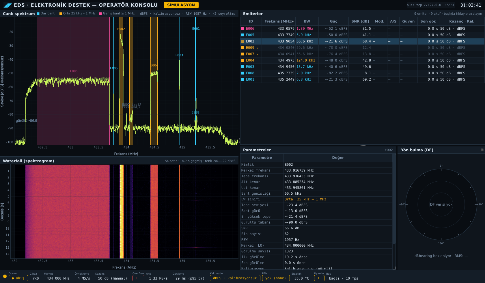

# EDS — Elektronik Destek Sistemi

**KTÜ TEKNOFEST Elektronik Harp takımının Elektronik Destek (ED) sistemi:** RF ortamını dinleyen
alıcı omurgası (RX) ve operatör konsolu. Pluto SDR'den (ya da donanım yokken fizik tabanlı
AD9363 simülatöründen) gelen örnekleri işler: spektrum çıkarır, sinyalleri tespit eder (CFAR),
frekans/güç kalibrasyonu uygular, sonuçları ZeroMQ bus'ına yayınlar. Operatör konsolu bu bus'ı
dinleyip canlı spektrum, waterfall, emiter tablosu, DF ve sistem durumunu gösterir. Sistem aynı
zamanda **kendi ölçüm cihazıdır**: KTR'nin istediği 9 nicel spesifikasyonu ölçüp raporlar. Faz-0
donanımı 2× ADALM-Pluto (AD9363). KrakenSDR (DF) ve HackRF (TX) geldiğinde üst katmanlar
değişmeden genişleyecek şekilde kuruldu.



<sub>Simülatörden canlı veri (433 MHz ISM demo sahnesi):
- **Canlı spektrum:** emiterler bant genişliği sınıfına göre renkli (mavi dar, turuncu orta, pembe geniş).
- **Waterfall:** darbeli telemetri kesikli çizgi olarak görünüyor.
- **Emiter tablosu ve parametre paneli:** seçili E002, FM drone bağlantısı.
- **⁎ işareti:** E002'nin LO aynasındaki sıfır-IF IQ imajını gösteriyor.
- **Kırmızı "Overflow 1":** bu çekimde CPU yükü nedeniyle gerçekten bir taşma oldu ve GUI bunu bildirdi.</sub>

---

## İçindekiler

1. [5 dakikalık hızlı başlangıç (simülasyon)](#1-5-dakikalık-hızlı-başlangıç-simülasyon)
2. [Tek komutla çalıştırma](#2-tek-komutla-çalıştırma)
3. [Mimari](#3-mimari)
4. [Operatör konsolu (GUI)](#4-operatör-konsolu-gui)
5. [Klasör haritası](#5-klasör-haritası)
6. [Donanım kurulumu (Pluto)](#6-donanım-kurulumu-pluto)
7. [Test](#7-test)
8. [KTR ölçümleri](#8-ktr-ölçümleri)
9. [Belgeler](#9-belgeler)

---

## 1. 5 dakikalık hızlı başlangıç (simülasyon)

SDR sürücüsü **gerekmez**: simülasyon modu yalnız pip paketleriyle çalışır.

```bash
git clone https://github.com/Nogeday/Sdr-kodlama.git
cd Sdr-kodlama
./setup.sh --sim                 # .venv + eds + GUI (PySide6, pyqtgraph); sonda kendini doğrular
source .venv/bin/activate
python run.py                    # bus proxy + simüle RX düğümü + operatör GUI — tek komut
```

Birkaç saniye içinde konsol açılır ve canlı veri gösterir. **Kapatmak için:** pencereyi kapatın
ya da terminalde Ctrl-C. Her iki durumda da bütün süreçler birlikte, temiz kapanır.

`setup.sh` adımları ekrana yazar (`[1/5] … [5/5]`) ve sonunda GUI'nin açılabildiğini dener.
İkinci kez çalıştırmak güvenlidir: yalnızca eksik olanı kurar.

> **Windows:** `setup.sh` Ubuntu içindir. Windows'ta Miniforge ile `conda env create -f environment.yml`,
> `conda activate eds`, `pip install -e ".[gui,dev]"`, `python run.py`. Ayrıntı:
> [`docs/KURULUM.md`](docs/KURULUM.md) §4.

Kısa komutların listesi: `make help`.

## 2. Tek komutla çalıştırma

`python run.py` ile `python -m eds.launch` aynı şeydir. Başlatıcı her süreci ayrı başlatır ve
birini kaybederse diğerlerini de kapatıp nedenini yazar.

| Komut | Ne çalışır | Ne zaman |
|---|---|---|
| `python run.py` (`make run-sim`) | proxy + **simüle** RX düğümü + GUI | Donanımsız geliştirme, demo |
| `python run.py --mode hardware` (`make run`) | proxy + **Pluto** RX düğümü + GUI | Tezgâh / yarışma |
| `python run.py --no-gui --listen-all` | proxy + RX düğümü, portlar ağa açık | Hat bir makinede (ör. Jetson), GUI başka makinede |
| `python run.py --gui-only --connect tcp://<ip>:5551` | yalnız GUI | Laptop'tan uzaktaki hatta bağlanmak |
| `python -m eds.gui` (`make gui`) | yalnız GUI (vars. `tcp://127.0.0.1:5555`) | Elle başlatılmış bir `eds rx`'e bağlanmak |

Diğer seçenekler: `-c DOSYA` (konfigürasyon), `--set anahtar=değer` (RX düğümüne iletilir),
`--duration S`, `--frontend-port/--backend-port`. Hepsi için: `python run.py --help`.

Çalışan bir hatta komut göndermek (ör. merkez frekansı değiştirmek):

```bash
eds --set bus.mode='"proxy"' bus send ctl.rx --cmd set_center_freq --arg hz=434.5e6 --wait-ack 2
```

## 3. Mimari

```
 ┌───────────────────────────┐
 │ KAYNAK                    │      --mode sim:      eds.hal.sim  (fizik tabanlı AD9363 modeli)
 │  sim  │  HAL (SoapySDR)   │      --mode hardware: eds.hal.soapy_backend → SoapyPlutoSDR → libiio → Pluto
 └─────────────┬─────────────┘                       (+ ince libiio katmanı: PPM, tracking, taşma kaydı)
               │ IQ blokları
 ┌─────────────▼─────────────┐
 │ RX DÜĞÜMÜ  (eds.rx.node)  │  Welch PSD → kalibrasyon (ppm, dBm) → çok çözünürlüklü CFAR
 │  ayrı süreç               │  hız sınırlı + seyreltilmiş spektrum yayını (GUI için 20 fps / 2048 bin)
 └─────────────┬─────────────┘
               │ PUB          rx.spectrum · rx.detections · rx.status · rx.sweep · cal.result
 ┌─────────────▼─────────────┐                    ▲
 │ BUS PROXY  XSUB :5550     │                    │ ctl.ack
 │  (ZeroMQ)  XPUB :5551     │◄───────────────────┼──────── ctl.rx  (komut: frekans, kazanç, tarama…)
 └──┬──────────┬─────────┬───┘                    │
    │ SUB      │ SUB     │ SUB
 ┌──▼───────┐ ┌▼───────┐ ┌▼────────────────────────────┐
 │ OPERATÖR │ │eds bus │ │ diğer modüller (DF, ölçüm,   │   df.bearing · meas.result
 │ GUI      │ │ echo   │ │ kendi programlarınız)        │   (bus'a yayın yapanlar da proxy'ye bağlanır)
 └──────────┘ └────────┘ └──────────────────────────────┘
```

- **GUI pipeline'a gömülü değildir.** Ayrı bir süreçte çalışan bir bus abonesidir. Kaynağın
  simülatör mü Pluto mu olduğunu bilmez: aynı mesajları çizer. Spektrum için "yalnız en son kare"
  aboneliği kullanır; GUI yavaşlasa da kuyruk birikmez ve RX düğümü asla beklemez.
- **Mesaj sözleşmesi tek yerde:** [`contracts/topics.json`](contracts/topics.json) +
  `contracts/schemas/*.schema.json` (JSON Schema 2020-12). Çerçeve: `[topic, json]`; her mesaj
  `{topic, v, src, seq, t_ns, data}` zarfını taşır.

| Topic | Kim yayınlar | İçerik |
|---|---|---|
| `rx.spectrum` | RX düğümü | Seyreltilmiş PSD karesi (dBm/dBFS), RBW, kalibrasyon modu, kazanç, zaman damgaları |
| `rx.detections` | RX düğümü | CFAR tespitleri: merkez/tepe frekans, BW, tepe/bant gücü, SNR, gürültü |
| `rx.status` | RX düğümü | Durum, frekans, örnekleme hızı, kazanç, overflow/drop, PPM, sıcaklık, uyarılar |
| `rx.sweep` | RX düğümü | Geniş bant tarama sonucu + tarama hızı |
| `df.bearing` | DF modülü | Kerteriz (azimut, belirsizlik, kalite) |
| `meas.result` | ölçüm aracı | KTR ölçüm sonucu (değer, birim, koşullar, hedef) |
| `cal.result` | kalibrasyon | PPM / güç / koherens kalibrasyonu |
| `ctl.rx` / `ctl.ack` | GUI/operatör → RX / RX | Komut ve yanıtı |

Daha ayrıntılı mimari ve modül arayüzleri: [`docs/ARCHITECTURE.md`](docs/ARCHITECTURE.md).

## 4. Operatör konsolu (GUI)

`PySide6` + `pyqtgraph`, koyu operatör teması, paneller yerinden oynatılabilir (dock).

| Panel | Kaynak | Ne gösterir |
|---|---|---|
| **Canlı spektrum** | `rx.spectrum` + `rx.detections` | PSD izi, tepe tutma izi, gürültü tabanı. Tespit edilen emiterler BW sınıfı renginde kutu ve etiketle işaretli. |
| **Waterfall** | `rx.spectrum` | Kayan spektrogram, en yeni satır üstte. Geçmiş uzunluğu `--history` ile ayarlanır. |
| **Emiter tablosu** | `rx.detections` | ID, frekans, BW, güç, SNR, modülasyon, A/S, güven, son görülme, kazanç/kalibrasyon. Başlığa tıklayınca sıralanır. |
| **Parametreler** | seçili emiter | Bilinen bütün parametreler: kenarlar, bant gücü, en yüksek tepe, RBW, görülme sayısı, IQ imajı şüphesi… |
| **Yön bulma (DF)** | `df.bearing`, `meas.result` | Azimut iğnesi, belirsiz ve ön-arka ayna yönleri, kalite/koherens, DF RMS. Veri yoksa "DF verisi yok". |
| **Durum çubuğu** | `rx.status` + GUI ölçümü | Durum lambası, merkez, örnekleme hızı, kazanç, **overflow** (>0 ise kırmızı), akış hızı, **gecikme** (medyan/p95 ms), kalibrasyon modu, PPM, sıcaklık, uyarılar, bus bağlantısı ve fps. |

Görsel kurallar:
- **Renk = BW sınıfı:** <span>dar (< 25 kHz) mavi, orta (25 kHz – 1 MHz) turuncu, geniş (≥ 1 MHz) pembe</span>.
  Spektrumda, tabloda ve parametre panelinde aynıdır.
- **Kalibrasyonsuz değerler:** başında `~`, gri yazı, tooltip'te açıklama. Kalibreli olanlar dBm.
- **`⁎` olası IQ imajı:** bir emiter, kendisinden ≥ 20 dB güçlü ve aynı genişlikte bir emiterin
  LO'ya göre aynasındaysa işaretlenir (sıfır-IF artefaktı). Gizlenmez, yalnızca işaretlenir.

Şu an olmayanlar (bilinçli):
- **Modülasyon / analog-sayısal / güven sütunları "—" gösterir,** çünkü repoda henüz sınıflandırıcı
  yok ve GUI tahmin uydurmaz.
- **DF paneli şimdilik "DF verisi yok" gösterir,** çünkü sürekli `df.bearing` yayınlayan bir düğüm
  henüz yok. `eds measure df_rms` sonucu RMS olarak görünür.
- **GUI'den donanım kontrolü (frekans, kazanç, tarama) Faz-2'dedir.** Altyapısı hazır:
  `ctl.rx` / `ctl.ack`.

## 5. Klasör haritası

```
run.py                tek komutla çalıştırma (python -m eds.launch kısayolu)
setup.sh              kurulum: --sim (yalnız pip) | --hardware (+ SDR sürücüleri)
Makefile              kısa komutlar (make help)
environment.yml       conda ortamı (Linux + Windows, sürümleri sabit SDR yığını)
DEPENDENCIES.md       hangi paket neden kuruluyor
contracts/            bus sözleşmesi: topic kayıt defteri + JSON şemaları (dil bağımsız)
config/               çalıştırılabilir konfigürasyonlar
  sim_gui.toml          GUI demo sahnesi (433 MHz, simülatör) — run.py varsayılanı
  rx_sim.toml           simülatör, geniş sahne (KTR ölçümleri)
  rx_pluto.toml         tek Pluto · dual_pluto.toml / dual_sim.toml: iki kanal (DF)
  profiles/             cihaz profilleri: AD9363 resmî sınırlar; planlanan Kraken/HackRF/bladeRF/B210
  ktr_targets.toml      KTR hedefleri (rapordaki Hedef/Durum sütunları)
src/eds/
  hal/                  donanım soyutlaması: SoapySDR backend, ince libiio katmanı, simülatör, 2× Pluto grubu
  dsp/                  Welch PSD, pencereler, çok çözünürlüklü CFAR, tepe bulma
  rx/                   akış, yazılım AGC, geniş bant tarayıcı, RX düğümü (servis)
  calib/                PPM (CW / GSM FCCH), güç kalibrasyonu, kalibrasyon deposu
  df/                   koherens kontrolü, 2 elemanlı interferometre
  bus/                  ZeroMQ yayın/abone/proxy, zarf, şema doğrulama
  measure/              9 KTR ölçümü, rapor (HTML/MD/CSV/PNG)
  gui/                  operatör konsolu (bus abonesi): model, bus istemcisi, paneller, tema
  launch.py             tek komutla başlatıcı (proxy + RX + GUI)
  cli/                  `eds` komutu (rx, sweep, cal, measure, bus, …)
examples/             kendi programından bus'ı dinleme / komut gönderme örnekleri
scripts/              install_ubuntu.sh (SDR yığını), Pluto udev kuralı
tests/                ~1700 test (simülatör + gerçek API'leri taklit eden SoapySDR/libiio sahteleri + GUI)
docs/                 kurulum, kullanım, donanım, ölçüm ve mimari belgeleri
cal/ · reports/       cihaz kalibrasyon dosyaları · ölçüm raporları (çalışınca oluşur)
```

## 6. Donanım kurulumu (Pluto)

```bash
./setup.sh --hardware            # SDR yığını (libiio, SoapySDR, SoapyPlutoSDR), udev, .venv + GUI
                                 # sonunda: SoapySDRUtil --find ile Pluto'yu arar; bulamazsa ne yapacağınızı yazar
# udev/plugdev grubu için OTURUMU KAPATIP AÇIN, Pluto'yu takın, sonra:
source .venv/bin/activate
python run.py --mode hardware    # config/rx_pluto.toml ile Pluto + GUI
```

Kodun AD9363 kısıtlarına cevabı:

| Kısıt | Kodun cevabı |
|---|---|
| 325 MHz–3.8 GHz, ≤ 20 MHz BW | Her ayar donanıma gitmeden profile göre doğrulanır |
| 12-bit ADC | Kırpma ve RF sıkışma tespiti, yazılım AGC |
| TCXO ±25 ppm | PPM kalibrasyonu, donanımda `xo_correction` |
| USB 2.0 | Sürdürülebilir hız ölçülür, taşmalar DMA kaydından okunur |
| İki Pluto | Her Pluto ayrı süreçte çalışır (SoapyPlutoSDR sınırı) |

İlk donanım oturumu, iki Pluto ve tezgâh bağlantıları: [`docs/KURULUM.md`](docs/KURULUM.md) §6 ve
[`docs/HARDWARE_PLUTO.md`](docs/HARDWARE_PLUTO.md).

## 7. Test

```bash
make test          # bütün testler (~3 dk); donanım gerekmez
make test-fast     # zamanlamaya duyarlı (realtime) testler hariç
make lint          # ruff
```

| Test grubu | Kapsam |
|---|---|
| Simülatör ve fizik | NF, filtreler, PPM, IQ imajı, sıkışma, USB2 taşma modeli |
| DSP ve kalibrasyon | PSD ölçekleme, CFAR yanlış alarm oranı, PPM kestirimi, güç kalibrasyonu, DF geometrisi |
| Donanım katmanı | Gerçek SoapySDR / libiio API'lerini taklit eden sahtelere karşı; ayrıca gerçek bağlamaların kurulu olduğu conda ortamında da koşuldu |
| Bus | Her topic'in JSON şemasına uyması, proxy |
| GUI | Ekransız (`QT_QPA_PLATFORM=offscreen`): sentetik mesajlar + simüle bir RX düğümünden canlı veri |
| Başlatıcı | Süreçlerin başlayıp proxy üzerinden yayın yapması ve hepsinin temiz kapanması |

GUI testleri PySide6 kurulu değilse kendiliğinden atlanır.

## 8. KTR ölçümleri

`eds measure all -c config/rx_sim.toml` (ya da `make demo` / `make report-sim`) dokuz spesifikasyonu
ölçer ve `reports/<zaman>/` altına HTML/MD/CSV/JSON rapor ile grafikler yazar:

| Spesifikasyon | Birim |
|---|---|
| duyarlılık | dBm |
| dinamik alan | dB |
| anlık BW | MHz |
| tarama hızı | GHz/s |
| frekans çözünürlüğü | Hz |
| DF RMS | ° |
| imaj bastırma | dB |
| taşmasız maks. örnekleme hızı | MS/s |
| uçtan uca gecikme | ms |

Simülatör verisi, hızlı mod ve kalibrasyonsuz değerler raporda açıkça işaretlenir; karşılaştırılamayan
değerlere hüküm verilmez. Tanımlar ve tezgâh kurulumu: [`docs/MEASUREMENTS.md`](docs/MEASUREMENTS.md).

## 9. Belgeler

| Belge | İçerik |
|---|---|
| [`docs/KURULUM.md`](docs/KURULUM.md) | Adım adım kurulum: Linux, Windows, WSL2, Pluto bağlantısı, sorun giderme |
| [`docs/KULLANIM.md`](docs/KULLANIM.md) | Adım adım kullanım: konfigürasyon, RX düğümü ve bus, tarama, kalibrasyon, ölçümler, senaryolar |
| [`docs/HARDWARE_PLUTO.md`](docs/HARDWARE_PLUTO.md) | Pluto'ya özgü ayrıntılar, iki Pluto, harici referans, güvenlik |
| [`docs/MEASUREMENTS.md`](docs/MEASUREMENTS.md) | 9 KTR ölçümünün tanımı ve yöntemi |
| [`docs/ARCHITECTURE.md`](docs/ARCHITECTURE.md) | Konvansiyonlar ve modül arayüzleri |
| [`DEPENDENCIES.md`](DEPENDENCIES.md) | Hangi paket neden kuruluyor |
