# Kullanım Rehberi: adım adım

Bu rehber, kurulum bittikten sonra EDS'yi **günlük işte nasıl kullanacağınızı** anlatır:
konfigürasyon dosyasını okumak, RX düğümünü çalıştırıp ZeroMQ bus'ını dinlemek, geniş bant
tarama, kalibrasyon, 9 KTR ölçümü ve rapor, kendi programınızdan (GUI, DF) bus'a bağlanmak.
Her adımda aynı düzeni izler: **amaç** (neden yapıyoruz), **komut**, **gerçek çıktı**,
**çıktı nasıl okunur**, **sık hatalar**.

> [!TIP]
> **Operatör konsolu (GUI):** `python run.py` bus proxy + RX düğümü + GUI'yi tek komutla açar
> (`--mode hardware` ile Pluto). Panellerin anlatımı: [README §4](../README.md#4-operatör-konsolu-gui).
> Bu rehberdeki `eds ...` komutları GUI'nin arkasındaki parçaları tek tek çalıştırmayı anlatır.

> [!NOTE]
> **Ön koşul:** [KURULUM.md](KURULUM.md) tamamlandı ve `eds --version` çalışıyor.
> Bu rehber kurulumu tekrar anlatmaz. Pluto'yu ilk kez bağlıyorsanız oradaki
> "Pluto'yu bağlamak ve ilk donanım testi" bölümüyle başlayın.

> [!IMPORTANT]
> **Ekran görüntüleri hakkında.** Bu rehberdeki bütün terminal görüntüleri, rapor şekilleri ve
> JSON örnekleri **simülatörde** (`backend = "sim"`) gerçekten çalıştırılmış komutlardan alındı
> (Linux, conda ortamı `eds`, EDS 0.1.0). Yalnızca iki düzenleme yapıldı: uzun dosya yolları
> `cal/...`, `reports/...` biçiminde kısaltıldı ve uzun çıktılarda bazı satırlar (bir JSON
> dosyasında bir liste) `…` ile atlandı. Saat ve sayılar her çalıştırmada biraz değişir; sizin
> çıktınız birebir aynı olmayacaktır. **Pluto ve Windows için** yazılan çıktılar ise **beklenen** çıktılardır;
> bu rehber hazırlanırken donanım ya da Windows bilgisayar yoktu, o yüzden onların ekran görüntüsü
> yoktur.

**İçindekiler**

0. [Her gün yapılacaklar](#0-her-gün-yapılacaklar)
1. [Temel kavramlar](#1-temel-kavramlar)
2. [Konfigürasyon dosyası anatomisi](#2-konfigürasyon-dosyası-anatomisi)
3. [Cihazı tanımak: profiles, info, devices](#3-cihazı-tanımak-profiles-info-devices)
4. [RX düğümü ve ZeroMQ bus](#4-rx-düğümü-ve-zeromq-bus)
5. [Geniş bant tarama](#5-geniş-bant-tarama)
6. [Kalibrasyon](#6-kalibrasyon)
7. [KTR ölçümleri ve rapor](#7-ktr-ölçümleri-ve-rapor)
8. [Kendi programından bus'ı dinlemek](#8-kendi-programından-busı-dinlemek)
9. [Senaryolar (kontrol listeleri)](#9-senaryolar-kontrol-listeleri)
10. [Sık sorulanlar ve sorun giderme](#10-sık-sorulanlar-ve-sorun-giderme)
- [Ek: Komut kopya kâğıdı](#ek-komut-kopya-kâğıdı)

---

## 0. Her gün yapılacaklar

**Amaç.** EDS ve onun kullandığı SDR kütüphaneleri (SoapySDR, libiio) `eds` adlı conda
ortamının içindedir. Ortamı etkinleştirmeden açılan bir terminal bunları **görmez**:
`eds` komutu bulunamaz ya da SoapySDR "No modules found!" der. Bu yüzden her yeni terminalde
önce ortamı etkinleştirir, sonra depo klasörüne geçersiniz. Bütün komutlar `config/rx_sim.toml`
gibi **göreli yollar** kullandığından depo klasöründe durmak da şarttır.

**Linux (her yeni terminalde):**

```bash
cd ~/Sdr-kodlama          # deponun klonlandığı yer
conda activate eds        # istemde (eds) görünmeli
git pull                  # isteğe bağlı: takımın son değişikliklerini al
eds --version             # "eds 0.1.0"
```

**Windows:** Başlat menüsünden **Miniforge Prompt** açın (normal `cmd` değil), sonra:

```bat
cd %USERPROFILE%\Sdr-kodlama
conda activate eds
eds --version
```

> [!TIP]
> Kurulum "düzenlenebilir" (editable) olduğu için `git pull` ile gelen `src/eds/` değişiklikleri
> **hemen** geçerlidir. Ama `git pull` `environment.yml` ya da `pyproject.toml` dosyasını da
> değiştirdiyse (yeni bağımlılık, yeni komut) ortamın da güncellenmesi gerekir. Emin değilseniz
> [KURULUM.md Bölüm 10.1](KURULUM.md#101-güncelleme)'deki üç komutu
> (`git pull` → `conda env update -f environment.yml --prune` → `pip install -e ".[dev]"`)
> çalıştırın; değişiklik yoksa birkaç saniyede biterler.

**Nerede ne var?**

| Klasör / dosya | İçindekiler | Ne zaman bakarsınız |
|---|---|---|
| `config/rx_sim.toml` | tek cihaz, **simülatör** konfigürasyonu (donanım gerekmez) | demo, deneme, eğitim |
| `config/rx_pluto.toml` | tek **ADALM-Pluto** konfigürasyonu | donanımla çalışırken |
| `config/dual_sim.toml`, `config/dual_pluto.toml` | iki kanal (2 Pluto) DF konfigürasyonları | DF, koherens |
| `config/ktr_targets.toml` | KTR hedefleri (raporun "Hedef" ve "Durum" sütunları) | ölçüm kampanyasından önce |
| `config/profiles/` | cihaz profilleri (AD9363 resmî sınırları, planlanan donanımlar) | genelde değiştirilmez |
| `cal/` | cihaz başına kalibrasyon dosyaları `cal/<seri>.json` | `eds cal` sonrası |
| `reports/` | her ölçüm oturumunun rapor klasörü `reports/<zaman>/` | `eds measure` sonrası |
| `examples/` | bus'a bağlanan küçük örnek programlar (§8) | GUI/DF yazarken |
| `contracts/` | ZeroMQ topic listesi ve JSON şemaları (mesaj sözleşmesi) | başka dilde istemci yazarken |
| `docs/` | bu rehber, kurulum, mimari, donanım, ölçüm belgeleri | takıldığınızda |

`cal/*.json` ve `reports/*` git tarafından yok sayılır (`.gitignore`): her bilgisayarın kendi
kalibrasyonu ve raporları olur. Takımla paylaşmak istediğiniz raporu elle kopyalayın (§9.c).

Her komutun kendi yardımı vardır: `eds --help`, `eds measure --help`, `eds bus send --help`.
Bir hatanın ayrıntısını görmek için komuta `-v` ekleyin: ayrıntılı günlük yazar ve hata olursa
Python'un hata izini (traceback, hatanın kodda nerede oluştuğu) da basar. `-vv` buna en ayrıntılı
"hata ayıklama" (debug) günlüğünü ekler. Örnek: `eds -v sweep ...`.

**Sık hatalar**

| Belirti | Neden | Çözüm |
|---|---|---|
| `eds: command not found` / `'eds' tanınmıyor` | ortam etkin değil | `conda activate eds` |
| `HATA: Konfigürasyon dosyası yok: config/rx_sim.toml` | depo klasöründe değilsiniz | `cd ~/Sdr-kodlama` (ekran görüntüsü: §10) |
| `SoapySDRUtil --info` → `No modules found!` | ortam etkin değil | `conda activate eds` |

---

## 1. Temel kavramlar

EDS'yi kullanırken her şey aynı zincirden geçer: bir **konfigürasyon dosyası** hangi cihazın
nasıl ayarlanacağını söyler; bir **eds komutu** cihazı açar ve işini yapar; sonuçlar ya
**ZeroMQ bus**'ına (canlı, başka programlar için) ya da **dosyaya** (kalibrasyon, rapor) gider.

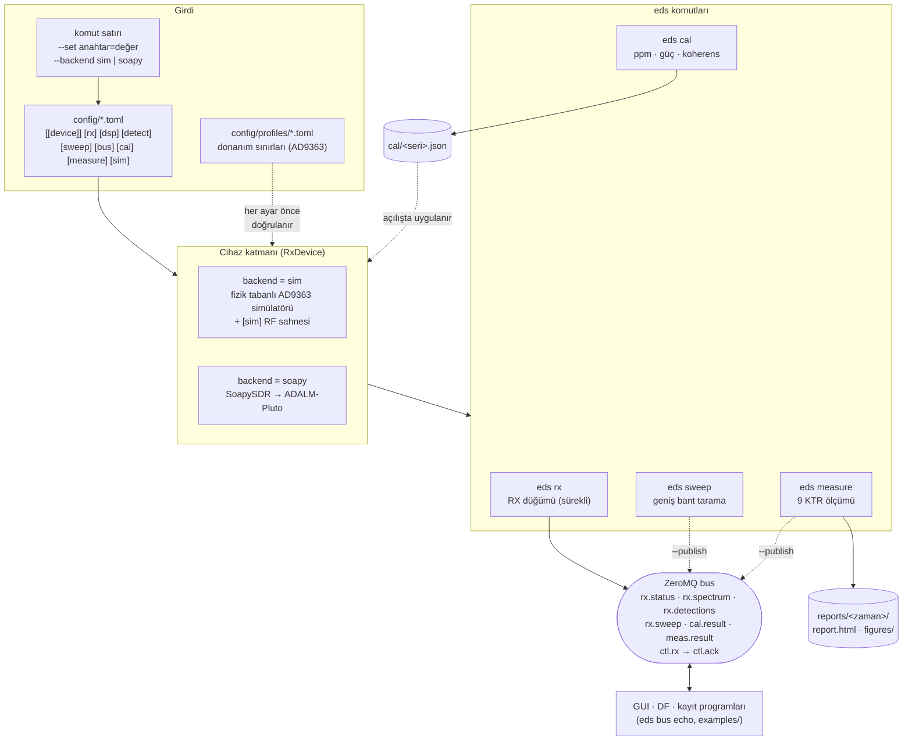

| Kavram | Ne demek | Neden önemli |
|---|---|---|
| **Konfigürasyon** (`-c dosya.toml`) | Cihaz, frekans, örnekleme hızı, DSP, tespit, bus ve ölçüm ayarlarının tamamı | Aynı dosya her komutta kullanılır; ayarlar tek yerde durur. Bilinmeyen anahtar **hatadır** (yazım hatası sessizce varsayılana düşmez). |
| **Backend** | Cihazın gerçekte ne olduğu: `sim` (simülatör) ya da `soapy` (SoapySDR üzerinden gerçek Pluto) | Aynı komutlar ikisinde de çalışır. Donanım yokken her şeyi simülatörde deneyebilirsiniz. |
| **Profil** | Donanımın resmî sınırları (`ad9363_pluto`: 325 MHz–3.8 GHz, ≤ 20 MHz BW, kazanç aralığı) | Her ayar donanıma gitmeden **önce** profile karşı kontrol edilir; yanlış bir frekans Pluto'ya hiç ulaşmaz. |
| **RX düğümü** (`eds rx`) | Sürekli çalışan servis: akış → spektrum (Welch PSD) → CFAR tespit → bus | Yarışmada çalışacak asıl boru hattı budur. |
| **Tarama** (`eds sweep`) | 325 MHz–3.8 GHz bandını 20 MHz'lik adımlarla tek seferde dolaşmak | Pluto bir anda en fazla 20 MHz görür; bandın tamamı için adım adım gezmek gerekir. |
| **Ölçüm** (`eds measure`) | KTR'nin istediği 9 nicel spesifikasyonun ölçülmesi + rapor | Sistem kendi ölçüm cihazıdır; sayılar koşullarıyla birlikte üretilir. |
| **Bus / topic** | ZeroMQ yayın/abone kanalı; her mesaj türünün bir adı (topic) vardır: `rx.detections` gibi | GUI, DF ve kayıt programları EDS'ye kod bağımlılığı olmadan bu kanaldan beslenir. |
| **Zarf** (envelope) | Her mesajın JSON kabı: `{topic, v, src, seq, t_ns, data}` | `seq` kayıp mesajı, `t_ns` gecikmeyi gösterir (§4.3). |
| **Kalibrasyon dosyası** | `cal/<seri>.json`: o cihazın ppm, güç, koherens kalibrasyonu | Cihaz her açıldığında seri numarasıyla bulunur ve otomatik uygulanır. |
| **Rapor klasörü** | `reports/<zaman>/`: `report.html`, özetler, tablolar, şekiller | KTR'ye ve jüriye gidecek belge. |

**Hangi komut neyi okur, neyi üretir?**

| Komut | Okur | Üretir | Ne kadar sürer (simülatör, bu bilgisayar) |
|---|---|---|---|
| `eds info` | konfigürasyon + profil | ekrana özet ve doğrulama | anında |
| `eds devices` | backend (sim / soapy) | bağlı cihaz listesi | anında |
| `eds rx` | konfigürasyon, `cal/` | bus mesajları (sürekli) | Ctrl-C'ye kadar |
| `eds sweep` | konfigürasyon, `cal/` | tespit tablosu, isteğe bağlı PNG/npz/bus | tam bant ≈ 8 s |
| `eds cal ppm` | konfigürasyon | `cal/<seri>.json` | ≈ 1 s |
| `eds measure all --quick` | konfigürasyon, `cal/`, `ktr_targets.toml` | `reports/<zaman>/` | ≈ 1 dk |
| `eds measure all` | aynı | aynı (tam mod) | ≈ 5 dk |

---

## 2. Konfigürasyon dosyası anatomisi

**Amaç.** Frekansı, örnekleme hızını, FFT boyunu, tespit eşiğini, bus adreslerini ve ölçüm
kaynağını hep konfigürasyon dosyası belirler. Bir sonucu yorumlayabilmek (ör. "RBW neden
1.96 kHz?") ve bir ayarı bilinçli değiştirebilmek için dosyanın bölümlerini tanımak gerekir.

Dosyalar [TOML](https://toml.io) biçimindedir: `[bölüm]` başlıkları, `anahtar = değer` satırları,
`#` ile yorum. `[[device]]` (çift köşeli parantez) bir **liste** öğesidir: iki cihazlı
dosyalarda iki tane `[[device]]` bloğu vardır. **Birimler her yerde SI'dır:** frekans Hz,
zaman s, güç dBm (alıcı girişinde), kazanç dB. `4e6` = 4 000 000 = 4 MS/s.

### 2.1 Bölüm bölüm `config/rx_sim.toml`

Aşağıdaki tablolar en önemli anahtarları özetler. Dosyanın kendisi de her satırda yorum içerir;
açıp birlikte okuyun.

**`[[device]]`: hangi cihaz**

| Anahtar | Örnek (`rx_sim`) | Anlamı |
|---|---|---|
| `name` | `"rx0"` | Mantıksal ad: bus mesajlarında `src`, komutlarda hedef adı |
| `backend` | `"sim"` | `sim` = simülatör, `soapy` = SoapySDR (Pluto) |
| `profile` | `"ad9363_pluto"` | Sınırların alındığı profil (`config/profiles/`) |
| `channels` | `[0]` | Kullanılan RX kanalları (Pluto: tek kanal) |
| `sim` | `{ ppm = 11.7, realtime = true }` | Yalnız simülatör: TCXO hatası (ppm), gerçek zamanlı USB modeli |
| `args` | (`rx_pluto`) `{ driver = "plutosdr", uri = "usb:1.5.5" }` | Yalnız soapy: hangi Pluto (`uri` ya da `serial = "..."`) |
| `control_uri` | (`rx_pluto`) `"ip:192.168.2.1"` | Yalnız Pluto: ince libiio katmanı (xo_correction, sıcaklık, overflow algılama) |

**`[rx]`: sürekli alım ayarları (`eds rx`, kalibrasyon, ölçümlerin başlangıç ayarı)**

| Anahtar | Birim | `rx_sim` | Etkisi |
|---|---|---|---|
| `center_freq_hz` | Hz | `935e6` | LO frekansı; görülen bant `fc ± fs/2` |
| `sample_rate_hz` | S/s | `4e6` | Anlık bant genişliği ve USB yükü (`fs × 4 bayt` = 16 MB/s; USB 2.0 pratik sınırı ≈ 24 MB/s) |
| `bandwidth_hz` | Hz | `4e6` | Analog alçak geçiren süzgeç (AD9363 ≤ 20 MHz) |
| `gain_mode` | – | `"manual"` | `manual` (sabit), `soft_agc` (yazılım AGC, `[agc]`), `hw_slow` / `hw_fast` / `hw_hybrid` (AD9363'ün kendi AGC'si) |
| `gain_db` | dB | `50.0` | RX kazancı. AD9363: 1.3 GHz altında −1…73 dB, üstünde −3…71 dB |
| `buffer_size`, `block_size` | örnek | `65536` | Sürücü tamponu ve işlenen blok boyu |
| `settle_buffers` | tampon | `-1` | Retune sonrası atılan bayat tampon sayısı (−1 = otomatik) |
| `dc_tracking`, `rf_dc_tracking`, `quad_tracking` | – | `true` | AD936x'in DC ve IQ dengesizliği düzeltmeleri (kapalıysa DC çivisi ve imajlar büyür) |

> [!WARNING]
> Ölçümlerde `gain_mode = "manual"` kullanın. Donanım AGC'si (`hw_*`) kazancı kendi başına
> değiştirir ve hangi örneğin hangi kazançla alındığı bilinmez; güç ölçümleri anlamsızlaşır.

**`[dsp]`: spektrum (Welch PSD)**

| Anahtar | `rx_sim` | Etkisi |
|---|---|---|
| `nfft` | `4096` | FFT boyu: büyüdükçe RBW küçülür (daha ince çözünürlük, daha düşük gürültü tabanı), analiz penceresi uzar |
| `window` | `"blackmanharris"` | Pencere: `rect`, `hann`, `hamming`, `blackman`, `blackmanharris` (−92 dB yan lob), `flattop` |
| `overlap` | `0.5` | Ardışık FFT'lerin örtüşmesi |
| `averages` | `16` | Ortalanan FFT sayısı: gürültüyü düzleştirir, pencereyi uzatır |
| `usable_fraction` | `0.8` | fs'nin kenarları (süzgeç eğimi, alias) atılır; merkezdeki %80 kullanılır |
| `dc_notch_bins` | `3` | Sıfır-IF DC çivisi: merkezin ±3 bini geçersiz sayılır |

> **Çalışılmış örnek: RBW ve analiz penceresi.** Çözünürlük bant genişliği (RBW), bir FFT
> bininin "gördüğü" etkin bant genişliğidir:
>
> RBW = ENBW × fs / nfft = 2.004 × 4 000 000 / 4096 ≈ **1957 Hz**
>
> (ENBW = pencerenin eşdeğer gürültü bant genişliği; Blackman-Harris için 2.004 bin.)
> Bir spektrum karesi için gereken örnek sayısı nfft + (averages − 1) × nfft × (1 − overlap)
> = 4096 + 15 × 2048 = **34 816 örnek** = 34 816 / 4 MS/s = **8.70 ms**. `eds info` aynı
> sayıları yazar (aşağıdaki ekran görüntüsünde `DSP:` satırı). `--set rx.sample_rate_hz=10e6`
> ile fs'yi 2.5 katına çıkarırsanız RBW de 2.5 katına (4.89 kHz) çıkar, pencere 3.48 ms'ye
> kısalır (§2.3'teki görüntü). Kural: **ince çözünürlük ↔ uzun pencere (gecikme)** takasını
> `nfft` ve `averages` ile siz seçersiniz.

**`[detect]`: CFAR tespit**

| Anahtar | `rx_sim` | Etkisi |
|---|---|---|
| `method` | `"os_cfar"` | `os_cfar` (sıralı istatistik, komşu sinyallere dayanıklı), `ca_cfar`, `fixed` (sabit eşik) |
| `pfa` | `1e-6` | Bin başına yanlış alarm olasılığı. Küçüldükçe eşik yükselir, zayıf sinyaller kaçabilir |
| `guard_bins`, `train_bins` | `4`, `32` | Test edilen binin çevresindeki koruma ve gürültü kestirim (eğitim) hücreleri |
| `min_snr_db` | `6.0` | Bu SNR'nin altındaki tespitler atılır |
| `resolutions` | `[1, 16, 128]` | Çok çözünürlüklü CFAR: 1 = doğal bin; 16 ve 128 = komşu binler birleştirilerek geniş bantlı sinyaller (LTE 10 MHz, Wi-Fi 20 MHz) de bulunur |

**`[agc]`** yalnızca `gain_mode = "soft_agc"` iken (ve taramada `gain_mode = "auto"` iken)
kullanılır: hedef tepe seviyesi (`target_peak_dbfs = -10`), kırpma sınırları, adım boyları.

**`[sweep]`: geniş bant tarama (`eds sweep`, `scan_speed` ölçümü)**

| Anahtar | `rx_sim` | Etkisi |
|---|---|---|
| `start_hz`, `stop_hz` | `325e6`, `3.8e9` | Taranan aralık (AD9363 resmî bandı) |
| `sample_rate_hz`, `bandwidth_hz` | `20e6` | Adım başına "burst" yakalama hızı (USB sınırı adımlar arasında geçerli değil, §5) |
| `nfft` / `rbw_hz` | `2048` / `0.0` | RBW = 2.004 × 20e6 / 2048 ≈ 19.6 kHz. `rbw_hz > 0` verilirse nfft ona göre seçilir |
| `averages` | `4` | Adım başına ortalama |
| `gain_mode`, `gain_db` | `"fixed"`, `50.0` | `fixed` = sabit kazanç; `auto` = adım başına otomatik kazanç + RF ön uç sıkışma denetimi (§5.4). Seviyeler her iki modda `gain_db`'ye normalize edilir (`dBFS@50dB`) |
| `usable_fraction`, `dc_avoid` | `0.8`, `true` | Adım = 0.8 × 20 MHz = 16 MHz; `dc_avoid` ile adımlar %50 örtüşür (adım ≈ 8 MHz) ve DC çivisi sonuçtan çıkar |

**`[bus]`: ZeroMQ adresleri**

| Anahtar | `rx_sim` | Etkisi |
|---|---|---|
| `mode` | `"direct"` | `direct`: her yayıncı kendi portunu açar. `proxy`: herkes ortadaki `eds bus proxy`'ye bağlanır (§4.6) |
| `pub_endpoint` | `"tcp://*:5555"` | RX düğümünün yayın yaptığı port (bind) |
| `sub_endpoint` | `"tcp://127.0.0.1:5555"` | Dinleyicilerin bağlandığı adres. Başka bilgisayardan dinlemek için IP'yi değiştirin |
| `ctl_endpoints` | `[]` | Düğümün **komut** dinlediği adresler. **Boşsa uzaktan kontrol kapalıdır** (§4.5) |
| `validate` | `false` | `true`: her mesaj JSON şemasına karşı denetlenir (geliştirirken açın, ölçümde kapalı tutun) |
| `status_period_s`, `spectrum_rate_hz`, `spectrum_max_bins` | `1.0`, `10.0`, `4096` | `rx.status` sıklığı, `rx.spectrum` en fazla sıklığı ve nokta sayısı |

**`[cal]`: kalibrasyonun nasıl uygulanacağı**

| Anahtar | `rx_sim` | Etkisi |
|---|---|---|
| `dir` | `""` | Kalibrasyon klasörü (`""` = `<depo>/cal`) |
| `ppm_mode` | `"auto"` | `auto` / `hardware` / `software` / `off` (§6.1) |
| `use_power_cal` | `true` | Güç kalibrasyonu varsa spektrumlar dBm olur (yoksa dBFS) |
| `temp_warn_delta_c` | `5.0` | Kalibrasyon sıcaklığından bu kadar sapınca uyarı (TCXO sıcaklıkla kayar) |
| `ppm_override` | (yorum satırı) | Sonlu bir sayı yazılırsa kalibrasyon dosyası yerine bu ppm kullanılır |

**`[measure]`: KTR ölçümleri**

| Anahtar | `rx_sim` | Etkisi |
|---|---|---|
| `out_dir` | `""` | Rapor kök klasörü (`""` = `<depo>/reports`) |
| `targets_file` | `"ktr_targets.toml"` | Hedef dosyası (`config/` klasörüne göre) |
| `source` | `"sim"` | Uyaran sinyal kaynağı: `sim`, `pluto_tx`, `scpi`, `manual`, `none` (§7.2) |
| `source_args` | `{ cabled = true, path_loss_db = 0.0 }` | Kaynağa özgü ayarlar (Pluto TX adresi, yol kaybı, `anchor_dbm` …) |
| `[measure.params]` | boş | Ölçüm başına parametre değiştirme, ör. `[measure.params.df_rms] baseline_m = 0.15` |

**`[sim]` ve `[[sim.emitters]]`: simülatörün RF sahnesi** (yalnız `backend = "sim"`)

`rx_sim.toml` gerçekçi bir yarışma ortamı kurar. Her `[[sim.emitters]]` bloğu bir vericidir:

| `name` | `kind` | Frekans | Güç (alıcı girişinde) | Ne için |
|---|---|---|---|---|
| `gsm900_bcch` | `gsm_fcch` | 935.2 MHz | −60 dBm | GSM baz istasyonu: **ppm kalibrasyonu** (§6) |
| `lte_b3_dl` | `noise` | 1842.5 MHz, 10 MHz BW | −65 dBm | geniş bantlı OFDM benzeri sinyal |
| `pmr446_ch1` | `fm` | 446.00625 MHz | −70 dBm | telsiz |
| `ism433_uav_link` | `fm` | 433.92 MHz | −55 dBm | İHA telemetri / kumanda bağı |
| `s_band_radar` | `pulse` | 2.8 GHz, PW 10 µs, PRI 1 ms | −50 dBm | darbeli radar |
| `wifi_ch6` | `noise` | 2437 MHz, 20 MHz BW | −62 dBm | Wi-Fi |
| `lband_beacon` | `cw` | 1.2 GHz | −110 dBm | çok zayıf işaretçi (duyarlılık demosu) |

Kendi senaryonuzu kurmak için bu blokları kopyalayıp değiştirin (`kind`: `cw`, `noise`, `fm`,
`pulse`, `gsm_fcch`). Simülatörün seviye modeli: **dBFS = dBm + kazanç − 5**, yani 50 dB
kazançta tam ölçek ≈ −45 dBm'dir.

### 2.2 `rx_sim.toml` ile `rx_pluto.toml` arasındaki farklar

İki dosya bilerek neredeyse aynıdır; simülatörde denediğiniz ayar donanımda da aynı anlamı taşır.

| | `rx_sim.toml` | `rx_pluto.toml` |
|---|---|---|
| `[[device]] backend` | `sim` | `soapy` |
| Cihaz seçimi | – | `args = { driver = "plutosdr", uri = "usb:1.5.5" }` **yer tutucudur**: kendi `uri`'nizi ya da `serial = "..."` yazın |
| İnce libiio katmanı | – | `control_uri = "ip:192.168.2.1"` |
| `[measure] source` | `sim` (mutlak, kesin) | `pluto_tx` (2. Pluto'nun TX'i, ≥ 30 dB zayıflatıcı üzerinden) |
| `[sim]` sahnesi | var | yok (gerçek dünya) |

### 2.3 Komut satırından değiştirmek: `--set` ve `--backend`

Dosyayı düzenlemeden tek bir çalıştırma için ayar değiştirmek isterseniz `--set` kullanın.
Biçim: **noktalı anahtar = TOML değeri**. Birden fazla `--set` yazabilirsiniz.

```bash
eds -c config/rx_sim.toml --set rx.center_freq_hz=2.4e9 --set rx.sample_rate_hz=10e6 info
eds -c config/rx_sim.toml --set bus.mode=proxy rx                             # metin tırnaksız da olur
eds -c config/rx_sim.toml --set "bus.ctl_endpoints=['tcp://127.0.0.1:5556']" rx  # liste: tek tırnaklı TOML metni
eds -c config/dual_sim.toml --set device.sim.realtime=false info              # [[device]] listesinin HEPSİNE uygulanır
eds -c config/rx_pluto.toml --backend sim info                                # Pluto dosyasını simülatörle dene
```

> [!TIP]
> Liste ya da metin içeren değerlerde **dış tırnak çift, iç tırnak tek** olsun:
> `--set "bus.ctl_endpoints=['tcp://127.0.0.1:5556']"`. Bu yazım Linux bash'te, Windows
> `cmd`'de ve PowerShell'de aynen çalışır.

`--backend sim` dosyadaki bütün cihazları simülatöre çevirir; donanım yokken `rx_pluto.toml`'un
geri kalan ayarlarını denemek için kullanışlıdır.

### 2.4 `eds info`: konfigürasyonu çalıştırmadan doğrulamak

**Amaç.** Bir şeyi çalıştırmadan önce "hangi ayarlar geçerli ve donanım sınırlarına uyuyor mu?"
sorusunu yanıtlar. Ölçümden, tarama ve RX'ten önce bir kez bakmak iyi bir alışkanlıktır.

```bash
eds -c config/rx_sim.toml info
```

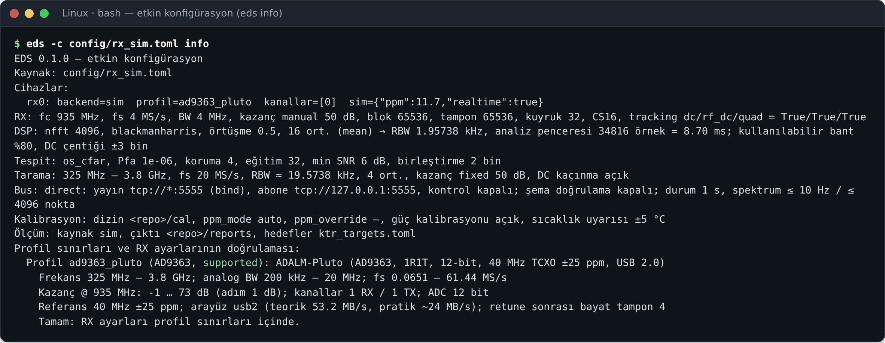

**Nasıl okunur?**

- `Cihazlar:` her `[[device]]` için backend, profil, kanal ve özel ayarlar.
- `RX:` / `DSP:` / `Tespit:` / `Tarama:` ilgili bölümlerin **hesaplanmış** özetleri: RBW ve
  analiz penceresi burada hazır yazılır (§2.1'deki çalışılmış örnek).
- `Bus:` direct/proxy, adresler ve **`kontrol kapalı`** (`ctl_endpoints` boş, §4.5).
- `Kalibrasyon:` ve `Ölçüm:` klasörler, ppm modu, sinyal kaynağı, hedef dosyası.
- Son blok **profil doğrulamasıdır**: `Tamam: RX ayarları profil sınırları içinde.` görmelisiniz.
  `UYARI:` çalıştırmayı engellemez ama dikkat ister; `HATA:` varsa o ayarla RX başlatılamaz.

`--set` ile değiştirilmiş üç örnek (biri uyarı, biri profil hatası, biri yazım hatası):

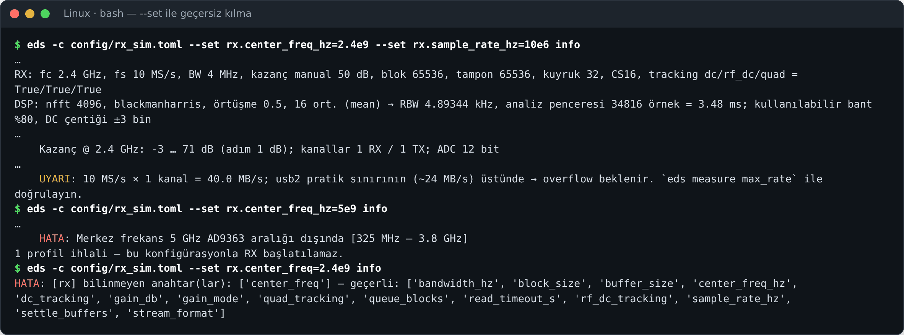

- 10 MS/s × 4 bayt = 40 MB/s, USB 2.0'ın pratik sınırının (~24 MB/s) üstündedir: **UYARI**
  (overflow beklenir; gerçek sınırı `eds measure max_rate` ölçer, §7).
- 5 GHz AD9363 bandının dışındadır: **HATA**, çıkış kodu 1. Bu frekans Pluto'ya hiç gönderilmez.
- `rx.center_freq` diye bir anahtar yoktur (doğrusu `center_freq_hz`): EDS **bütün geçerli
  anahtarları** listeleyerek reddeder. Yazım hatası sessizce varsayılana düşmez.

**Sık hatalar**

| Belirti | Neden | Çözüm |
|---|---|---|
| `bilinmeyen anahtar(lar)` | yazım hatası, birim eki unutulmuş (`_hz`) | mesajdaki geçerli listeden doğru adı seçin |
| `TOML sözdizimi hatası` | dosyada tırnak/parantez eksik | hata satır numarasını verir; o satıra bakın |
| `--set` değeri yanlış okunuyor | kabuk tırnakları yedi | dış çift, iç tek tırnak kuralı (yukarıda) |

---

## 3. Cihazı tanımak: profiles, info, devices

### 3.1 `eds profiles`

**Amaç.** Hangi donanımların desteklendiğini ve sınırlarını görmek.

```bash
eds profiles
```

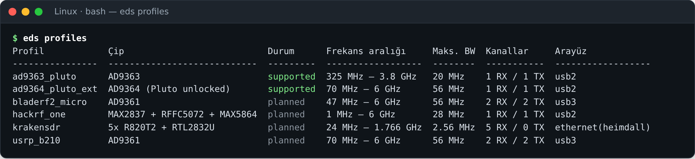

`supported` profiller kullanılabilir; `planned` olanlar (KrakenSDR, HackRF, bladeRF, USRP)
gelecek donanımlar için hazırdır. `ad9364_pluto_ext` "unlock" edilmiş Pluto içindir ve
resmî sınırların dışında olduğundan raporda "SPESİFİKASYON DIŞI MOD" bandı çıkar; KTR
ölçümlerinde `ad9363_pluto` kullanın.

### 3.2 `eds devices`

**Amaç.** Bilgisayarın gerçekten hangi cihazları gördüğünü öğrenmek. `--probe` cihazı açar ve
seri numarasını, çalışma zamanı sınırlarını ve sensörleri (sıcaklık) yazar.

```bash
eds -c config/rx_sim.toml devices            # konfigürasyondaki backend'leri tara
eds -c config/rx_sim.toml devices --probe    # aç, özellikleri ve sensörleri yazdır
eds devices --backend soapy                  # gerçek Pluto'ları ara
```

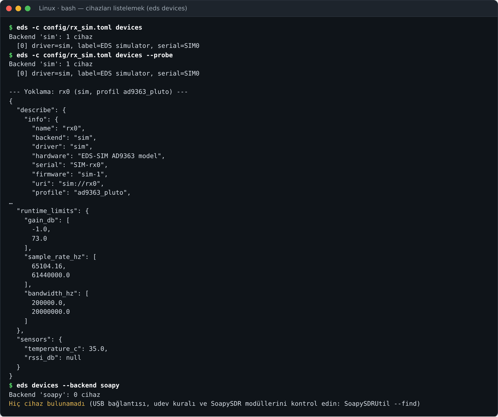

**Nasıl okunur?**

- `describe.info.serial` **seri numarasıdır**: kalibrasyon dosyası bu adla yazılır
  (`cal/SIM-rx0.json`; Pluto'da `cal/104473dc5993....json` gibi).
- `runtime_limits` o andaki kazanç / örnekleme hızı / bant genişliği aralıkları;
  `sensors.temperature_c` AD9363 sıcaklığı (TCXO kaymasını izlemek için).
- `--backend soapy` Pluto yokken `Hiç cihaz bulunamadı` der ve **1** ile çıkar. Bu, kurulumun
  doğru olduğunu ama cihazın görülmediğini söyler (kablo, udev, sürücü:
  [KURULUM.md](KURULUM.md) sorun giderme bölümü).

> **Pluto takılıyken (beklenen, burada çalıştırılmadı):** `Backend 'soapy': 1 cihaz` ve
> `driver=plutosdr`, `uri=usb:…` içeren bir satır. `--probe` ile `"backend": "soapy"`, Pluto'nun
> seri numarası, sıcaklık ve `overflow_source` görünür. İki Pluto takılıysa iki satır çıkar.
> SoapySDR taraması seri numarasını **yazmaz**; hangi `usb:` adresinin hangi seri numarasına ait
> olduğunu şu komut gösterir (conda ortamında `iio_info` yoktur, bu onun Python eşdeğeridir):
> `python -c "import iio; print(iio.scan_contexts())"`. Pluto takılı değilken çıktısı `{}`'dir
> (bu ortamda denendi); takılıyken `{'usb:1.5.5': '0456:b673 (...), serial=104473...'}` biçimindedir.

---

## 4. RX düğümü ve ZeroMQ bus

**Amaç.** RX düğümü (`eds rx`) yarışmada çalışacak boru hattıdır: Pluto'dan sürekli örnek
okur, her ~9 ms'lik pencere için spektrum hesaplar, CFAR ile sinyalleri bulur ve sonuçları
ZeroMQ bus'ına yayınlar. GUI, DF ve kayıt programları bu yayını dinler; RX düğümünü
**yeniden derlemeden** ona bağlanırlar. Bu bölümde iki terminal kullanacağız:

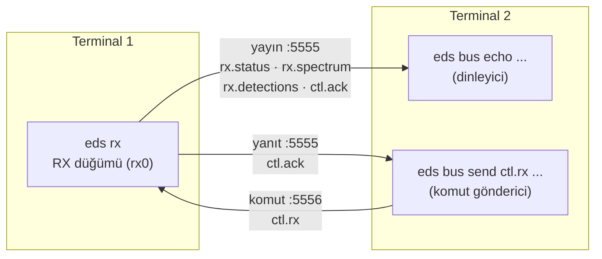

### 4.1 Düğümü başlatmak (Terminal 1)

```bash
eds rx -c config/rx_sim.toml --set "bus.ctl_endpoints=['tcp://127.0.0.1:5556']"
```

`--set "bus.ctl_endpoints=..."` kısmı düğümün **komut** dinlemesini açar (§4.5'te frekans
değiştireceğiz). Yalnız dinleyecekseniz `eds rx -c config/rx_sim.toml` yeterlidir.
`--duration 16` gibi bir süre verirseniz düğüm o kadar saniye sonra kendi durur; vermezseniz
**Ctrl-C** ile durdurursunuz. Aşağıdaki çalıştırmada düğüm 16 s çalıştı ve bu sürede ikinci
terminalden frekansı ve kazancı değiştirdik:

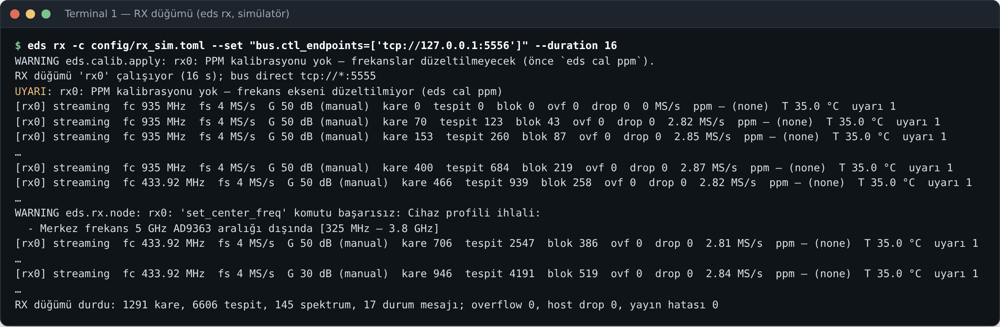

**Durum satırı nasıl okunur?** (saniyede bir, `bus.status_period_s`)

| Alan | Örnek | Anlamı ve ne beklemeli |
|---|---|---|
| durum | `streaming` | `idle`, `streaming`, `sweeping`, `error`. `error`'da düğüm 2 s'de bir akışı yeniden dener |
| `fc`, `fs`, `G` | `935 MHz`, `4 MS/s`, `50 dB (manual)` | Şu anki ayar. Komutla değişince burada görünür |
| `kare` | `400` | İşlenen spektrum karesi sayısı (her kare = bir `rx.detections` mesajı) |
| `tespit` | `684` | Toplam tespit sayısı |
| `blok` | `219` | Okunan IQ bloğu sayısı |
| `ovf` | `0` | **Overflow** (USB örnek kaybı). Açılışta tek seferlik 1 olabilir; **artmaya devam ediyorsa** fs çok yüksek ya da bilgisayar yetişemiyor |
| `drop` | `0` | Host kuyruğunda atılan blok (DSP yetişemiyor). 0 kalmalı |
| `MS/s` | `2.87` | Başlangıçtan beri ortalama gerçek örnek hızı. Pluto'da fs'ye yakın olmalı (bkz. not) |
| `ppm` | `— (none)` | Uygulanan TCXO düzeltmesi ve nerede uygulandığı. `—` = kalibrasyon yok (§6) |
| `T` | `35.0 °C` | AD9363 sıcaklığı |
| `uyarı` | `1` | Etkin uyarı sayısı; her yeni uyarı bir kez `UYARI:` satırı olarak yazılır |

> [!NOTE]
> Bu ekran görüntüsünde `MS/s` 4 yerine ~2.9 çıkıyor, çünkü simülatör 7 vericilik RF sahnesini
> **işlemcide üretiyor** ve bu bilgisayar gerçek zamanda ancak ~2.9 MS/s üretebiliyor. Gerçek
> Pluto'da örnekleri donanım üretir; sınır USB'dir ve `eds measure max_rate` ile ölçülür.

`UYARI: rx0: PPM kalibrasyonu yok` normaldir: henüz `eds cal ppm` yapmadık (§6). Bu durumda
frekanslar TCXO hatası kadar kaymıştır (935 MHz'de 11.7 ppm ≈ 11 kHz).

### 4.2 Bus'ı dinlemek (Terminal 2)

İkinci bir terminal açın (`cd ~/Sdr-kodlama`, `conda activate eds`) ve dinleyin:

```bash
eds bus echo rx.detections rx.status --count 5    # 5 mesaj sonra çık (vermezseniz Ctrl-C'ye kadar)
eds bus echo rx.status --count 2
```

Aşağıdaki görüntü ikinci terminalin tamamıdır: dinleme, frekans değiştirme (§4.5), profil dışı
komut ve kazanç değiştirme sırayla yapıldı.

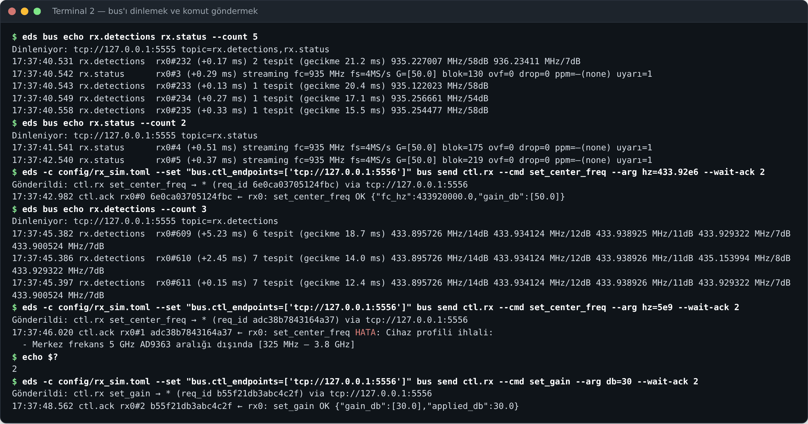

**`eds bus echo` satırı nasıl okunur?**

```text
17:37:40.531 rx.detections  rx0#232 (+0.17 ms) 2 tespit (gecikme 21.2 ms) 935.227007 MHz/58dB 936.23411 MHz/7dB
└─ alındı ─┘ └── topic ──┘  └src#seq┘ └taşıma┘ └────── data özeti: tespitler (en güçlü 5'i) frekans/SNR ──────┘
```

- `rx0#232`: kaynak (`src`) ve sıra numarası (`seq`). `seq` her topic için 1'er artar;
  **atlama varsa mesaj kaçırılmıştır** (`eds bus echo` sonunda uyarır).
- `(+0.17 ms)`: zarftaki gönderim anından alınana kadar geçen **taşıma** süresi.
- `gecikme 21.2 ms`: analiz penceresinin **son örneğinden** mesajın alınmasına kadar geçen
  süre (spektrum + CFAR + taşıma). KTR'deki uçtan uca gecikme ölçümü bunun RF olayından
  başlayan hâlidir (`eds measure latency`).
- `935.227007 MHz/58dB`: GSM baz istasyonu (935.2 MHz, 200 kHz). Tepe frekansı her karede
  biraz oynar, çünkü GSM sinyali zamanla değişir.
- `936.23411 MHz/7dB`: **zayıf ve hep aynı yerde.** Bu, simülatörün bilerek eklediği dahili
  bir "spur"dur (fc + 1.234 MHz, −85 dBFS); gerçek alıcılardaki saat kaynaklı spurları taklit
  eder. Nasıl anlaşılır? Frekansı değiştirdiğinizde **o da fc ile birlikte kayar**
  (433.92 MHz'e geçince 435.154 MHz'de görünüyor). Dışarıdan gelen bir sinyal kaymaz.

Retune sonrası 433.92 MHz'deki ISM vericisi **birden çok tespit** olarak görünür: FM sinyalinin
spektrumu (taşıyıcı + yan bantlar) en ince çözünürlükte ayrı tepeler verir. Aynı vericiyi tek
tespit olarak birleştirmek tüketicinin (GUI/DF) işidir; frekans yakınlığına göre gruplayın.

### 4.3 Bir mesajın içi: `rx.detections` JSON

`--raw` zarfın tamamını tek satır JSON olarak yazar. Okunabilirlik için `python -m json.tool`
ile girintiledik (bu çıktı gerçek; düğüm çalışırken alındı):

```bash
eds bus echo rx.detections --count 1 --raw | python -m json.tool
```

```json
{
    "topic": "rx.detections",
    "v": 1,
    "src": "rx0",
    "seq": 233,
    "t_ns": 1793986897210484162,
    "data": {
        "device": "rx0",
        "block_seq": 128,
        "t_acq_ns": 1793986897186432769,
        "t_acq_end_ns": 1793986897195136769,
        "t_proc_ns": 1793986897210418942,
        "fc_hz": 935000000.0,
        "rbw_hz": 1957.3759162275855,
        "unit": "dBFS",
        "method": "os_cfar",
        "pfa": 1e-06,
        "detections": [
            {
                "f_center_hz": 935188194.7181287,
                "f_peak_hz": 935122022.5904605,
                "f_lo_hz": 935090332.03125,
                "f_hi_hz": 935288574.21875,
                "bw_hz": 198242.1875,
                "peak_db": -32.835991061213456,
                "band_power_db": -15.084282019930683,
                "snr_db": 57.78785337245281,
                "noise_db": -90.62384443366626,
                "n_bins": 203
            }
        ]
    }
}
```

| Alan | Anlamı |
|---|---|
| `topic`, `v`, `src`, `seq`, `t_ns` | Zarf: topic adı, zarf sürümü (1), kaynak düğüm, sıra no, gönderim anı (ns, 1970'ten beri) |
| `t_acq_ns`, `t_acq_end_ns`, `t_proc_ns` | Analiz penceresinin ilk/son örneğinin zamanı ve DSP'nin bittiği an. Farkları gecikme bütçesini verir |
| `fc_hz`, `rbw_hz`, `unit` | Bu karenin merkez frekansı, RBW'si ve güç birimi (`dBFS`; güç kalibrasyonu varsa `dBm`) |
| `method`, `pfa` | Kullanılan CFAR ve yanlış alarm olasılığı |
| `f_lo_hz` … `f_hi_hz`, `bw_hz` | Tespitin kapladığı bant (burada 198 kHz: GSM kanalı) |
| `f_center_hz`, `f_peak_hz` | Bandın ortası ve en güçlü binin frekansı |
| `band_power_db` | Bant içindeki toplam güç (sinyal gücü için bunu kullanın) |
| `peak_db`, `noise_db`, `snr_db` | Tepe bin gücü, yerel gürültü tabanı (RBW'de), SNR |

Bütün alanların resmî tanımı JSON Schema dosyalarındadır: `contracts/schemas/rx.detections.schema.json`
(ve `common.schema.json`). Başka bir dilde istemci yazarken bu dosyaları kaynak alın.

> [!WARNING]
> `t_ns` gibi `*_ns` tamsayıları 2^53'ten büyüktür. Python'da sorun yoktur; **JavaScript**'te
> `BigInt` ile ayrıştırın ya da yalnız `t_ns / 1e9` saniye değerini kullanın.

### 4.4 Topic'ler: hangisi ne zaman gelir?

| Topic | Üretici | Ne sıklıkta | İçerik / ne için |
|---|---|---|---|
| `rx.status` | `eds rx` | `status_period_s` (1 s) | Durum, ayarlar, akış sayaçları (overflow, drop), ppm, sıcaklık, uyarılar. Sağlık göstergesi |
| `rx.detections` | `eds rx` | **her kare** (~9 ms'de bir; boş liste dahil) | CFAR tespitleri. GUI listesi, DF tetikleme |
| `rx.spectrum` | `eds rx` | en fazla `spectrum_rate_hz` (10/s) | PSD karesi (≤ 4096 nokta, max-hold seyreltilmiş). Şelale/spektrum ekranı |
| `rx.sweep` | `eds sweep --publish`, ctl `sweep` | tarama başına bir | Birleştirilmiş geniş bant spektrum + tespitler + tarama hızı |
| `cal.result` | `eds cal ... --publish`, `cal coherence` | kalibrasyon başına bir | ppm / güç / koherens sonucu |
| `meas.result` | `eds measure --publish` | ölçüm başına bir | KTR ölçüm sonucu (değer, birim, durum) |
| `df.bearing` | DF modülü | – | Kerteriz (Faz-0: 2 elemanlı interferometre) |
| `ctl.rx` | GUI / `eds bus send` | komut başına | Komut: `ping`, `set_center_freq`, `set_gain`, `set_gain_mode`, `set_sample_rate`, `set_bandwidth`, `sweep`, `stop` |
| `ctl.ack` | `eds rx` | komut başına bir | Komutun sonucu: `ok`, `error` (Türkçe), `result` |

Tek doğruluk kaynağı `contracts/topics.json` dosyasıdır.

### 4.5 Düğümü uzaktan yönetmek: `eds bus send`

**Amaç.** GUI'deki "frekansa git", "kazancı düşür" düğmelerinin yaptığı işi komut satırından
yapmak ve düğümün yanıtını (`ctl.ack`) görmek.

```bash
# Terminal 2 (düğüm §4.1'deki gibi ctl_endpoints ile başlatılmış olmalı)
eds -c config/rx_sim.toml --set "bus.ctl_endpoints=['tcp://127.0.0.1:5556']" bus send ctl.rx --cmd set_center_freq --arg hz=433.92e6 --wait-ack 2
```

Aynı komutun kısa yazımı (komut adresini doğrudan vererek; aynı şekilde çalışır):

```bash
eds bus send ctl.rx --endpoint tcp://127.0.0.1:5556 --cmd set_center_freq --arg hz=433.92e6 --wait-ack 2
```

**Neden `ctl_endpoints`?** Direct modda düğüm komutları kendisi aramaz: `bus.ctl_endpoints`
listesindeki adreslere **bağlanır**, komut gönderen program o adresi **açar** (bind). Liste
boşsa (`rx_sim.toml` ve `rx_pluto.toml`'da varsayılan) uzaktan kontrol kapalıdır; `eds info`
bunu `kontrol kapalı` diye yazar. Sürekli kullanacaksanız bir kopya konfigürasyon oluşturup
`[bus]` bölümüne `ctl_endpoints = ["tcp://127.0.0.1:5556"]` yazın.

**Yanıt nasıl okunur?** (yukarıdaki Terminal 2 görüntüsü)

- `Gönderildi: ctl.rx set_center_freq → * (req_id 6e0ca037...)`: komut tüm düğümlere (`*`)
  gitti. `--target rx0` ile tek düğüm seçilir. `req_id` yanıtı komutla eşleştirir.
- `ctl.ack ... set_center_freq OK {"fc_hz":433920000.0,"gain_db":[50.0]}`: uygulandı;
  `result` yeni ayarı verir. Terminal 1'de `fc 433.92 MHz` görünür.
- Profil dışı değer (`hz=5e9`): `HATA: Cihaz profili ihlali` yanıtı gelir, **düğüm çalışmaya
  devam eder** ve frekans değişmez; `eds bus send` **2** ile çıkar (`echo $?`).

| Komut | `--arg` | Örnek |
|---|---|---|
| `ping` | – | `--cmd ping` (durum ve ayarları döndürür) |
| `set_center_freq` | `hz` | `--cmd set_center_freq --arg hz=2.437e9` |
| `set_gain` | `db` | `--cmd set_gain --arg db=30` |
| `set_gain_mode` | `mode` | `--cmd set_gain_mode --arg mode=soft_agc` |
| `set_sample_rate` | `hz` | `--cmd set_sample_rate --arg hz=2e6` |
| `set_bandwidth` | `hz` | `--cmd set_bandwidth --arg hz=2e6` |
| `sweep` | `[sweep]` anahtarları | `--cmd sweep --arg start_hz=400e6 --arg stop_hz=500e6` (sonuç `rx.sweep`) |
| `stop` | – | `--cmd stop` (düğümü durdurur) |

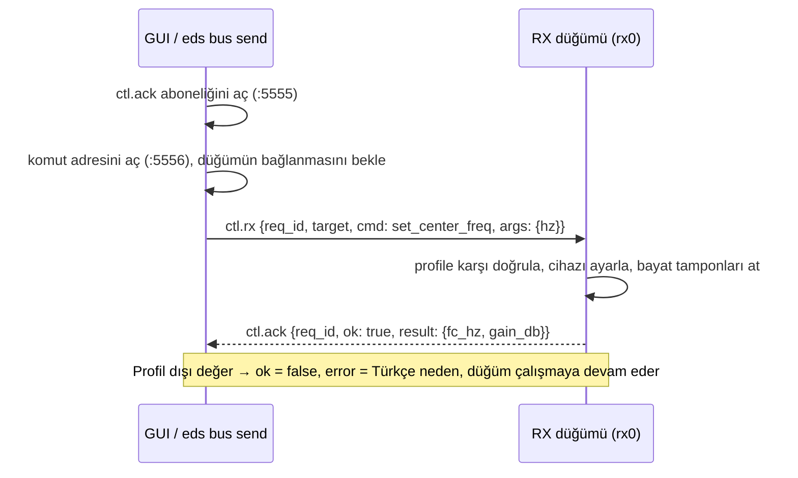

### 4.6 Proxy modu (çok üreticili kurulum)

Direct modda yayın portunu (5555) **yalnız bir program** açabilir. `eds rx` çalışırken yayın
yapan ikinci bir komut (`eds cal ... --publish`, varsayılan olarak yayın yapan `eds cal coherence`,
`eds measure --publish`, `eds sweep --publish`) aynı portu açmaya çalışır ve
`Address already in use` hatası verir. İki Pluto düğümü, ölçüm ve DF aynı anda yayın yapacaksa
herkesin tek bir "santral"a (proxy) bağlanması bu yüzden gereklidir. Üç terminal:

```bash
eds bus proxy                                                    # Terminal A: santral (5550 ← yayıncılar, 5551 → aboneler)
eds rx -c config/rx_sim.toml --set bus.mode=proxy                # Terminal B: düğüm santrale bağlanır
eds -c config/rx_sim.toml --set bus.mode=proxy bus echo rx.status   # Terminal C: dinle
eds -c config/rx_sim.toml --set bus.mode=proxy bus send ctl.rx --cmd set_center_freq --arg hz=2.437e9 --wait-ack 2
```

Proxy modunda `ctl_endpoints` gerekmez; komutlar da santral üzerinden gider. (Bu dört komut
simülatörde denendi: `ctl.ack ... set_center_freq OK {"fc_hz":2437000000.0,...}`.)

### 4.7 Sık hatalar

| Belirti | Neden | Çözüm |
|---|---|---|
| `HATA: ZMQ uç noktasına bind edilemedi: tcp://*:5555 (Address already in use)` | Başka bir `eds rx` ya da yayın yapan başka bir komut (`--publish`, `cal coherence`) 5555'i kullanıyor | Diğerini durdurun, proxy modunu kullanın (§4.6) ya da farklı port: `--set bus.pub_endpoint=tcp://*:5565` (dinleyicide `--endpoint tcp://127.0.0.1:5565`) |
| `eds bus echo` hiçbir şey yazmıyor, `Zaman aşımı: 0/N` | Düğüm çalışmıyor ya da farklı adreste/modda | Terminal 1'e bakın; proxy modundaysanız dinleyiciye de `--set bus.mode=proxy` |
| `HATA: Bilinmeyen topic(ler): ['rx.detection']` | topic adı yanlış | Hata mesajı doğru listeyi verir (`rx.detections`) |
| `HATA: bus.ctl_endpoints boş` | `bus send` komutun nereye gideceğini bilmiyor | `--set "bus.ctl_endpoints=[...]"` ya da `--endpoint` |
| `HATA: 3 s içinde ctl.rx dinleyen RX düğümü bulunamadı` | Düğüm komut dinlemiyor (ctl_endpoints olmadan başlatılmış) ya da adresler farklı | Düğümü §4.1'deki gibi yeniden başlatın; iki tarafta aynı adres |
| `ovf` sürekli artıyor | USB/işlemci yetişemiyor | `sample_rate_hz`'i düşürün; `eds measure max_rate` ile sınırı ölçün |
| Başka bilgisayardan dinleyemiyorum | `sub_endpoint` `127.0.0.1` (yalnız aynı makine) / güvenlik duvarı | Dinleyicide `--endpoint tcp://<RX-bilgisayarı-IP>:5555`; Windows'ta güvenlik duvarında Python'a "Özel ağ" izni |

Bu hataların gerçek ekran görüntüsü [§10](#10-sık-sorulanlar-ve-sorun-giderme)'dadır.

---

## 5. Geniş bant tarama

**Amaç.** Pluto bir anda en fazla 20 MHz görür, ama yarışma bandı 325 MHz–3.8 GHz'tir. Tarama,
LO'yu adım adım kaydırarak bandın tamamının spektrumunu çıkarır ve sinyalleri bulur. "Ortamda
neler var?" sorusunun ilk cevabı budur; RX düğümünü nereye ayarlayacağınızı buradan seçersiniz.

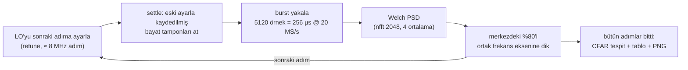

**Neden 20 MS/s olabiliyor?** Sürekli akışta 20 MS/s × 4 bayt = 80 MB/s USB 2.0'ı aşar. Tarama
ise her adımda yalnız 5120 örneklik kısa bir "burst" alır; bu örnekler Pluto'nun kendi
belleğinde ardışık kaydedilir, USB darboğazı yalnız adımlar **arasında** boşluk yaratır, bu da
sonucu etkilemez.

### 5.1 Tam bant tarama

```bash
eds -c config/rx_sim.toml sweep --png tarama.png --out tarama.npz
```

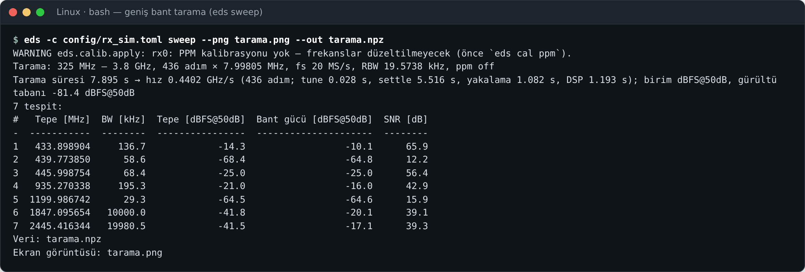

`--png` spektrum analizörü görünümünde bir ekran görüntüsü kaydeder:

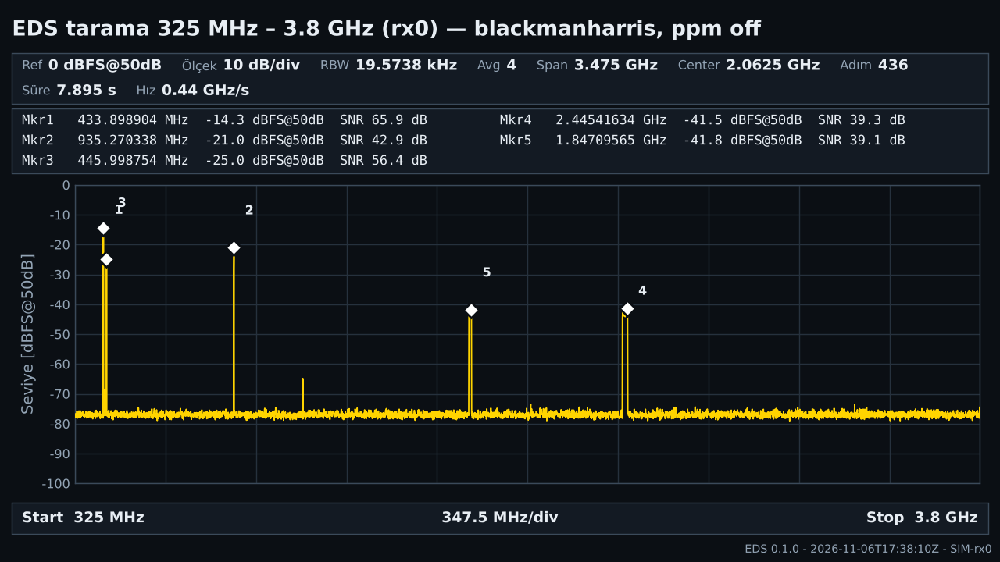

**Çıktı nasıl okunur?**

- `436 adım × 7.99805 MHz, fs 20 MS/s, RBW 19.5738 kHz, ppm off`: adım planı. 16 MHz'lik
  kullanılabilir bant `dc_avoid` ile %50 örtüşür (adım ≈ 8 MHz); 3.475 GHz / 8 MHz ≈ 436.
  `ppm off` = henüz kalibrasyon yok (§6 sonrası `ppm hardware` yazar).
- `Tarama süresi 7.895 s → hız 0.4402 GHz/s` ve döküm `tune / settle / yakalama / DSP`:
  sürenin büyük kısmı (5.5 s) **settle**'dır, yani retune sonrası bayat tamponları atmak. KTR'deki
  "tarama hızı" (`scan_speed`) bu sayıdır ve neyin sınırladığı bu dökümden görülür.
- `birim dBFS@50dB`: seviyeler 50 dB kazançta okunacak dBFS'ye normalize. Güç kalibrasyonu
  (§6.3) varsa birim `dBm` olur.
- Tablo sütunları: **Tepe** (en güçlü binin frekansı), **BW** (kapladığı bant), **Tepe** /
  **Bant gücü** (seviye), **SNR**.

**Sahnedeki 7 vericiyle karşılaştıralım** (§2.1 tablosu):

| Tespit | Gerçekte ne |
|---|---|
| 433.90 MHz, BW 137 kHz, SNR 66 dB | ISM İHA bağı (433.92 MHz, FM) |
| **439.77 MHz, −68 dBFS, SNR 12 dB** | **Sahte!** 433.92 MHz'in **IQ imajı** (≈ 55 dB aşağıda) |
| 446.00 MHz | PMR446 telsiz |
| 935.27 MHz, BW 195 kHz | GSM baz istasyonu |
| 1199.99 MHz, SNR 16 dB | −110 dBm'lik zayıf işaretçi (RBW 19.6 kHz'te bulunabiliyor) |
| 1847.1 MHz, BW 10 MHz | LTE (geniş bant: kaba çözünürlüklü CFAR buldu) |
| 2445.4 MHz, BW 20 MHz | Wi-Fi kanal 6 |
| (yok) | **2.8 GHz radar bu taramada kaçırıldı** (her taramada değil, aşağıya bakın) |

> [!NOTE]
> **Tespit sayısı taramadan taramaya değişir.** Bu rehber denetlenirken aynı komut üç kez
> çalıştırıldı ve 8, 11 ve 10 tespit verdi (ekran görüntüsündeki koşuda 7). Fark iki kaynaktan gelir:
> (1) darbeli radar bazen yakalanır, bazen kaçar (aşağıda), yakalandığında 2.785–2.801 GHz
> arasında 2-3 tespit olarak görünür; (2) SNR'si ~10 dB'nin altında, tek binlik (BW 9.8–19.5 kHz)
> zayıf tespitler CFAR'ın **yanlış alarmı** olabilir (ör. bir koşuda 1423.34 MHz, SNR 8.8 dB).
> Bin başına yanlış alarm olasılığı `pfa = 1e-6`, taramada ~356 000 bin olduğundan tarama başına
> ortalama ~0.4 yanlış alarm beklenir. Kural: zayıf bir tespiti ciddiye almadan önce taramayı
> tekrarlayın; aynı yerde yine çıkıyorsa gerçektir. Güçlü vericiler (433.9, 446.0, 935.2, 1200,
> 1842.5, 2437 MHz) ve 433.92 MHz'in imajı her koşuda aynı yerde çıktı. Modüleli sinyallerde
> **Tepe** frekansı bandın içinde gezer (ör. LTE 1839.6–1847.1 MHz, Wi-Fi 2428.4–2445.4 MHz):
> sinyalin yerini BW ve bant ortasından okuyun.

- **İmaj nasıl anlaşılır?** Sıfır-IF alıcıda güçlü bir sinyal, adım merkezine göre aynalanmış
  frekansta zayıf bir kopya üretir (bastırma ~55 dB; `image_rejection` ölçümü). Adım planını
  değiştirince **yeri değişir**: aynı sahneyi `--start 400e6 --stop 1000e6` ile taradığımızda
  imaj 438.23 MHz'te çıktı, gerçek sinyaller yerinde kaldı. Güçlü bir sinyalin hemen yanında,
  ondan ~55 dB zayıf, yeri tarama ayarıyla oynayan tespit = imaj.
- **Radar neden bazen yok?** Radar 1 ms'de bir yalnız 10 µs yayın yapıyor; tarama her adımda
  yalnız 0.256 ms (5120 örnek) bakıyor. Bir bakışın bir darbeye denk gelme olasılığı
  (0.256 + 0.010) / 1 ≈ %27'dir. `dc_avoid` örtüşmesi yüzünden 2.8 GHz iki adımda görülür, yani
  en az bir kez yakalama olasılığı 1 − 0.73² ≈ **%46**, kabaca yazı-tura. Bu rehber denetlenirken
  üç taramanın ikisinde yakalandı; ekran görüntüsündeki taramada kaçtı. Darbeli sinyaller için
  tarama güvenilir değildir: o frekansta RX düğümünü sürekli çalıştırın (`eds rx`, %100 dinleme)
  ya da taramayı birkaç kez tekrarlayıp sonuçları birleştirin.

### 5.2 Aralık, RBW ve örnekleme hızı seçmek

```bash
eds -c config/rx_sim.toml sweep --start 400e6 --stop 1000e6          # yalnız 400 MHz–1 GHz (1.3 s)
eds -c config/rx_sim.toml sweep --start 420e6 --stop 460e6 --rbw 5e3 # dar aralık, ince RBW
eds -c config/rx_sim.toml sweep --publish                            # sonucu rx.sweep olarak bus'a yayınla
```

Küçük RBW gürültü tabanını düşürür (zayıf sinyal görünür) ama adım başına daha çok örnek ister
(tarama yavaşlar). `--fs` burst örnekleme hızını değiştirir (adım sayısı değişir).

### 5.3 Kaydedilen veriyi kendi programınızla açmak

`--out tarama.npz` bir NumPy arşividir: `f_hz` (frekans ekseni), `p_db` (seviye) ve `meta`
(tarama ayarları, süre, tespitler; JSON metni).

```python
import json
import numpy as np

z = np.load("tarama.npz")
f_hz, p_db = z["f_hz"], z["p_db"]          # frekans ekseni [Hz] ve seviye (birim meta'da)
meta = json.loads(str(z["meta"]))          # tarama ayarları, süre, tespitler (JSON)
print(len(f_hz), "nokta,", meta["unit"], ", RBW", round(meta["rbw_hz"]), "Hz")
for d in meta["detections"]:
    print(f"{d['f_peak_hz'] / 1e6:10.3f} MHz  SNR {d['snr_db']:5.1f} dB")
```

Yukarıdaki taramada çıktı: `355841 nokta, dBFS@50dB , RBW 19574 Hz` ve ardından tablodaki 7
tespit.

### 5.4 Kazanç: `fixed` ve `auto`, RF ön uç sıkışması

**İki kazanç modu.**

- `sweep.gain_mode = "fixed"` (varsayılan): her adım aynı kazançla (`sweep.gain_db`, 50 dB)
  alınır. Seviyeler doğrudan karşılaştırılabilir ve tarama en hızlıdır. Ama ortamda çok güçlü bir
  verici varsa (yanı başınızdaki baz istasyonu, kendi telsiziniz) o adımda **ADC kırpar** (12 bit
  ADC'nin tam ölçeği aşılır). Kırpılan sinyal harmonikler ve karışım ürünleri üretir, tarama
  ortada olmayan onlarca "sinyal" bulur. Sabit kazançta bu durum **denetlenmez ve uyarı verilmez**.
- `--set sweep.gain_mode=auto`: her adım kendi kazancını seçer. Kırpma varsa kazancı düşürür, sinyal
  çok zayıfsa yükseltir (eşikler `[agc]` bölümündedir). Seviyeler yine `sweep.gain_db`'ye
  normalize edilir (`dBFS@50dB`), yani adımlar arasında karşılaştırılabilir kalır. Adım başına
  birkaç ek yakalama yaptığı için biraz daha yavaştır.

**RF ön uç sıkışması nedir, neden ayrıca denetlenir?** Kazanç en düşük değere (1.3 GHz altında
−1 dB) indiği hâlde sinyal hâlâ çok güçlüyse, ADC'den **önceki** analog katlar (LNA, karıştırıcı)
doymaya başlar. Bu durumda ADC kırpmaz, otomatik kazanç döngüsü de bir sorun görmez, ama ölçülen
seviye gerçek değerin **altında** kalır (giriş 1 dB artınca çıkış 1 dB'den az artar: "1 dB sıkışma
noktası" kavramı). EDS bunu `auto` modda şöyle yakalar:

1. Döngü bittikten sonra şu üç koşulu **birlikte** sağlayan adımlara bakılır: kazanç en düşük
   değere yakın (en fazla 6 dB üstünde), tepe seviyesi yüksek (≥ −9 dBFS), ADC kırpmıyor.
   Normal bir sahnede bu koşullara uyan adım olmaz, sıkışma denetimi hiç ek yakalama yapmaz.
2. Bu adımda kazanç 3–6 dB değiştirilip **bir ek yakalama** yapılır ve seviyenin ne kadar
   değiştiğine bakılır (kazanç döngüsünün son adımı bu ölçümü zaten verdiyse ek yakalama da
   gerekmez). Doğrusal bir alıcıda kazanç 6 dB artınca seviye de 6 dB artar
   (eğim **1.00 dB/dB**). Ön uç sıkışıyorsa daha az artar.
3. Eğim **0.85**'in altındaysa adım "sıkışmış" sayılır. Ek yakalama birleştirilmiş spektruma
   girmez, kazanç eski değerine döner.

**Kendiniz deneyin (simülatör).** Sahneye alıcı girişinde +3 dBm'lik, çok yakın bir verici
ekleyen bir kopya konfigürasyon oluşturup aynı bandı iki modda tarayın:

```bash
cp config/rx_sim.toml config/guclu_verici.toml
cat >> config/guclu_verici.toml <<'EOF'

[[sim.emitters]]                  # çok yakındaki güçlü verici: alıcı girişinde +3 dBm
name = "yakin_verici"
kind = "cw"
freq_hz = 910e6
power_dbm = 3.0
EOF
eds -c config/guclu_verici.toml sweep --start 880e6 --stop 960e6
eds -c config/guclu_verici.toml --set sweep.gain_mode=auto sweep --start 880e6 --stop 960e6 --png sikisma.png --out sikisma.npz
```

(Windows'ta `cat >> ... <<'EOF'` yoktur: `copy config\rx_sim.toml config\guclu_verici.toml`
yapın, sonra dosyayı Not Defteri ya da VS Code ile açıp `[[sim.emitters]]` bloğunu en sona
yapıştırın. İşiniz bitince `config/guclu_verici.toml` dosyasını silebilirsiniz.)

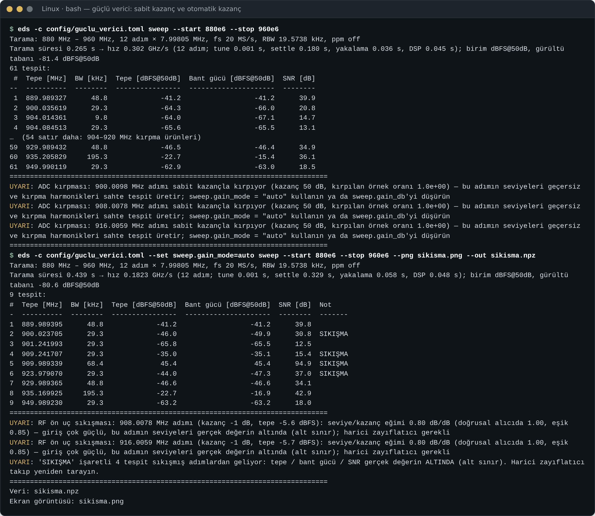

**Nasıl okunur?**

- **Sabit kazanç:** `61 tespit` (tekrar koşularda 59–61). Oysa bu bantta sahnede yalnız iki verici var: eklediğimiz
  910 MHz vericisi ve 935.2 MHz GSM (güçlü verici eklenmeden aynı tarama yalnız GSM'i bulur).
  904–920 MHz arasındaki ~0.37 MHz aralıklı tespit dizisi ADC kırpmasının ürettiği sahte
  çizgilerdir. 890, 930 ve 950 MHz'tekiler güçlü vericiden tam 20 MHz'in katları kadar uzaktadır,
  yani örnekleme hızıyla (fs = 20 MHz) ilişkili kopyalardır. Tablonun altındaki
  `UYARI: ADC kırpması` satırları kırpan adımları (900, 908, 916 MHz) listeler: bu adımlardan gelen
  seviyelere ve tespitlere güvenmeyin. Sabit kazanç sıkışmayı denetlemez, yalnız kırpmayı bildirir.
  Güçlü sinyal beklenen ortamda `auto` kullanın.
- **Otomatik kazanç:** sahte dizi kayboldu (`9 tespit`). Ama 908.0 ve 916.0 MHz adımlarında
  kazanç en düşük değere (−1 dB) indiği hâlde tepe −5.6 dBFS'te kaldı ve ölçülen eğim
  **0.80 dB/dB** çıktı (< 0.85): ön uç sıkışıyor. İşaretli dört tespitten yalnız **909.99 MHz**
  gerçek vericidir. 900.0, 909.2 ve 924.0 MHz'tekiler sahnede yoktur: güçlü sinyalin ve alıcının
  kendi spur'larının yan ürünleridir (909.24 = 908.008 + 1.234 MHz, §4.2'deki dahili spur; düşük
  kazançta `dBFS@50dB`'ye normalize edilince büyük görünür). Güçlü bir sinyal varken o çevredeki
  zayıf tespitlere ihtiyatla bakın.
- **`Not` sütunu `SIKIŞMA`:** bu adımlardan gelen tespitler. Frekansları doğrudur, ama **Tepe**,
  **Bant gücü** ve **SNR** değerleri **alt sınırdır**: gerçek değer daha yüksektir. Örnekte
  910 MHz'teki verici `45.4 dBFS@50dB` görünüyor. Doğrusal bir alıcıda +3 dBm, 50 dB kazançta
  3 + 50 − 5 = 48 dBFS'e karşılık gelirdi (§2.1'deki simülatör modeli), yani ~2.6 dB eksik ölçüldü.
  (`dBFS@50dB` değerinin 0'ın üstünde olması normaldir: "kazanç 50 dB olsaydı okunacak seviye"
  demektir.) `Not` sütunu yalnız işaretli tespit varsa görünür.
- **`====` arasındaki `UYARI:` satırları:** sıkışan her adımın merkez frekansı, kazancı, tepe
  seviyesi ve ölçülen eğim (eşikle birlikte), en sonda kaç tespitin etkilendiği. `auto` modda kazanç
  en düşükteyken hâlâ ADC kırpan bir adım olursa burada `ADC kırpması` uyarısı da çıkar. Uyarılar
  hata akışına (stderr) yazılır; çıktıyı dosyaya yönlendirirken `2>&1` ekleyin.
- **Ne yapmalı?** Antenle alıcı arasına **harici zayıflatıcı** (ör. 20–30 dB) takıp aynı aralığı
  `auto` ile yeniden tarayın; `SIKIŞMA` kaybolana kadar zayıflatmayı artırın. Gerçek seviye =
  okunan seviye + zayıflatıcı kaybı. Yazılımla düzeltilemez: sıkışmış ölçüm bilgi kaybetmiştir.
  Bu rehber denetlenirken aynı verici 30 dB zayıflatıcıya karşılık gelen −27 dBm ile tarandı:
  `auto` modda `SIKIŞMA` ve uyarılar kayboldu, verici `18.0 dBFS@50dB` okundu (doğrusal beklenen
  −27 + 50 − 5 = 18, birebir). Sabit 50 dB kazançta ise bu seviye hâlâ ADC'yi kırptı (74 sahte
  tespit, `ADC kırpması` uyarılarıyla): zayıflatıcı **ve** `auto` birlikte gerekir.

`--png` görüntüsünde işaretli tespitlerin işaretçilerinde `SIKIŞMA` yazar ve altta kırmızı bir
uyarı satırı sıkışan adımları listeler:

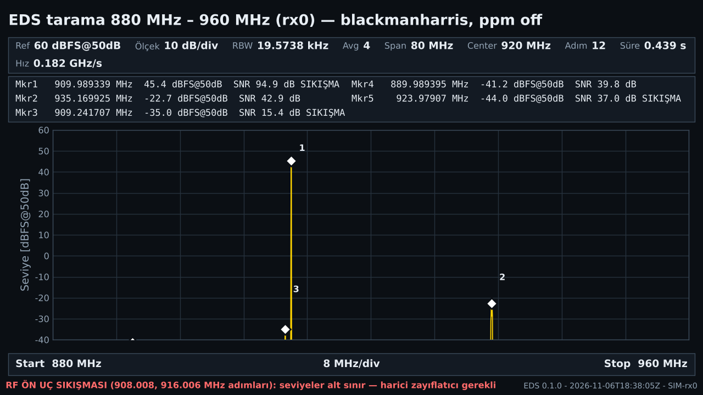

(Bu görüntüde ölçek üst sınırı 60 dBFS@50dB seçildiği için −40'ın altındaki iki işaretçi alt
kenarda kalıyor; değerleri üstteki işaretçi tablosundan okuyun.)

`--out sikisma.npz` dosyasının `meta` bölümüne de aynı bilgi yazılır: `compressed_detections`
(işaretli tespitlerin sırası, 0'dan başlar: bu örnekte `[1, 3, 4, 5]`), `compressed_steps`
(adım no, merkez frekansı, kazanç, eğim) ve `warnings` (uyarı metinleri). §5.3'teki kodla okunur.

> [!NOTE]
> Bus tarafı: `rx.sweep` mesajının sözleşmesi değişmedi, yani mesajda sıkışma/kırpma alanı **yoktur**.
> RX düğümüne `ctl.rx` `sweep` komutuyla başlatılan taramalarda bu bilgi iki yoldan gelir:
> `ctl.ack` yanıtının `result` nesnesinde `warnings`, `compressed_steps`, `clipped_steps`,
> `compressed_detections` alanları; ve `rx.status` mesajının `warnings` listesinde
> `rx0: tarama #N: UYARI metni` satırları. GUI bunları oradan okur. Eşikler (−9 dBFS, 0.85)
> simülatörün AD9363 modeline göre seçildi; gerçek Pluto'da henüz doğrulanmadı.

### 5.5 Sık hatalar

| Belirti | Neden | Çözüm |
|---|---|---|
| `HATA: ... Tarama aralığı [100 MHz – 200 MHz] AD9363 resmî frekans aralığı dışında` | `--start` 325 MHz altında | 325e6–3.8e9 arasında kalın |
| Frekanslar beklenenden ~kHz kayık | ppm kalibrasyonu yok (`ppm off`) | §6.1 |
| Aynı sinyal iki taramada farklı tepe frekansı veriyor | GSM/LTE/FM gibi modüleli sinyallerde tepe bandın içinde gezer | `f_center_hz` / BW'ye bakın, tepeye değil |
| Darbeli sinyal görünmüyor | tarama her frekansa çok kısa bakar | o frekansta `eds rx` |
| Güçlü sinyalin yanında zayıf "hayalet" | IQ imajı | §5.1'deki imaj testi |
| Güçlü sinyalin çevresinde onlarca, düzenli aralıklı tespit; altta `UYARI: ADC kırpması` | sabit kazançta ADC kırpması | `--set sweep.gain_mode=auto` ile tekrar tarayın (§5.4) |
| Tabloda `SIKIŞMA`, altta `UYARI: RF ön uç sıkışması` | kazanç en düşükteyken bile ön uç doyuyor; seviyeler alt sınır | harici zayıflatıcı takıp `auto` ile tekrar tarayın (§5.4) |
| Zayıf bir tespit bir taramada var, diğerinde yok | CFAR yanlış alarmı (SNR ~10 dB'nin altı) ya da darbeli sinyal | taramayı tekrarlayın; darbeli sinyal için o frekansta `eds rx` (§5.1) |

---

## 6. Kalibrasyon

### 6.1 TCXO ppm kalibrasyonu (`eds cal ppm`)

**Amaç.** Pluto'nun 40 MHz referans osilatörü (TCXO) ±25 ppm'e kadar hatalı olabilir. Bu hata
bütün frekanslara oranla yansır: 2.4 GHz'te 25 ppm = **60 kHz**. Bir emitter'ı kanalına
oturtmak, raporda frekans doğruluğu vermek ve iki Pluto'yu DF için hizalamak için bu hatayı
ölçüp düzeltmek gerekir.

**Referans olarak GSM.** GSM baz istasyonları her BCCH taşıyıcısında düzenli olarak **FCCH**
yayınlar: taşıyıcının tam 67.708 kHz üstünde saf bir ton. Baz istasyonlarının frekansı çok
kararlıdır (şebekeye/GPS'e kilitli), yani bedava ve hassas bir referanstır. EDS bu tonun
**görünen** frekansını ölçer; gerçeğinden farkı TCXO hatasıdır.

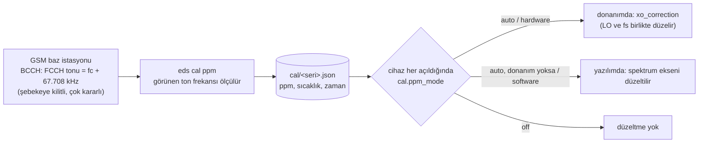

Simülatör sahnesinde 935.2 MHz'te bir GSM BCCH vericisi (`gsm900_bcch`, `kind = "gsm_fcch"`)
var; simüle TCXO hatası +11.7 ppm. Taşıyıcıyı frekansla ya da ARFCN numarasıyla verebilirsiniz:

```bash
eds -c config/rx_sim.toml cal ppm --gsm-freq 935.2e6         # taşıyıcı frekansıyla
eds -c config/rx_sim.toml cal ppm --gsm-arfcn 1 --apply      # aynı kanal, ARFCN ile; sonucu hemen uygula
eds -c config/rx_sim.toml rx --duration 3                    # artık ppm uygulanmış
```

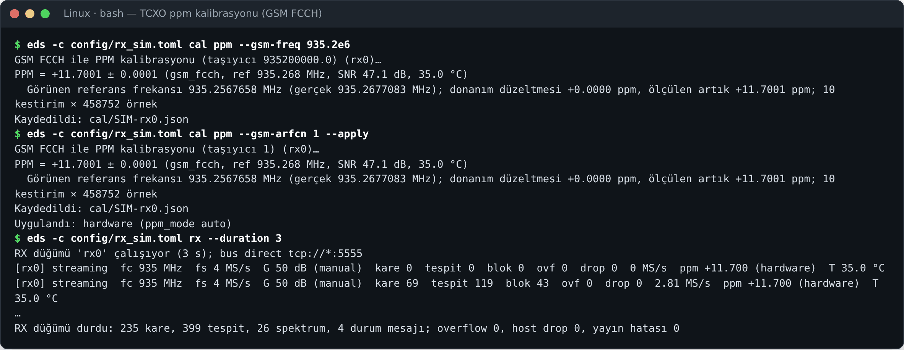

**Nasıl okunur?**

- `PPM = +11.7001 ± 0.0001`: ölçülen TCXO hatası ve belirsizliği (10 FCCH patlaması arasındaki
  saçılım). Simülatördeki gerçek değer 11.7'dir. **Pozitif = TCXO hızlı**, bu yüzden sinyaller
  olduklarından **düşük** frekansta görünür: `Görünen referans frekansı 935.2567658 MHz (gerçek
  935.2677083 MHz)`, fark 10.9 kHz.
- `SNR 47.1 dB`: FCCH tonunun kalitesi. Gerçek havada 20 dB'nin altına düşerse güçlü bir kanal
  seçin.
- `donanım düzeltmesi +0.0000 ppm`: ölçüm sırasında donanımda zaten uygulanan düzeltme
  (ilk kalibrasyonda 0).
- `Kaydedildi: cal/SIM-rx0.json`: dosya adı cihazın **seri numarasıdır**. Pluto'da her Pluto'nun
  kendi dosyası olur.
- `Uygulandı: hardware (ppm_mode auto)`: `--apply` sonucu hemen cihaza yazar. Yazmasanız da
  **sonraki her açılışta** (`eds rx`, `eds sweep`, `eds measure`) dosyadaki değer otomatik
  uygulanır: RX durum satırında `ppm +11.700 (hardware)`, taramada `ppm hardware` görünür ve
  "PPM kalibrasyonu yok" uyarısı kaybolur.

**Kalibrasyon dosyası** (`cal/SIM-rx0.json`, yukarıdaki iki komuttan sonra; yalnız 10 FCCH
patlamasının ayrıntı listesi `…` ile kısaltıldı):

```json
{
  "format": 1,
  "serial": "SIM-rx0",
  "profile": "ad9363_pluto",
  "ppm": {
    "ppm": 11.700058581727017,
    "std_ppm": 0.00010589150149573854,
    "f_measured_hz": 935256765.7743849,
    "f_ref_hz": 935267708.3333334,
    "snr_db": 47.14178013957387,
    "n": 458752,
    "method": "gsm_fcch",
    "temperature_c": 35.0,
    "t_ns": 1793986694586722531,
    "fc_nominal_hz": 935000000.0,
    "fs_hz": 1000000.0,
    "ppm_residual": 11.700058581727017,
    "ppm_hw": 0.0,
    "repeats": 10,
    "extra": {
      "carrier_hz": 935200000.0,
      "bursts": [ … 10 patlamanın ayrıntısı … ],
      "bursts_used": 10,
      "bursts_outliers": 0,
      "candidates_rejected": 0,
      "frame_len": 256,
      "threshold_db": 17.748167753614258,
      "capture_s": 0.458752,
      "gain_db": [
        50.0
      ],
      "channel": 0,
      "device": "rx0",
      "serial": "SIM-rx0",
      "snr_definition": "patlama içi örnek başına SNR (fs bandı)",
      "std_definition": "1.4826·MAD (patlamalar arası)"
    }
  },
  "power": null,
  "image_rejection_db": {},
  "coherence": {},
  "notes": [
    "2026-11-06T17:38:14Z PPM gsm_fcch: +11.7001 ppm",
    "2026-11-06T17:38:15Z PPM gsm_fcch: +11.7001 ppm"
  ],
  "updated_ns": 1793986695476555878
}
```

`ppm` ölçülen toplam hata, `std_ppm` belirsizliği, `ppm_hw` ölçüm sırasında donanımda zaten
uygulanan düzeltme, `temperature_c` kalibrasyon sıcaklığıdır (sonradan sıcaklık uyarısı buna
göre verilir). `notes` her kalibrasyonda bir satır büyür.

Aynı dosyada güç (`power`) ve koherens (`coherence`) kalibrasyonları da tutulur; her `eds cal`
komutu yalnız kendi alanını günceller ve `notes`'a bir satır ekler.

**Uygulama modları (`[cal] ppm_mode`)**

| Mod | Ne yapar | Ne zaman |
|---|---|---|
| `auto` (varsayılan) | Önce donanımda (`xo_correction`, ince libiio katmanı), olmazsa SoapySDR'nin frekans düzeltmesiyle, o da olmazsa yazılımda | Hemen her zaman |
| `hardware` | Donanımda uygulanmak **zorunda**; olmazsa hata | Donanım düzeltmesini garanti etmek istediğinizde (DF) |
| `software` | Donanıma dokunmaz, yalnız spektrum ekseni düzeltilir | İnce katman (`control_uri`) yokken |
| `off` | Düzeltme yok | Ham davranışı görmek için |

Donanımda düzeltme (`xo_correction`) hem LO'yu hem örnekleme saatini düzeltir; yazılım
düzeltmesi yalnız frekans eksenini kaydırır. Çift düzeltme hiçbir zaman olmaz.

**Pluto ile (beklenen, burada çalıştırılmadı).** Bölgenizdeki güçlü bir GSM900 kanalını bulmak
için önce tarayın, sonra ARFCN'yi hesaplayın:

```bash
eds -c config/rx_pluto.toml sweep --start 925e6 --stop 960e6     # GSM900 downlink
# en güçlü ~200 kHz'lik taşıyıcı f [MHz] → ARFCN = (f − 935.0) / 0.2   (ör. 947.4 MHz → 62)
eds -c config/rx_pluto.toml cal ppm --gsm-arfcn 62
```

Simülatörde aynı arama tek tespit verdi (`935.178 MHz, BW 195.3 kHz`) → (935.2 − 935.0) / 0.2 =
ARFCN 1. DCS1800 kanalları (512–885) da desteklenir (`--band DCS1800` ya da numaradan otomatik).
GSM yoksa GPS'e kilitli bir sinyal üretecinin tonunu kullanın:
`eds -c config/rx_pluto.toml cal ppm --ref-hz 1e9` (üreteç tam 1 GHz'te, RX bandının içinde).

> [!TIP]
> TCXO sıcaklıkla kayar. Pluto'yu 20–30 dakika ısıttıktan sonra kalibre edin. Çalışırken sıcaklık
> kalibrasyondakinden `temp_warn_delta_c` (5 °C) fazla saparsa `rx.status`'ta uyarı çıkar;
> o zaman kalibrasyonu yenileyin.

### 6.2 İki kanal koherens kontrolü (`eds cal coherence`)

**Amaç.** İki Pluto ile yön bulmak (DF) için iki alıcının **aynı saati** paylaşması gerekir.
Paylaşmıyorlarsa aralarındaki faz sürekli döner ve faz farkından açı hesaplanamaz. Bu komut,
iki girişe kablo ve bölücüyle verilen **ortak** bir sinyalde iki kanalın faz ilişkisinin sabit
olup olmadığını ölçer.

```bash
eds -c config/dual_sim.toml cal coherence; echo "çıkış kodu: $?"
eds -c config/dual_sim.toml --set 'device.sim.shared_clock=""' cal coherence --no-save --no-publish; echo "çıkış kodu: $?"
```

İlk komut ortak referanslı (`shared_clock`) simülasyon, ikincisi aynı kurulumun ortak referans
**olmadan** hâlidir. (İkinci komuttaki `'device.sim.shared_clock=""'` yazımı yalnız bash'te çalışır.
Windows `cmd`/PowerShell'de §2.3'teki kurala uyan `--set "device.sim.shared_clock=''"` yazımını
kullanın; bu yazım bash'te de aynı sonucu verir, denendi: çıkış kodu 3.)

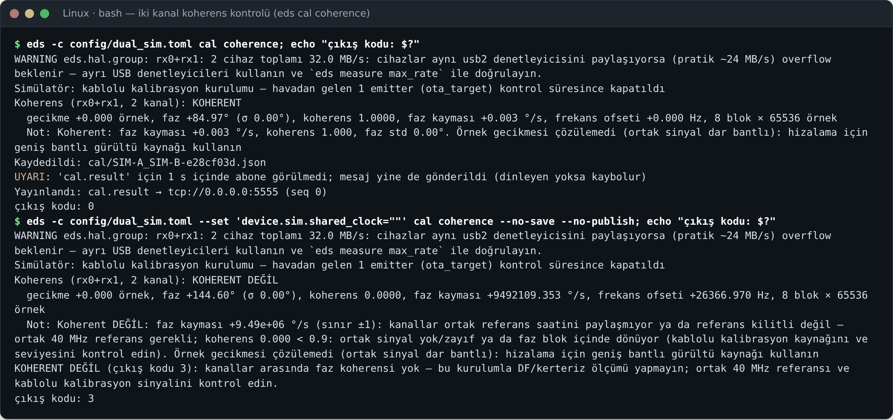

**Nasıl okunur?**

- `KOHERENT`: `faz kayması +0.003 °/s` (sınır ±1 °/s), `koherens 1.0000` (≥ 0.9 olmalı),
  `frekans ofseti +0.000 Hz`. Faz farkı (`+84.97°`) sabit olduğu sürece önemli değildir;
  DF ölçümü onu kablolu faz kalibrasyonuyla çıkarır.
- `KOHERENT DEĞİL`: frekans ofseti 26 kHz, faz saniyede milyonlarca derece dönüyor: iki TCXO
  bağımsız. Mesaj nedeni ve çözümü yazar: **ortak 40 MHz referans** (Pluto Rev C/D CLK_IN,
  [HARDWARE_PLUTO.md](HARDWARE_PLUTO.md)).
- `Örnek gecikmesi çözülemedi (ortak sinyal dar bantlı)`: tek tonla örnek kayması
  ölçülemez; gerekirse geniş bantlı gürültü kaynağı kullanın. Koherens kararını etkilemez.
- `Kaydedildi: cal/SIM-A_SIM-B-....json`: iki cihazlı grubun koherens raporu.
  `Yayınlandı: cal.result ...` ve öncesindeki `abone görülmedi` uyarısı: komut sonucu varsayılan
  olarak bus'a da yayınlar; dinleyen yoksa uyarı zararsızdır. `eds rx` çalışırken port çakışmasın
  diye `--no-publish` ekleyin (§4.6).

**Çıkış kodları:** `0` = koherent, `3` = koherent DEĞİL (rapor yine kaydedilir), `1` =
konfigürasyon/cihaz hatası. Kod 3, DF ölçümünü başlatan betiklerin durması içindir:

```bash
eds -c config/dual_pluto.toml cal coherence && eds -c config/dual_pluto.toml measure df_rms
```

Windows'ta çıkış kodunu görmek için: `cmd`'de `echo %ERRORLEVEL%`, PowerShell'de `$LASTEXITCODE`.

> [!NOTE]
> Simülatör, kontrol süresince havadan gelen vericileri kapatır (çıktıdaki `ota_target`
> satırı); donanımda ise antenleri sökmeniz ve ortak sinyali bölücüyle iki girişe vermeniz istenir.

### 6.3 Mutlak güç kalibrasyonu (`eds cal power`)

**Amaç.** Alıcı seviyeleri doğal olarak **dBFS**'dir (tam ölçeğe göre). KTR'de duyarlılık gibi
değerler **dBm** ister. Güç kalibrasyonu, bilinen güçte bir sinyal vererek her frekans/kazanç
için `dBm = dBFS + ofset` tablosu çıkarır.

> [!WARNING]
> Bu kalibrasyon **mutlak seviyesi bilinen bir üreteç** gerektirir: laboratuvar sinyal üreteci
> (`--source scpi` / `measure.source = "scpi"`), ya da çıkışı güç ölçerle ölçülüp
> `source_args.anchor_dbm` girilmiş Pluto TX. `--p-in`, üretecin **RX girişindeki** gücüdür
> (kablo ve zayıflatıcı kaybı düşülmüş). Seviyesi bilinmeyen bir kaynakla yapılan güç
> kalibrasyonu raporu yanlış dBm değerleriyle doldurur.

Simülatör kaynağı tanım gereği mutlak olduğundan komut simülatörde de çalışır:

```bash
eds -c config/rx_sim.toml cal power --freqs 935e6 1.8e9 --gains 30 50 --p-in -60 --no-save
```

```text
Güç kalibrasyonu: 2 frekans × 2 kazanç, kaynak sim_src…
Frekans [MHz]  Kazanç [dB]  Ofset [dB] (dBm = dBFS + ofset)
-------------  -----------  -------------------------------
      935.000           30                           -24.99
      935.000           50                           -44.99
     1800.000           30                           -24.99
     1800.000           50                           -44.99
```

Simülatörün seviye modeli (dBFS = dBm + G − 5) burada doğrudan görünür: ofset = 5 − G.
`--no-save` kaldırılınca tablo `cal/<seri>.json`'a yazılır ve sonraki spektrumlar dBm olur.

---

## 7. KTR ölçümleri ve rapor

**Amaç.** KTR'de taahhüt edilen 9 nicel spesifikasyonu ölçmek ve her sayıyı **koşullarıyla**
(frekans, RBW, kazanç, kaynak, belirsizlik) birlikte, jüriye verilebilecek bir rapora dökmek.
Yöntemlerin ayrıntısı [MEASUREMENTS.md](MEASUREMENTS.md)'dedir; burada nasıl çalıştırılacağı ve
sonucun nasıl okunacağı anlatılır.

| `spec_id` | Ölçülen | Birim | Not |
|---|---|---|---|
| `sensitivity` | Duyarlılık (MDS), Pd = 0.9 @ Pfa | dBm | kalibrasyonsuz: dBFS |
| `dynamic_range` | Dinamik alan (anlık, SFDR, toplam) | dB | |
| `inst_bw` | Anlık bant genişliği (−3 dB) | MHz | |
| `scan_speed` | Tarama hızı | GHz/s | §5'teki tarayıcı |
| `freq_resolution` | Frekans çözünürlüğü + doğruluk | Hz | ppm kalibrasyonunu kullanır |
| `df_rms` | DF RMS hatası | ° | 2 kanal gerekir |
| `image_rejection` | İmaj bastırma | dB | sinyal kaynağı gerekir |
| `max_rate` | Taşmasız en yüksek örnekleme hızı | MS/s | DSP hattı açık |
| `latency` | Uçtan uca gecikme (RF olayı → ZMQ) | ms | |

### 7.1 Tek, birkaç ya da hepsi

```bash
eds -c config/rx_sim.toml measure image_rejection                  # tek ölçüm
eds -c config/rx_sim.toml measure image_rejection freq_resolution  # birkaç ölçüm (≈ 11 s)
eds -c config/rx_sim.toml measure all --quick                      # hepsi, hızlı mod (≈ 1 dk)
eds -c config/rx_sim.toml measure all                              # hepsi, tam mod (≈ 5 dk)
```

Tam modda 9 ölçümün gerçek çıktısı (simülatör):

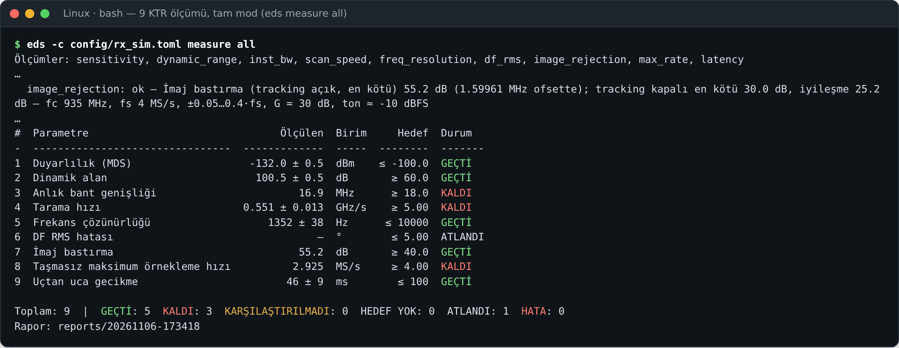

**Nasıl okunur?**

- Her ölçüm için tek satırlık **özet** (`image_rejection: ok — İmaj bastırma ... 55.2 dB ...`):
  değer + koşullar. `ok` ölçümün hatasız bittiğini söyler, hedefi geçtiğini değil.
- Tablo: ölçülen değer ± belirsizlik, birim, hedef ve **Durum** (§7.4).
- `Rapor: reports/<zaman>`: bu oturumun klasörü (§7.3).

**Bu simülatör sonuçları neden böyle?** `inst_bw` 16.9 MHz < 18 (fs = BW = 20 MHz ayarında
ölçülen −3 dB geçirme bandı; analog süzgecin kenarları bandı daraltır), `scan_speed` 0.55 GHz/s < 5 (adım başına retune + settle), `max_rate`
2.925 MS/s < 4 (bu koşuda simülatörün sahne üretimi işlemciye takıldı; aşağıdaki şekil).

> [!NOTE]
> `max_rate` (ve biraz da `latency`) simülatörde **bilgisayarın o anki işlemci yüküne** bağlıdır.
> Bu rehber denetlenirken aynı komut başka bir koşuda `max_rate` = **5.875 MS/s (GEÇTİ)** verdi ve
> özet `GEÇTİ: 6  KALDI: 2  ATLANDI: 1` oldu (süre 4 dk 36 s). Diğer sayılar ondalık düzeyinde
> aynıydı. Bu yüzden simülatördeki `max_rate` bir kapasite kanıtı değildir; gerçek değer Pluto'da,
> boşta bir bilgisayarda ölçülür.
Hedefler `ktr_targets.toml`'daki **örnek** sayılardır; kendi KTR değerlerinizle değiştirin (§7.5).
`df_rms` tek kanallı `rx_sim.toml`'da ATLANDI; `config/dual_sim.toml` ile koşar.

### 7.2 Seçenekler

| Seçenek | Ne yapar | Ne zaman |
|---|---|---|
| `--quick` | Daha az nokta, daha kısa süre. Sonuç hedefle **karşılaştırılmaz** (KARŞILAŞTIRILMADI), raporda "HIZLI MOD" bandı | Kurulumu/prosedürü denemek, CI. KTR için **asla** |
| `--source sim\|pluto_tx\|scpi\|manual\|none` | Uyaran sinyal kaynağı (`measure.source`'u geçersiz kılar) | Bkz. aşağı |
| `--out DİZİN` | Raporun yazılacağı kök klasör | Kampanya klasörü ayırmak |
| `--title "BAŞLIK"` | Rapor başlığı | "KTR ölçümü, Pluto A, 12 Kasım" gibi |
| `--publish` | Her sonucu `meas.result` olarak bus'a da yayınla | Canlı ekranda göstermek |
| `--no-report` | Rapor klasörü yazma | Hızlı kontrol |
| `--yes` | Operatör onaylarını otomatik geç (donanımdaki bağlantı onayları, `manual` kaynakta her adımdaki Enter) | Otomatik betikler |

**Sinyal kaynakları:**

| `--source` | Nedir | Güç |
|---|---|---|
| `sim` | Simülatörün kendi üreteci | mutlak, kesin |
| `pluto_tx` | 2. Pluto'nun TX çıkışı, **≥ 30 dB sabit zayıflatıcı** üzerinden RX'e | bağıl; `anchor_dbm` ile mutlak |
| `scpi` | LAN üzerinden laboratuvar sinyal üreteci (TCP 5025) | mutlak (en doğrusu) |
| `manual` | Operatör üreteci elle ayarlar, her adımda Enter bekler | mutlak/bağıl |
| `none` | Kaynak yok: `image_rejection` atlanır, diğerleri kaynaksız yöntem kullanır | – |

> [!CAUTION]
> Pluto TX'i **asla doğrudan** RX girişine bağlamayın; arada en az 30 dB sabit zayıflatıcı olmalı
> ([KURULUM.md](KURULUM.md), [HARDWARE_PLUTO.md](HARDWARE_PLUTO.md)). EDS yazılımda da girişi
> −5 dBm ile sınırlar ama donanımı koruyan zayıflatıcıdır.

**`--publish` örneği** (Terminal 1'de ölçüm, Terminal 2'de dinleme; gerçek çıktı):

```bash
eds bus echo meas.result --count 2 --timeout 120                                   # Terminal 2
eds -c config/rx_sim.toml measure image_rejection freq_resolution --publish         # Terminal 1
```

```text
Dinleniyor: tcp://127.0.0.1:5555 topic=meas.result
17:35:27.282 meas.result    measure#0 (+3.48 ms) image_rejection = 55.11831677316431 dB [ok] geçti=True
17:35:32.858 meas.result    measure#1 (+2.18 ms) freq_resolution = 1314.722401278762 Hz [ok] geçti=True
```

**Çıkış kodları:** `0` = başarısız ölçüm yok (ATLANDI sayılmaz), `2` = en az bir ölçüm hata
verdi, `1` = konfigürasyon hatası, `130` = Ctrl-C. Ctrl-C ile keserseniz tamamlanan ölçümlerle
"YARIDA KESİLDİ" başlıklı kısmi bir rapor yine yazılır.

### 7.3 Rapor klasörü

Her `eds measure` çalıştırması (`--no-report` yoksa) yeni bir klasör açar:

```text
reports/20261106-173418/
├── report.html        ← tek dosya, tarayıcıda açın; A4 yazdırılabilir (jüri raporu)
├── summary.md         ← özet tablo + her ölçümün ayrıntısı (Markdown: GitHub'da, KTR taslağında)
├── summary.csv        ← tek satır/ölçüm (Excel'de açılır; UTF-8 BOM'lu)
├── results.json       ← makine okunur: meta + results[] (değer, birim, koşullar, durum, tablo...)
├── tables/            ← ölçüm başına ham ölçüm satırları (CSV), ör. sensitivity.csv
└── figures/           ← ölçüm başına grafikler ve spektrum "ekran görüntüleri" (1280×720 PNG)
```

`report.html`'i tarayıcıda açın (Linux: `xdg-open reports/<zaman>/report.html`, Windows:
`start reports\<zaman>\report.html`):

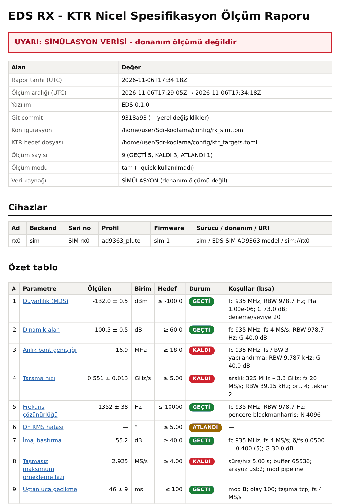

**`report.html` bölümleri, yukarıdan aşağı:**

1. **Uyarı bantları:** `SİMÜLASYON VERİSİ`, `HIZLI MOD - KTR'de kullanılmaz`, `SPESİFİKASYON
   DIŞI MOD`. Jüriye gidecek raporda bunların **hiçbiri** olmamalı.
2. **Rapor bilgileri:** tarih, yazılım sürümü, **git commit** (`+ yerel değişiklikler` yazıyorsa
   kod commit'lenmemiş demektir; kampanyadan önce commit'leyin), konfigürasyon ve hedef dosyası.
3. **Cihazlar:** seri no, profil, firmware.
4. **Özet tablo:** her ölçüm bir satır; parametre adına tıklayınca ayrıntısına gider.
5. **Ölçüm bölümleri:** Sonuç, (varsa) karşılaştırılmama nedeni, hedef notu, özet, **yöntem**
   metni (KTR'ye neredeyse aynen girebilir), **koşullar** tablosu, ek değerler, belirsizlik,
   ham tablo ve şekiller.

Rapordaki iki gerçek şekil:

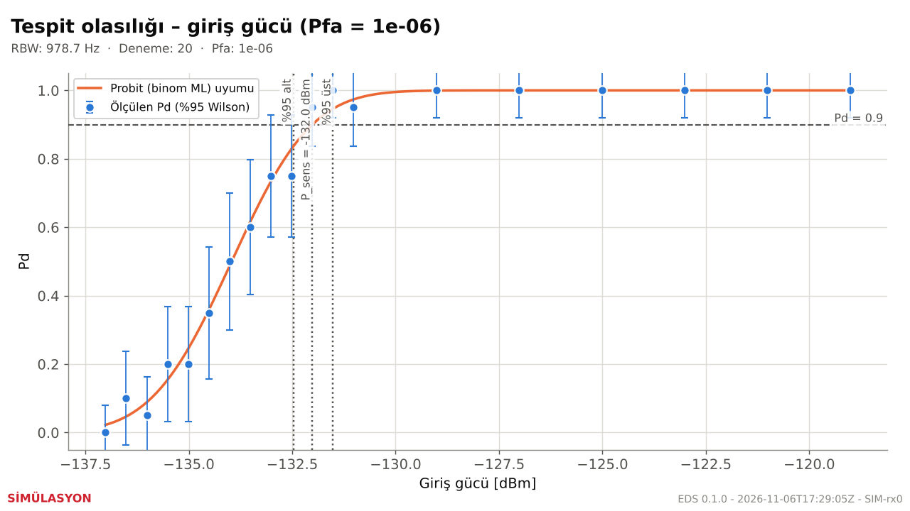

**Duyarlılık (Pd eğrisi):** her giriş seviyesinde ton 20 kez verilip CFAR'ın kaç kez bulduğu
sayılır (mavi noktalar, %95 hata çubuklarıyla); turuncu eğri bu noktalara uydurulan modeldir.
Duyarlılık, eğrinin **Pd = 0.9** çizgisini kestiği giriş gücüdür (`P_sens = −132.0 dBm`); dikey
noktalı çizgiler %95 güven aralığıdır. KTR'ye yazarken koşulları da yazın: RBW 978.7 Hz,
Pfa 1e-6, deneme sayısı 20 (şeklin üst satırı).

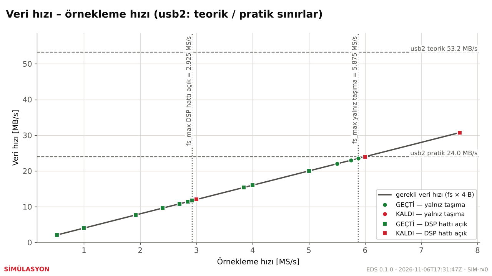

**Taşmasız maksimum hız:** her nokta bir örnekleme hızında yapılan sürekli akış denemesidir
(yeşil = kayıpsız, kırmızı = overflow ya da örnek kaybı). Kesikli yatay çizgiler USB 2.0'ın
teorik (53.2 MB/s) ve pratik (24 MB/s) sınırlarıdır. **Yalnız taşıma** (kareler değil, daireler)
5.875 MS/s'e kadar kayıpsız: USB modelinin sınırı. **DSP hattı açıkken** (RX düğümü gerçekten
spektrum ve CFAR hesaplarken, kareler) 2.925 MS/s'te kalıyor: bu bilgisayarda simülatör sahneyi
daha hızlı üretemiyor. KTR'ye yazılan değer DSP hattı açık olandır, çünkü sistemin gerçek
kapasitesi odur. Pluto'da bu ölçümü mutlaka donanımda tekrarlayın.

**`results.json`'ı kendi programınızla okumak:**

```python
import json

r = json.load(open("reports/20261106-173418/results.json", encoding="utf-8"))
for x in r["results"]:
    print(f"{x['spec_id']:16} {x['value']!s:>22} {x['unit']:6} {x['verdict']}")
```

```text
sensitivity          -132.0147477975116 dBm    GEÇTİ
dynamic_range        100.47484531821247 dB     GEÇTİ
inst_bw                16.8735190514488 MHz    KALDI
scan_speed           0.5512242460474186 GHz/s  KALDI
freq_resolution      1352.3760970411593 Hz     GEÇTİ
df_rms                             None °      ATLANDI
image_rejection      55.161194407890534 dB     GEÇTİ
max_rate                          2.925 MS/s   KALDI
latency                      45.9721418 ms     GEÇTİ
```

### 7.4 Durum sözcükleri ve ne yapmalı

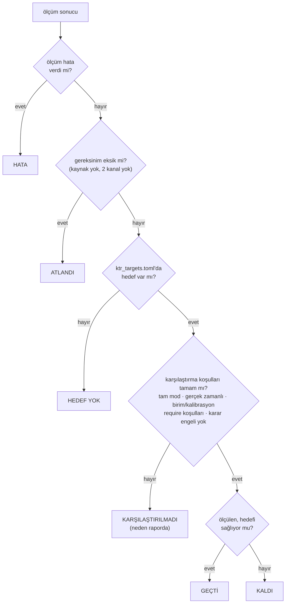

| Durum | Anlamı | Ne yapmalı |
|---|---|---|
| **GEÇTİ** | Ölçüldü, koşullar uygun, hedef sağlandı | KTR'ye değeri **koşulları ve belirsizliğiyle** yazın |
| **KALDI** | Ölçüldü, koşullar uygun, hedef sağlanmadı | Önce koşulları kontrol edin (yanlış kazanç, fs, nfft?). Ayar doğruysa ya sistemi iyileştirin ya da KTR hedefinin donanımla gerçekçi olup olmadığını takımla tartışın. Gizlemeyin: koşullu dürüst bir sayı, koşulsuz iddiadan iyidir |
| **KARŞILAŞTIRILMADI** | Sayı var ama hedefe karar verilmedi: `--quick`, gerçek zamanlı olmayan simülatör, ölçümün kendi karar engeli (`blockers`), birim/kalibrasyon uyuşmazlığı (ör. dBFS değer, dBm hedef), `require` koşulu sağlanmadı | Rapordaki **"Karşılaştırılmama nedeni"** satırını okuyun, nedeni giderin (tam mod, güç kalibrasyonu, doğru koşullar), o ölçümü tekrarlayın |
| **HEDEF YOK** | `ktr_targets.toml`'da bu ölçüm için hedef yok **ya da hedef dosyası hatalı olduğu için yüklenemedi** | Dosyaya hedef ekleyin; ölçüm çıktısında `KTR hedefleri yüklenemedi` uyarısı var mı bakın (§7.5) |
| **ATLANDI** | Gereksinim karşılanmadı (sinyal kaynağı yok, 2 kanal yok) | Gereksinimi sağlayın (`--source`, `dual_*.toml`) ya da bilinçli olarak bırakın |
| **HATA** | Ölçüm çalışırken hata oluştu | Rapordaki hata metnini/traceback'i okuyun, `eds -v measure <id>` ile o ölçümü tek başına tekrarlayın |

### 7.5 `config/ktr_targets.toml`: hedefleri düzenlemek

Dosyadaki sayılar **örnektir**; takımın KTR'sinde taahhüt edilen değerlerle değiştirin. Her
ölçüm bir tablodur:

```toml
[sensitivity]                     # birim: dBm  (daha negatif = daha iyi)
target = -100.0                   # ölçümün biriminde
op = "<="                         # geçme koşulu: ölçülen <= hedef
note = "ÖRNEK — KTR değeriyle değiştirin. Pd = 0.9 @ CFAR Pfa = 1e-6, belirtilen RBW'de giriş gücü."

# [sensitivity.require]           # İSTEĞE BAĞLI: hedefin taahhüt edildiği koşullar
# rbw_hz_max = 1000.0             # RBW 1 kHz'ten büyükse karar verilmez (KARŞILAŞTIRILMADI)
# pfa_max = 1e-6
```

- `op`: yalnız `"<="` ya da `">="`. Birimler: `sensitivity` dBm, `dynamic_range` dB, `inst_bw`
  MHz, `scan_speed` GHz/s, `freq_resolution` Hz, `df_rms` °, `image_rejection` dB, `max_rate`
  MS/s, `latency` ms.
- `note` rapora aynen düşer: KTR madde numarasını ve koşulu buraya yazın.
- `[<ölçüm>.require]`: hedef belirli koşullarda verildiyse (ör. "1 kHz RBW'de"), bu koşulu
  sağlamayan sonuç otomatik olarak **KARŞILAŞTIRILMADI** olur. Anahtar adları rapordaki
  "Koşullar" ve "Ek" tablolarındaki adlardır; `_min`, `_max`, `_count_min` son ekleri ya da
  eşitlik.

> [!WARNING]
> Hedef dosyasında hata varsa (yanlış `op`, yanlış ölçüm adı) ölçüm **yine çalışır** ama hiçbir
> hedef yüklenmez: tüm satırlar **HEDEF YOK** olur ve çıktının başında `KTR hedefleri
> yüklenemedi (...)` uyarısı bütün hataları listeler. Gerçek bir örnek (bilerek bozulmuş kopya
> dosyayla):
>
> ```text
> WARNING eds.measure.session: KTR hedefleri yüklenemedi (KTR hedef dosyası geçersiz (hedef_hatali.toml):
>   - [dynamic_range]: 'op' = '=>' geçersiz; seçenekler: ['<=', '>=']
>   - [inst_bww]: bilinmeyen ölçüm kimliği; geçerli: ['sensitivity', 'dynamic_range', 'inst_bw', ...]
>   ...); 'Hedef' sütunu boş kalacak
> ```
>
> Dosyayı düzenledikten sonra kısa bir kontrol yapın:
> `eds -c config/rx_sim.toml measure inst_bw --quick --no-report` (uyarı yoksa ve Hedef sütunu
> doluysa dosya geçerlidir).

### 7.6 Sık hatalar

| Belirti | Neden | Çözüm |
|---|---|---|
| Her şey KARŞILAŞTIRILMADI | `--quick` kullanıldı | Tam modda tekrarlayın |
| `sensitivity` dBFS çıkıyor, KARŞILAŞTIRILMADI | güç kalibrasyonu yok, hedef dBm | §6.3 güç kalibrasyonu ya da mutlak kaynak |
| `image_rejection` ATLANDI | `--source none` | sinyal kaynağı verin |
| `df_rms` ATLANDI | tek kanallı konfigürasyon | `config/dual_sim.toml` / `dual_pluto.toml` |
| `max_rate` beklenenden düşük | USB hub, uzun kablo, yüklü bilgisayar | Pluto'yu doğrudan anakart portuna takın, diğer programları kapatın |
| Ölçüm uzun sürüyor | tam mod tüm noktaları ölçer | deneme için tek ölçüm + `--quick`; kampanyada tam mod |

---

## 8. Kendi programından bus'ı dinlemek

**Amaç.** GUI, DF ya da kayıt yazan takım arkadaşları EDS'nin içini bilmek zorunda değildir:
RX düğümünün yayınına abone olurlar ve komut gönderirler. `examples/` klasöründe bunun üç
çalışan örneği var; `tests/examples/test_examples.py` onları her test koşusunda simülatördeki
gerçek bir RX düğümüne karşı çalıştırır, yani API değişse bile örnekler bozuk kalmaz.

| Dosya | Ne yapar | Bağımlılık |
|---|---|---|
| `examples/bus_dinleyici.py` | `rx.detections` + `rx.status` dinler, tespit başına bir satır yazar | `eds` paketi |
| `examples/komut_gonder.py` | `ctl.rx set_center_freq` gönderir, `ctl.ack` bekler; GUI için `Commander` sınıfı | `eds` paketi |
| `examples/saf_zmq_dinleyici.py` | Aynı dinlemeyi **eds olmadan**, yalnız `pyzmq` + `json` ile yapar | `pyzmq` |

### 8.1 Çalıştırmak

Terminal 1'de düğüm komut dinleyecek şekilde çalışıyorken (§4.1):

```bash
python examples/bus_dinleyici.py --count 6                  # 6 tespit satırı yaz ve çık
python examples/komut_gonder.py 446.00625e6                 # PMR446 kanal 1'e git
python examples/bus_dinleyici.py --count 4 --min-snr 20     # yeni frekansta, SNR ≥ 20 dB
python examples/komut_gonder.py 6e9                         # profil dışı: reddedilir, çıkış kodu 2
python examples/saf_zmq_dinleyici.py tcp://127.0.0.1:5555 3 # eds'siz dinleyici, 3 mesaj
```

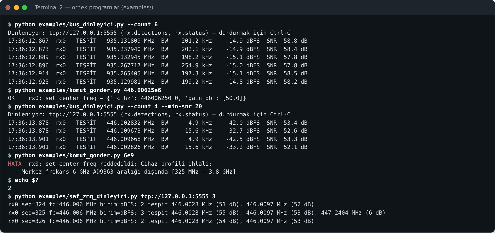

- `bus_dinleyici.py` seçenekleri: `--endpoint` (vars. `tcp://127.0.0.1:5555`), `-c config`
  (adresi dosyadan alır, proxy modunu da anlar), `--duration`, `--count`, `--min-snr`
  (vars. 10 dB), `--no-status`.
- `komut_gonder.py` seçenekleri: `--ctl-endpoint` (vars. `tcp://127.0.0.1:5556`),
  `--ack-endpoint` (vars. `tcp://127.0.0.1:5555`), `--target`, `--timeout`, `-c config`.
  Çıkış kodu: 0 = uygulandı, 2 = reddedildi, 1 = düğüm yok / yanıt gelmedi.
- 447.2404 MHz'teki 6 dB'lik tespit yine simülatörün fc + 1.234 MHz spur'üdür (§4.2).

### 8.2 GUI / DF programına yerleştirmek

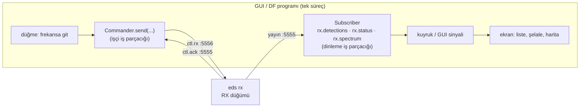

Dinlemek için en küçük kod (`bus_dinleyici.py`'nin özü):

```python
from eds.bus import RX_DETECTIONS, RX_STATUS, Subscriber

with Subscriber("tcp://127.0.0.1:5555", [RX_DETECTIONS, RX_STATUS]) as sub:
    while True:
        msg = sub.recv(0.5)                     # 0.5 s içinde mesaj yoksa None
        if msg is None:
            continue
        if msg.topic == RX_DETECTIONS:
            for d in msg.data["detections"]:
                print(msg.src, d["f_peak_hz"], d["snr_db"])
        else:                                   # rx.status
            print(msg.data["state"], msg.data["fc_hz"])
```

Komut göndermek için `Commander` (programın ömrü boyunca **bir kez** açın):

```python
import sys
sys.path.insert(0, "examples")                  # ya da komut_gonder.py'yi kendi projenize kopyalayın
from komut_gonder import Commander, NoListener

kanal = Commander("tcp://127.0.0.1:5556", "tcp://127.0.0.1:5555")
try:
    acks = kanal.send("set_center_freq", {"hz": 433.92e6}, target="rx0", timeout_s=3)
    if acks and acks[0]["ok"]:
        print("yeni ayar:", acks[0]["result"])  # {'fc_hz': 433920000.0, 'gain_db': [50.0]}
    elif acks:
        print("reddedildi:", acks[0]["error"])
    else:
        print("yanıt gelmedi")
except NoListener:
    print("RX düğümü komut dinlemiyor (ctl_endpoints?)")
kanal.close()
```

**Dikkat edilecekler:**

- **Kanalı her komutta yeniden açmayın.** Direct modda komut adresini sizin programınız açar
  (bind); kapatıp aynı portu hemen tekrar açmak "Address already in use" verebilir ve düğümün
  yeniden bağlanması zaman alır. `Commander`'ı bir kez oluşturun, kapanışta `close()` çağırın.
- **ZeroMQ soketleri iş parçacıkları arasında paylaşılmaz.** `Subscriber` için bir dinleme
  iş parçacığı açın, mesajları bir kuyrukla (Qt'de sinyal/slot) arayüze aktarın. `Commander.send`
  yanıtı beklerken bloklar (en fazla `timeout_s`); GUI donmasın diye bir işçi iş parçacığından
  çağırın.
- `rx.detections` saniyede ~100 mesajdır (her kare). Ekranda her tespiti ayrı satır göstermek
  yerine yakın frekanstakileri gruplayıp "son görülme zamanı" tutun.
- Mesajları kaçırıp kaçırmadığınızı `sub.stats.seq_gaps` söyler; artıyorsa dinleyici yavaştır.

### 8.3 Python dışı diller için çerçeve biçimi (saf pyzmq örneği)

`examples/saf_zmq_dinleyici.py` eds paketini **içe aktarmaz**; C++, C#, MATLAB, JavaScript ile
yazanlar aynı adımları kendi ZeroMQ kütüphanesiyle uygular:

```python
import json
import zmq

ctx = zmq.Context()
sock = ctx.socket(zmq.SUB)
sock.connect("tcp://127.0.0.1:5555")                 # RX düğümünün yayın adresi
sock.setsockopt(zmq.SUBSCRIBE, b"rx.detections")     # ÖNEK filtresi
while True:
    topic, payload = sock.recv_multipart()           # her mesaj 2 parça: [topic, JSON]
    if topic != b"rx.detections":                    # önek eşleşmesi: tam eşitliği siz kontrol edin
        continue
    env = json.loads(payload)                        # {"topic","v","src","seq","t_ns","data"}
    for d in env["data"]["detections"]:
        print(env["src"], env["seq"], d["f_peak_hz"], d["snr_db"])
```

**Kurallar:**

1. Her mesaj **iki parçalı** (multipart) gelir: `[topic (UTF-8), zarf (UTF-8 JSON)]`.
2. ZeroMQ **önekle** süzer: `"rx.s"` aboneliği hem `rx.status` hem `rx.spectrum` getirir;
   topic'i ayrıca tam eşitlikle kontrol edin.
3. Zarf: `topic`, `v` (= 1), `src` (düğüm adı), `seq` (kaynak + topic başına 0'dan artar),
   `t_ns` (gönderim anı, ns), `data` (topic'in şeması: `contracts/schemas/<topic>.schema.json`).
4. JSON'da NaN/Infinity yoktur; bilinmeyen değerler `null` gelir.
5. **Komut göndermek** (`ctl.rx`) için aynı biçimde bir zarf yayınlayın: `topic = "ctl.rx"`,
   `data = {"req_id": "<benzersiz>", "target": "*", "cmd": "set_center_freq", "args": {"hz": 433.92e6}}`.
   Direct modda PUB soketiyle düğümün `ctl_endpoints` adresini **bind** edin ve göndermeden önce
   düğümün bağlanmasını bekleyin (ZeroMQ'da bağlantı kurulmadan gönderilen mesaj kaybolur:
   "slow joiner"). Yanıt, `ctl.ack` topic'inde aynı `req_id` ile gelir.

---

## 9. Senaryolar (kontrol listeleri)

### 9.a Donanımsız demo (≈ 10 dakika)

Takıma ya da danışmana sistemi göstermek için; yalnız bir dizüstü yeterli.

- [ ] Terminal aç → `cd ~/Sdr-kodlama` → `conda activate eds`
- [ ] `eds -c config/rx_sim.toml info`: "Tamam: RX ayarları profil sınırları içinde."
- [ ] `eds -c config/rx_sim.toml sweep --png tarama.png`: 7–11 tespit; `tarama.png`'i açıp vericileri
      sahne tablosuyla (§2.1) eşleştirin, imajı ve radarın neden bazen kaçtığını anlatın (§5.1)
- [ ] İsteğe bağlı: §5.4'teki `guclu_verici.toml` ile sabit ve otomatik kazançlı taramayı
      karşılaştırın (`SIKIŞMA` uyarısı)
- [ ] Terminal 1: `eds rx -c config/rx_sim.toml --set "bus.ctl_endpoints=['tcp://127.0.0.1:5556']"`
- [ ] Terminal 2: `python examples/bus_dinleyici.py --count 10`: canlı tespitler
- [ ] Terminal 2: `python examples/komut_gonder.py 433.92e6`, ardından tekrar dinleyin: İHA bağı
- [ ] Terminal 1'de Ctrl-C
- [ ] `eds -c config/rx_sim.toml measure all --quick` (≈ 1 dk), `report.html`'i açın; bantları
      ("SİMÜLASYON", "HIZLI MOD") ve neden KARŞILAŞTIRILMADI olduğunu anlatın

### 9.b İlk Pluto oturumu

Kurulum rehberindeki sırayı izleyin: [KURULUM.md, "Pluto'yu bağlamak ve ilk donanım testi"](KURULUM.md#6-plutoyu-bağlamak-ve-ilk-donanım-testi).
Bu rehberin hangi bölümünün nerede devreye girdiği:

- [ ] TX çıkışları ile RX girişleri arasında **≥ 30 dB zayıflatıcı** (ya da TX hiç bağlı değil)
- [ ] `SoapySDRUtil --find="driver=plutosdr"` (uri) ve `python -c "import iio; print(iio.scan_contexts())"`
      (uri ↔ seri numarası; conda ortamında `iio_info` yoktur)
- [ ] `config/rx_pluto.toml`'da `uri` ya da `serial` kendi Pluto'nuzla değiştirildi (§2.2)
- [ ] `eds devices --backend soapy --probe`: seri no, sıcaklık, `overflow_source` (§3.2)
- [ ] `eds info -c config/rx_pluto.toml`: hata yok (§2.4)
- [ ] 20–30 dk ısınma, sonra GSM kanalını bul ve `eds cal ppm -c config/rx_pluto.toml --gsm-arfcn N` (§6.1)
- [ ] `eds measure max_rate -c config/rx_pluto.toml`: `rx.sample_rate_hz`'i bulunan değerin altında seçin
- [ ] `eds rx -c config/rx_pluto.toml` + ikinci terminalde `eds bus echo rx.status`: `ovf` artmıyor,
      `ppm ... (hardware)` (§4)

### 9.c KTR ölçüm kampanyası

KTR'ye ve jüriye gidecek sayıların üretildiği oturum. Amaç, **tekrarlanabilir ve koşulları
belgelenmiş** bir rapor klasörü.

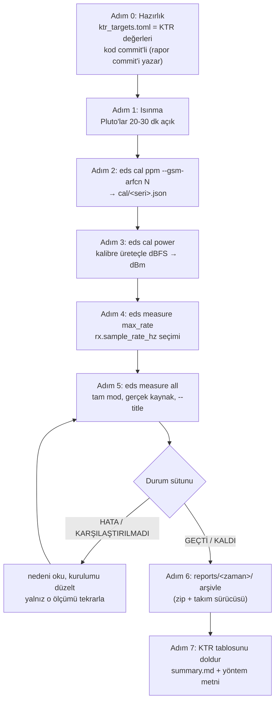

- [ ] **Hazırlık:** `config/ktr_targets.toml` KTR'deki hedeflerle dolduruldu, `note` alanlarına KTR
      madde numaraları yazıldı, hızlı kontrolle dosyanın yüklendiği doğrulandı (§7.5)
- [ ] Kod ve konfigürasyon **commit'lendi** (raporda `+ yerel değişiklikler` görünmemeli)
- [ ] Tezgâh: zayıflatıcılar takılı, kablolar etiketli, kaynak (`pluto_tx` + `anchor_dbm` ya da
      `scpi`) hazır; bağlantı fotoğrafı çekildi
- [ ] **Isınma** 20–30 dk; `eds devices --backend soapy --probe` ile sıcaklık not edildi
- [ ] **ppm:** `eds cal ppm -c config/rx_pluto.toml --gsm-arfcn N` (SNR ≥ 20 dB, belirsizlik küçük)
- [ ] **Güç:** `eds cal power -c config/rx_pluto.toml --freqs ... --gains ... --p-in ...` (mutlak üreteç, §6.3)
- [ ] **Hız:** `eds measure max_rate -c config/rx_pluto.toml`; gerekiyorsa `sample_rate_hz` güncellendi
- [ ] **Ölçüm:** `eds measure all -c config/rx_pluto.toml --title "KTR ölçümü — <tarih>"` (`--quick` YOK)
- [ ] Raporda uyarı bandı yok (SİMÜLASYON / HIZLI MOD / SPESİFİKASYON DIŞI)
- [ ] KARŞILAŞTIRILMADI / HATA satırlarının nedenleri giderildi, o ölçümler tek tek tekrarlandı
- [ ] **Arşiv:** `reports/<zaman>/` klasörü ve o anki `cal/<seri>.json` dosyaları zip'lenip takım
      sürücüsüne kondu (klasör adı = tarih; içinde `report.html`, `results.json`, `figures/`)
- [ ] **KTR tablosu:** değer + birim + belirsizlik + **koşullar** (`summary.md`'deki "Koşullar
      (kısa)" sütunu) + yöntem cümlesi (raporun "Yöntem" metninden); şekiller `figures/`'dan

### 9.d İki Pluto ile DF

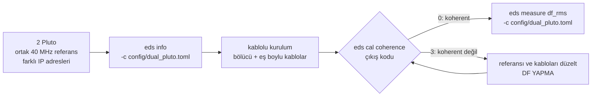

- [ ] Önce simülatörde prosedürü deneyin: `eds -c config/dual_sim.toml cal coherence` (§6.2) ve
      `eds -c config/dual_sim.toml measure df_rms --quick` (bu ortamda 2 s sürdü, `0.35 ± 0.08°`,
      KARŞILAŞTIRILMADI: hızlı mod ve simülatör yalnız termal gürültüyü modeller, sonuç gerçek
      dizinin hatasının alt sınırıdır)
- [ ] İki Pluto'nun IP adresleri farklı (birinin `config.txt`'si değiştirildi), ortak 40 MHz referans
      bağlı ([HARDWARE_PLUTO.md](HARDWARE_PLUTO.md))
- [ ] `config/dual_pluto.toml`'da iki cihazın `uri`/`serial` değerleri doğru; her Pluto otomatik
      olarak kendi alt sürecinde açılır (`isolation = "auto"`), bir şey yapmanız gerekmez
- [ ] Antenler sökülü, ortak sinyal bölücüyle iki girişe: `eds -c config/dual_pluto.toml cal coherence`
      → çıkış kodu **0** olmadan devam etmeyin
- [ ] `eds -c config/dual_pluto.toml measure df_rms` (tam mod)
- [ ] Referans kablosu ya da sıcaklık değişirse koherens kontrolünü tekrarlayın

---

## 10. Sık sorulanlar ve sorun giderme

Aşağıdaki görüntü, kullanım sırasında en sık karşılaşılan hata mesajlarını gerçek hâliyle
gösterir (sırasıyla: yanlış klasör, komut adresi yok, yanlış topic adı, dinleyecek düğüm yok,
port zaten kullanımda):

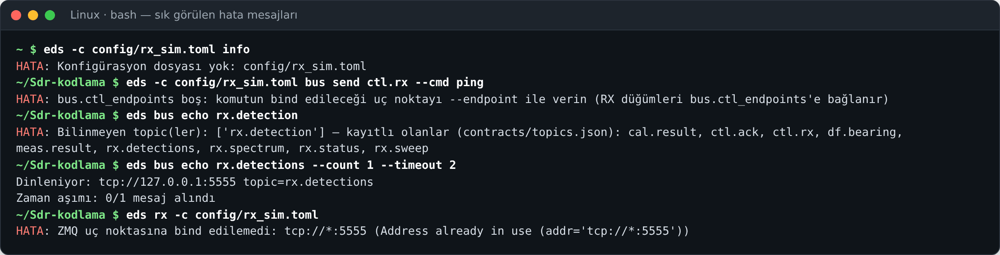

**S: Hiçbir komut çalışmıyor, `HATA: Konfigürasyon dosyası yok`.**
Depo klasöründe değilsiniz (görüntüdeki istem `~ $`). `cd ~/Sdr-kodlama`.

**S: `Address already in use` hatası alıyorum.**
Direct modda 5555'i aynı anda yalnız bir program açabilir. Başka bir `eds rx` hâlâ çalışıyor
olabilir (başka bir terminalde ya da arka planda) ya da `eds rx` çalışırken yayın yapan bir komut
başlattınız (`--publish`, `eds cal coherence`). Gerçek örnek: `eds rx` çalışırken
`eds cal ppm --publish` kalibrasyonu yapar ama yayın aşamasında bu hatayla 1 koduyla çıkar.
Çözüm: diğerini kapatın (Ctrl-C), proxy modunu kullanın (§4.6), `cal coherence`'a `--no-publish`
ekleyin ya da ikinci yayıncıya farklı port verin: `--set bus.pub_endpoint=tcp://*:5565`.
`--publish` olmadan `eds measure` kendi özel portlarını kullanır ve çakışmaz; yine de işlemciyi
paylaştıkları için `max_rate` ve `latency` ölçerken başka EDS süreci çalıştırmayın.

**S: `eds bus echo` boş kalıyor.**
Düğüm çalışıyor mu (Terminal 1)? Aynı mod mu (biri `proxy`, diğeri `direct` olmamalı)? Başka
bilgisayardan dinliyorsanız `--endpoint tcp://<IP>:5555` ve güvenlik duvarı.

**S: Frekans değiştirme komutu "dinleyen RX düğümü bulunamadı" diyor.**
Düğüm `ctl_endpoints` olmadan başlatılmış (`eds info` → `kontrol kapalı`). §4.1'deki gibi
yeniden başlatın ya da proxy modunu kullanın (§4.6).

**S: Tespitler beklediğim frekansta değil, birkaç kHz kayık.**
ppm kalibrasyonu yok ya da eski (`rx.status`'ta `ppm — (none)` veya sıcaklık uyarısı). §6.1.

**S: Ortada olmayan sinyaller görüyorum.**
Üç olağan kaynak: (1) güçlü bir sinyalin **IQ imajı** (merkezin diğer yanında, ~55 dB zayıf;
taramada adım planı değişince yer değiştirir), (2) **dahili spur** (fc ile birlikte kayar),
(3) **kırpma/sıkışma** ürünleri (çok güçlü sinyal varken onlarca yeni çizgi: sabit kazançlı
taramada uyarı **çıkmaz**; `--set sweep.gain_mode=auto` ile tarayın, `SIKIŞMA` notu çıkarsa harici
zayıflatıcı takın, §5.4).

**S: Darbeli radar / kısa paket görünmüyor.**
Taramada her frekansa çok kısa bakılır (§5.1). O frekansta `eds rx` çalıştırın; düğüm bandı
kesintisiz analiz eder.

**S: `ovf` sayacı artıyor.**
USB ya da işlemci yetişemiyor: örnekleme hızını düşürün, USB hub kullanmayın, `eds measure max_rate`
ile güvenli hızı ölçün. Tek seferlik 1 overflow (açılışta) normal olabilir; önemli olan artmasıdır.

**S: Ölçüm sonuçlarım hep KARŞILAŞTIRILMADI.**
`--quick` kullanıyorsunuz ya da birim/kalibrasyon uyuşmuyor (dBFS değer, dBm hedef). Rapordaki
"Karşılaştırılmama nedeni" satırı tam nedeni yazar (§7.4).

**S: Her şey HEDEF YOK.**
`ktr_targets.toml` yüklenemedi. Ölçüm çıktısının başındaki `KTR hedefleri yüklenemedi` uyarısını
okuyun (§7.5).

**S: Ölçüm yarıda kaldı (Ctrl-C ya da elektrik).**
Ctrl-C'de tamamlananlarla kısmi rapor yazılır ("YARIDA KESİLDİ"). Yalnız eksik ölçümleri tekrar
çalıştırın: `eds measure latency max_rate ...`. Birden çok rapor klasörü olur; KTR için tek bir
tam oturum tercih edin.

**S: Windows'ta `--set` değerim yanlış okunuyor.**
Dış tırnak çift, iç tırnak tek: `--set "bus.ctl_endpoints=['tcp://127.0.0.1:5556']"`. Türkçe
harfler `?` görünüyorsa [KURULUM.md](KURULUM.md)'deki UTF-8 adımı (`setx PYTHONUTF8 1`).

**S: Bir hatanın ayrıntısını nasıl görürüm?**
Komuta `-v` ekleyin (ayrıntılı günlük + hata olursa traceback); daha da ayrıntı için `-vv`
(hata ayıklama günlüğü): `eds -v rx -c ...`.
Takıma sorarken komutu, tam çıktıyı ve `eds --version`'ı birlikte gönderin.

---

## Ek: Komut kopya kâğıdı

| İş | Komut |
|---|---|
| Ortamı aç | `cd ~/Sdr-kodlama && conda activate eds` |
| Yardım | `eds --help`, `eds <komut> --help` |
| Profiller | `eds profiles` |
| Konfigürasyonu doğrula | `eds -c config/rx_sim.toml info` |
| Ayar değiştirerek doğrula | `eds -c config/rx_sim.toml --set rx.center_freq_hz=2.4e9 info` |
| Pluto dosyasını simülatörde dene | `eds -c config/rx_pluto.toml --backend sim info` |
| Cihazları listele | `eds devices --backend soapy --probe` |
| RX düğümü | `eds rx -c config/rx_sim.toml` |
| RX düğümü (komut dinleyen) | `eds rx -c config/rx_sim.toml --set "bus.ctl_endpoints=['tcp://127.0.0.1:5556']"` |
| Dinle | `eds bus echo rx.detections rx.status` |
| Ham JSON | `eds bus echo rx.detections --count 1 --raw` |
| Frekans değiştir | `eds bus send ctl.rx --endpoint tcp://127.0.0.1:5556 --cmd set_center_freq --arg hz=433.92e6 --wait-ack 2` |
| Kazanç değiştir | `eds bus send ctl.rx --endpoint tcp://127.0.0.1:5556 --cmd set_gain --arg db=30 --wait-ack 2` |
| Proxy | `eds bus proxy` + her komutta `--set bus.mode=proxy` |
| Tam bant tarama | `eds -c config/rx_sim.toml sweep --png tarama.png --out tarama.npz` |
| Dar tarama | `eds -c config/rx_sim.toml sweep --start 400e6 --stop 1000e6` |
| Otomatik kazançlı tarama (sıkışma denetimi) | `eds -c config/rx_sim.toml --set sweep.gain_mode=auto sweep` |
| ppm kalibrasyonu | `eds -c config/rx_sim.toml cal ppm --gsm-arfcn 1` |
| Koherens | `eds -c config/dual_sim.toml cal coherence` (0 = koherent, 3 = değil) |
| Güç kalibrasyonu | `eds -c config/rx_pluto.toml cal power --freqs 935e6 --gains 30 50 --p-in -60` |
| Tek ölçüm | `eds -c config/rx_sim.toml measure image_rejection` |
| Hepsi, hızlı | `eds -c config/rx_sim.toml measure all --quick` |
| Hepsi, tam | `eds -c config/rx_sim.toml measure all --title "..."` |
| Sonuçları bus'a | `eds measure ... --publish` + `eds bus echo meas.result` |
| Örnek dinleyici | `python examples/bus_dinleyici.py` |
| Örnek komut | `python examples/komut_gonder.py 433.92e6` |
| Ayrıntılı hata (traceback) | `eds -v <komut> ...` (`-vv`: hata ayıklama günlüğü) |

İlgili belgeler: [KURULUM.md](KURULUM.md) (kurulum, Pluto bağlantısı),
[HARDWARE_PLUTO.md](HARDWARE_PLUTO.md) (tezgâh, iki Pluto, referans),
[MEASUREMENTS.md](MEASUREMENTS.md) (ölçüm yöntemleri ve KTR'de nasıl yazılacağı),
[ARCHITECTURE.md](ARCHITECTURE.md) (kod yapısı, konvansiyonlar).
