# Kurulum Rehberi — Linux ve Windows

Bu rehber EDS'yi (Elektronik Destek RX omurgası) **sıfırdan çalışır hâle** getirir:
önce donanım olmadan **simülatörde**, sonra **ADALM-Pluto** ile. Her adımda ne yaptığını,
neden yaptığını ve başarılı olduğunda ne göreceğini anlatır.

> **En kısa yol (Ubuntu):** `./setup.sh --sim` (yalnız pip; operatör GUI'si dahil, SDR sürücüsü yok)
> ya da `./setup.sh --hardware` (+ Pluto sürücüleri) → `source .venv/bin/activate` → `python run.py`.
> Hangi paketin neden kurulduğu: [`DEPENDENCIES.md`](../DEPENDENCIES.md).
>
> **Kısa yol (her iki işletim sistemi, conda):** Miniforge kur → `conda env create -f environment.yml`
> → `conda activate eds` → `pip install -e ".[gui,dev]"` → `python run.py` (simülasyon + GUI).
> Ayrıntılar ve işletim sistemine özgü adımlar aşağıda.

> 📗 **Kurulum bitti mi?** → Programın nasıl kullanılacağı (RX düğümü, tarama, ölçüm, rapor,
> ZeroMQ) için: **[Kullanım Rehberi: KULLANIM.md](KULLANIM.md)**.

### Bu rehber nasıl okunur?

Her kurulum adımı aynı dört parçalı blokla yazıldı. Sırayla gidin; bir adımın "Beklenen sonuç"
kısmını görmeden bir sonrakine geçmeyin. Hata bir adımda yakalanırsa çözmesi kolaydır, üç adım
sonra yakalanırsa nedenini bulmak zorlaşır.

| Parça | İçeriği |
|---|---|
| 🎯 **Ne yapıyoruz ve neden** | Adımın amacı ve atlanırsa ne bozulacağı |
| ⌨️ **Komut** | Kopyala-yapıştır yapılabilir komut(lar). `#` ile başlayan kısım açıklamadır, yazmanız gerekmez |
| ✅ **Beklenen sonuç** | Linux'ta bu rehber hazırlanırken **gerçekten çalıştırılıp yakalanmış** çıktı ya da ekran görüntüsü. Windows ve Pluto donanımı için çıktılar **beklenen** çıktılardır (bu ortamda Windows bilgisayar ve gerçek Pluto yoktu) ve öyle etiketlendi |
| 🛠️ **Olmazsa** | O adımda en sık yaşanan 2-3 hata ve çözümü. Daha fazlası: [Bölüm 8](#8-sorun-giderme) |

Ekran görüntülerindeki `~` işareti ev klasörünüzdür (Linux'ta `/home/<kullanıcı-adınız>`).
İstemdeki `(base)` / `(eds)` öneki o an hangi conda ortamının etkin olduğunu gösterir
(bkz. [Bölüm 1.1](#11-conda-ortam-environment-ve-miniforge-nedir)).

**İçindekiler**

0. [Başlamadan önce: kontrol listesi](#0-başlamadan-önce-kontrol-listesi)
1. [Büyük resim: neyi kuruyoruz?](#1-büyük-resim-neyi-kuruyoruz)
2. [Hangi yolu seçmeliyim?](#2-hangi-yolu-seçmeliyim)
3. [Linux kurulumu (önerilen yol: Miniforge)](#3-linux-kurulumu)
4. [Windows kurulumu (önerilen yol: Miniforge)](#4-windows-kurulumu)
5. [Doğrulama: her şey çalışıyor mu?](#5-doğrulama-her-şey-çalışıyor-mu)
6. [Pluto'yu bağlamak ve ilk donanım testi](#6-plutoyu-bağlamak-ve-ilk-donanım-testi)
7. [Alternatif yollar: Ubuntu betiği, WSL2](#7-alternatif-yollar)
8. [Sorun giderme](#8-sorun-giderme)
9. [Doğrulanmış sürümler ve neyin nerede test edildiği](#9-doğrulanmış-sürümler)
10. [Güncelleme, kaldırma ve iki bilgisayarı aynı tutmak](#10-güncelleme-kaldırma-ve-iki-bilgisayarı-aynı-tutmak)

---

## 0. Başlamadan önce: kontrol listesi

Kuruluma başlamadan önce aşağıdakileri işaretleyin. Kurulumun yarısında "yer kalmadı" ya da
"yönetici şifresi lazım" sorunuyla karşılaşmamak için bu kontrol 5 dakikanızı alır.

| ✔ | Gereksinim | Neden | Nasıl kontrol edilir |
|---|---|---|---|
| ☐ | **64-bit işletim sistemi, x86-64 (Intel/AMD) işlemci** | `environment.yml` yalnızca `linux-64` ve `win-64` için çözülerek doğrulandı. ARM (Raspberry Pi, ARM'lı Windows dizüstüleri, Apple Silicon) **doğrulanmadı** | Linux: `uname -m` → `x86_64` · Windows: `echo %PROCESSOR_ARCHITECTURE%` → `AMD64` |
| ☐ | **En az ~3 GB boş disk** | Ölçüldü: Miniforge kurucusu 123 MB, `~/miniforge3` (conda + `eds` ortamı + paket önbelleği) **2.3 GB**, depo ~20 MB. Geri kalanı ölçüm raporları (`reports/`) içindir | Linux: `df -h ~` · Windows: Dosya Gezgini → Bu Bilgisayar → C: |
| ☐ | **İnternet (bir kez ~400 MB)** | Kurucu 123 MB + conda paketleri 260.5 MB + pip ~11 MB. Kurulum bittikten sonra çalışmak için internet **gerekmez** | Tarayıcıda <https://github.com> açılıyor mu? Okul/kurum ağında vekil sunucu (proxy) varsa [Bölüm 8](#8-sorun-giderme) |
| ☐ | **Yönetici yetkisi (yalnızca bazı adımlar)** | Linux: `sudo` yalnızca `git` kurulumu ve Pluto USB izni (udev) için. Windows: Git for Windows ve ADI Pluto sürücüsü için. **Miniforge ve EDS yönetici yetkisi istemez** | Linux: `sudo -v` şifre sorup hata vermiyorsa tamam · Windows: hesabınız "Yönetici" mi (Ayarlar → Hesaplar) |
| ☐ | **İşletim sistemi sürümü** | Linux: Ubuntu 22.04/24.04 (diğer 64-bit dağıtımlar da olur). Windows: 10 (21H2 ve sonrası) veya 11 | Linux: `grep PRETTY_NAME /etc/os-release` · Windows: `Win + R` → `winver` |
| ☐ | **Pluto için USB portu ve kablo** (donanım adımları için) | Pluto USB 2.0 cihazıdır. Veri kablosu ile **doğrudan anakart portuna** takın: hub, ön panel portu ve uzun kablo hem bağlantıyı hem de ölçülen sürdürülebilir örnekleme hızını düşürür. Pluto'da iki mikro-USB vardır: veri için **"USB"** yazanı kullanın, **"PWR"** yazanı yalnızca ek güç içindir. İki Pluto = iki ayrı port | Kablonun veri taşıdığını telefonla dosya aktararak deneyebilirsiniz. Yalnızca şarj kabloları Pluto'yu **hiç** göstermez |
| ☐ | **Zaman** | Hızlı internetle ~15 dakika, testler dahil ~20 dakika | — |
| ☐ | **(Donanım) ≥ 30 dB zayıflatıcı** | Pluto TX → Pluto RX bağlantısı **asla doğrudan yapılmaz** ([Bölüm 6.1](#61-bağlantı-ve-güvenlik)) | — |

> 💡 **Donanımınız yoksa** USB/kablo ve zayıflatıcı satırlarını atlayın. Bütün testler ve 9 KTR ölçümü fizik tabanlı
> AD9363 simülatöründe çalışır; Pluto'yu daha sonra takmak yeterlidir.

---

## 1. Büyük resim: neyi kuruyoruz?

EDS bir Python paketidir; Pluto'ya ise birkaç katman üzerinden konuşur. Kurulumun tamamı bu
katmanları alttan üste doğru yerleştirmekten ibarettir:

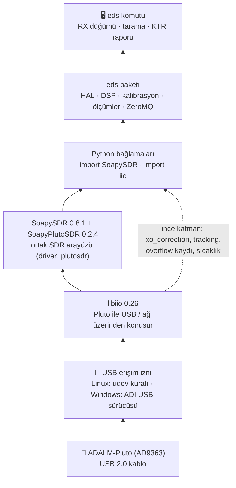

| Katman | Linux'ta nereden gelir | Windows'ta nereden gelir |
|---|---|---|
| USB erişim izni | `scripts/53-adi-plutosdr-usb.rules` (udev) | ADI **PlutoSDR-M2k-USB-Drivers** kurulumu |
| libiio, SoapySDR, SoapyPlutoSDR, Python bağlamaları | `environment.yml` (conda-forge) | `environment.yml` (conda-forge) — **aynı dosya** |
| eds paketi | `pip install -e ".[dev]"` | `pip install -e ".[dev]"` |

> 💡 **Simülatör için donanım gerekmez.** Pluto'nuz yokken de bütün testler ve 9 KTR
> ölçümü fizik tabanlı AD9363 simülatöründe çalışır. Pluto katmanları yalnızca donanım
> takıldığında devreye girer.

### 1.1 conda, ortam (environment) ve Miniforge nedir?

Bu rehberin geri kalanı üç kavramı kullanır. Kısaca:

- **conda** bir *paket yöneticisidir*. `pip` gibi paket kurar, ama yalnızca Python paketlerini
  değil, **C/C++ kütüphanelerini de** (libiio, SoapySDR, libusb, ZeroMQ) hazır derlenmiş olarak
  kurar. Pluto yığını C++ kütüphanelerinden oluştuğu için bu bizim için kritiktir: aksi hâlde
  SoapyPlutoSDR'ı kaynaktan derlemek gerekirdi (Windows'ta bu ciddi bir iştir).
- **Ortam (environment)**, kendi Python'u ve kendi paketleri olan **yalıtılmış bir klasördür**.
  `eds` ortamındaki Python 3.12 ve SoapySDR 0.8.1, bilgisayardaki diğer Python'ları ve başka
  projeleri etkilemez, onlardan da etkilenmez. Bir ortam bozulursa silip 1 dakikada yeniden
  kurarsınız ([Bölüm 10.2](#102-kaldırma)).
- **Miniforge**, conda'nın küçük bir dağıtımıdır ve paketleri yalnızca topluluk kanalı
  **conda-forge**'dan alır. Anaconda'nın ticari kanalını kullanmaz, bu yüzden lisans sorunu
  yoktur. SoapySDR ve SoapyPlutoSDR zaten conda-forge'dadır.

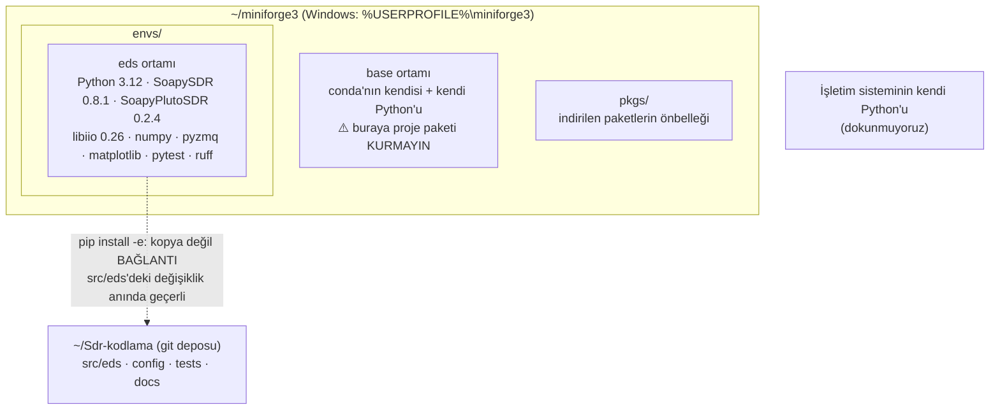

**`conda activate eds` ne yapar?** Terminalin `PATH` değişkeninin başına `eds` ortamının
klasörünü ekler ve `CONDA_PREFIX` değişkenini ayarlar. Böylece `python`, `pip`, `eds` ve
`SoapySDRUtil` komutları **bu ortamdan** çalışır. conda-forge'daki SoapySDR, Pluto modülünü
de `CONDA_PREFIX` üzerinden bulur. Ortamı etkinleştirmeden programı doğrudan yoluyla
çalıştırırsanız modül bulunamaz ([Bölüm 3.7](#37-kurulumu-doğrula)'deki "Olmazsa" kısmında
gerçek çıktısı var). **Kural:** her yeni terminalde önce `conda activate eds`.

---

## 2. Hangi yolu seçmeliyim?

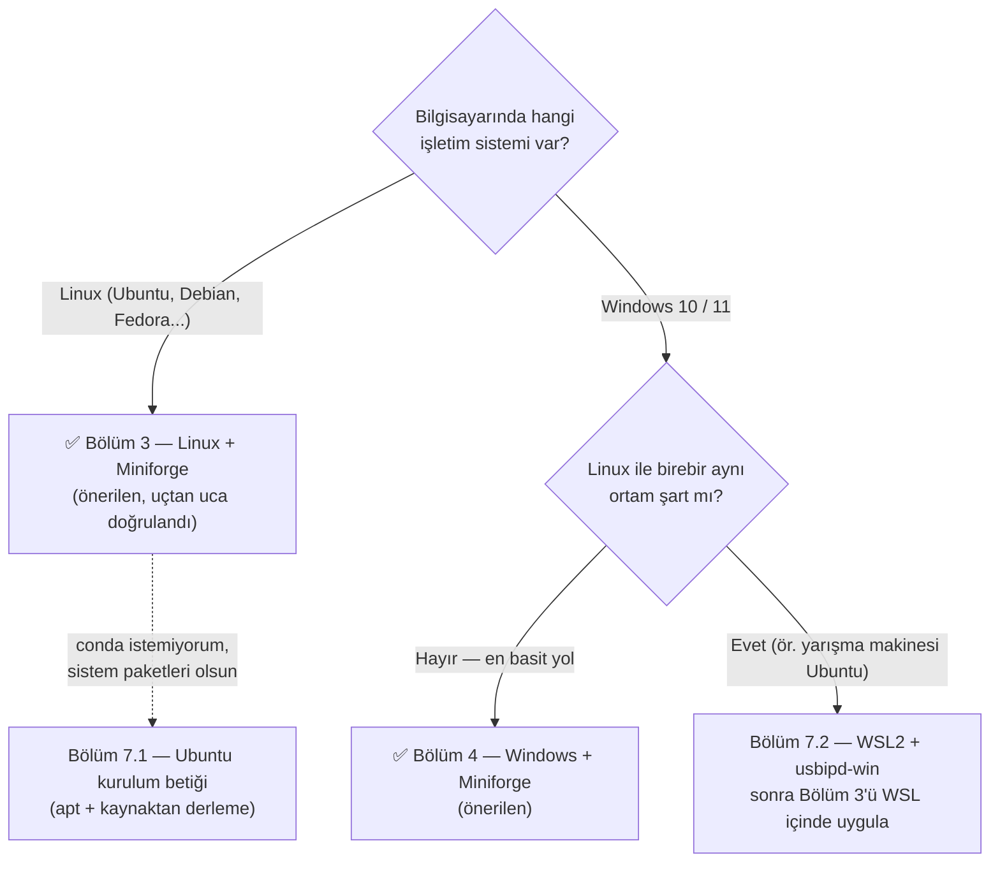

**Neden Miniforge (conda)?** Pluto için gereken dört parça (libiio, SoapySDR, SoapyPlutoSDR
sürücüsü, Python bağlamaları) **Linux'ta da Windows'ta da aynı sürümlerle**, derleme
gerektirmeden gelir. Takımdaki herkesin aynı ortamda çalışması "bende çalışıyordu" sorununu
ortadan kaldırır.

> ⚠️ **Sürümler bilerek sabitlendi.** conda-forge'daki `soapysdr-module-plutosdr 0.2.4`
> paketi SoapySDR **0.9** ve libiio **1.0** ile kurulamıyor; `environment.yml` bu yüzden
> SoapySDR 0.8.1 ve libiio 0.26 seçer. Ortamı "güncellemek" için sürümleri elle değiştirmeyin.

---

## 3. Linux kurulumu

Aşağıdaki adımlar herhangi bir 64-bit Linux'ta (Ubuntu 22.04/24.04 dahil) çalışır.
Toplam süre: ~10 dakika (çoğu indirme). Bütün komutlar **normal kullanıcı** olarak yazılır;
`sudo` yalnızca gösterilen yerlerde gerekir.


Bölüm numaralarıyla eşleşme: 3.1 sistem kontrolü · 3.2–3.3 Miniforge (1️⃣) · 3.4 depo (2️⃣) ·
3.5 conda ortamı (3️⃣) · 3.6 EDS (4️⃣) · 3.7 doğrulama (6️⃣) · 3.8–3.9 udev ve Pluto (5️⃣) ·
3.10 günlük rutin.

### 3.1 Sistemi tanı

🎯 **Ne yapıyoruz ve neden?** İndireceğimiz Miniforge dosyası işlemci mimarisine göre seçilir.
Yanlış dosya ("cannot execute binary file") ya da dolu disk kurulumu yarıda bırakır.
`git` sonraki adımda depoyu indirmek için gerekir.

⌨️ **Komut**

```bash
uname -m                              # işlemci mimarisi
grep PRETTY_NAME /etc/os-release      # dağıtım ve sürüm
df -h ~                               # ev klasörünün olduğu diskte boş yer ("Avail")
git --version                         # git kurulu mu?
```

✅ **Beklenen sonuç** (gerçek çıktı):

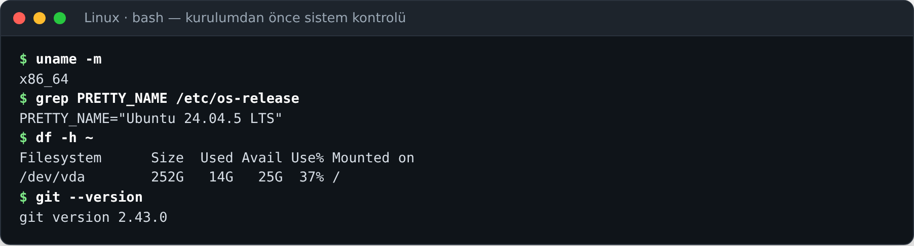

`x86_64` görmelisiniz. `Avail` sütunu en az `3G` olmalı. `git version 2.x` yazıyorsa git kurulu.

🛠️ **Olmazsa**

- **`aarch64` / `armv7l` çıktı** → ARM işlemci. Bu yol doğrulanmadı; takımdan x86-64 bir
  bilgisayar kullanın ya da [Bölüm 7.1](#71-ubuntu-sistem-paketleriyle-kurulum-betiği)'deki
  apt yolunu deneyin (o da ARM'da test edilmedi).
- **`git: command not found`** → `sudo apt install -y git` (Fedora: `sudo dnf install -y git`).
- **Disk yetersiz** → `~/.cache` gibi büyük klasörleri temizleyin ya da Miniforge'u başka bir
  diske kurun (aşağıda `-p` ile yolu verin; yol **boşluk içermemeli**).

### 3.2 Miniforge'u kur (bir kez)

🎯 **Ne yapıyoruz ve neden?** conda'yı kendi ev klasörünüze (`~/miniforge3`) kuruyoruz.
Sistem klasörlerine dokunmadığı için `sudo` gerekmez ve işletim sisteminin Python'unu bozmaz.
`-b` (batch) seçeneği lisans/klasör sorularını atlar. Batch kurulum kabuğu kendiliğinden
ayarlamadığı için hemen ardından `conda init` çalıştırırız: bu komut `~/.bashrc` dosyasına
küçük bir blok ekler ve her yeni terminalde `conda` komutunu kullanılabilir yapar.

⌨️ **Komut**

```bash
cd ~
curl -L -O "https://github.com/conda-forge/miniforge/releases/latest/download/Miniforge3-$(uname)-$(uname -m).sh"
bash Miniforge3-$(uname)-$(uname -m).sh -b -p ~/miniforge3
~/miniforge3/bin/conda init bash        # zsh kullanıyorsanız: ~/miniforge3/bin/conda init zsh
exec $SHELL                             # terminali yeniden başlat (ya da terminali kapatıp açın)
conda --version
```

✅ **Beklenen sonuç** (gerçek çıktı; uzun paket listesi `…` ile kısaltıldı):

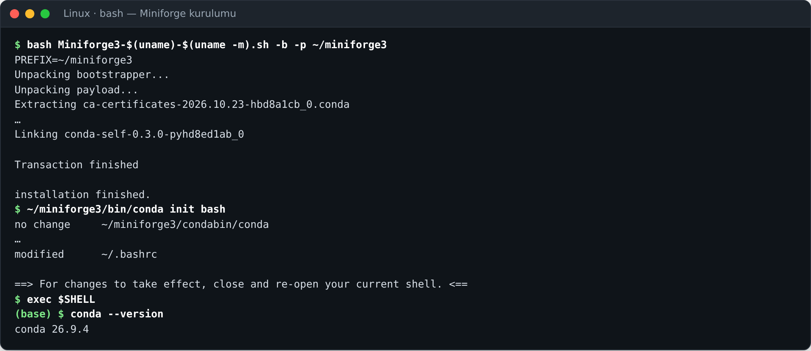

- `installation finished.` → kurulum tamam (bu bilgisayarda 5 saniye sürdü; indirme hariç).
- `modified ~/.bashrc` → `conda init` kabuk ayarını yaptı.
- Yeni terminalde istemin başında **`(base)`** belirir ve `conda --version` bir sürüm yazar
  (burada `conda 26.9.4`; sizde daha yeni olabilir, sorun değil).

🛠️ **Olmazsa**

- **`conda: command not found`** → Terminal yeniden başlatılmadı ya da başka bir kabuk
  kullanıyorsunuz. `echo $SHELL` çıktısı `/bin/zsh` ise `~/miniforge3/bin/conda init zsh`
  çalıştırıp terminali kapatıp açın. Hızlı çözüm: `source ~/.bashrc`.
- **`ERROR: File or directory already exists: '~/miniforge3'`** (gerçek çıktı) → Miniforge
  zaten kurulu. Yeniden kurmanız gerekmez; `~/miniforge3/bin/conda init bash` ile devam edin.
  Bozuk bir kurulumu güncellemek için kurucuyu `-u` ile çalıştırın.
- **`curl: command not found`** → `sudo apt install -y curl` ya da aynı adresi
  `wget "https://..."` ile indirin. İndirme yarıda kesildiyse dosyayı silip yeniden indirin
  (bozuk dosya `bash ...sh` aşamasında hata verir).

> 💡 Kurucunun yardımı (`bash Miniforge3-Linux-x86_64.sh -h`) kurulum yolu için açıkça
> "*must not contain spaces*" der: Miniforge'u boşluk içeren bir klasöre kurmayın.

### 3.3 Miniforge'u doğrula: `conda info`

🎯 **Ne yapıyoruz ve neden?** conda'nın **doğru yere** kurulduğunu ve paketleri
**conda-forge**'dan alacağını kontrol ediyoruz. Bilgisayarda daha önce Anaconda kuruluysa
yanlış conda'nın çalışması sık rastlanan bir sorundur. `conda info` bunu hemen gösterir.

⌨️ **Komut**

```bash
conda info
```

✅ **Beklenen sonuç** (gerçek çıktı; ilgisiz satırlar `…` ile kısaltıldı):

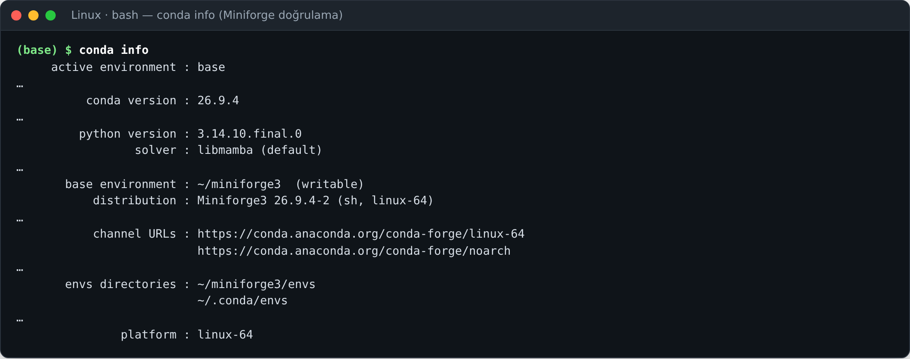

Bakılacak dört satır:

| Satır | Olması gereken | Anlamı |
|---|---|---|
| `base environment` | `~/miniforge3  (writable)` | Çalışan conda sizin kurduğunuz Miniforge; yazma izniniz var |
| `distribution` | `Miniforge3 ...` | Anaconda/Miniconda değil, Miniforge |
| `channel URLs` | yalnızca `conda-forge/...` | Paketler conda-forge'dan gelecek |
| `platform` | `linux-64` | 64-bit Linux paketleri seçilecek |

🛠️ **Olmazsa**

- **`base environment` başka bir yolu gösteriyor** (ör. `~/anaconda3`) → Eski bir conda
  `~/.bashrc`'de önce yükleniyor. `~/.bashrc` içindeki **eski** `>>> conda initialize >>>`
  bloğunu silin (ya da eski conda ile `conda init --reverse bash`), sonra
  `~/miniforge3/bin/conda init bash` ve terminali yeniden açın.
- **`channel URLs` içinde `repo.anaconda.com` görünüyor** → `~/.condarc` dosyasında
  `defaults` kanalı tanımlı. `conda config --remove channels defaults` çalıştırın.
  `environment.yml` zaten yalnızca `conda-forge` ister, yine de karışıklığı önleyin.

### 3.4 Depoyu indir

🎯 **Ne yapıyoruz ve neden?** EDS'nin kaynak kodunu, konfigürasyon dosyalarını ve
`environment.yml`'yi GitHub'dan bilgisayara kopyalıyoruz. `git clone` kullanıyoruz (ZIP
indirmiyoruz), çünkü takım kodu güncellediğinde tek komutla (`git pull`) yenisini alabilirsiniz.

⌨️ **Komut**

```bash
cd ~
git clone https://github.com/Nogeday/Sdr-kodlama.git
cd Sdr-kodlama
ls
```

✅ **Beklenen sonuç** (gerçek çıktı, 2026-11-06; nesne sayıları depo büyüdükçe artar):

```text
Cloning into 'Sdr-kodlama'...
remote: Enumerating objects: 529, done.
remote: Counting objects: 100% (529/529), done.
remote: Compressing objects: 100% (306/306), done.
remote: Total 529 (delta 254), reused 473 (delta 201), pack-reused 0 (from 0)
Receiving objects: 100% (529/529), 1.71 MiB | 7.24 MiB/s, done.
Resolving deltas: 100% (254/254), done.
```

`ls` en az şunları listelemeli: `Makefile  README.md  cal  config  contracts  docs
environment.yml  examples  pyproject.toml  reports  scripts  src  tests`.

🛠️ **Olmazsa**

- **`fatal: destination path 'Sdr-kodlama' already exists and is not an empty directory.`**
  → Depo zaten indirilmiş. `cd Sdr-kodlama && git pull` ile güncelleyin
  ([Bölüm 10.1](#101-güncelleme)).
- **`Could not resolve host: github.com`** → İnternet/DNS sorunu ya da kurum ağında vekil
  sunucu (proxy). Kurum ağında `git config --global http.proxy http://<vekil>:<port>`
  gerekebilir; ağ yöneticinize sorun.
- **Depo herkese açıktır**, kullanıcı adı/şifre istenmemelidir. İstenirse adresi yanlış
  yazmışsınızdır (büyük/küçük harf: `Nogeday/Sdr-kodlama`).

### 3.5 conda ortamını oluştur

🎯 **Ne yapıyoruz ve neden?** `environment.yml` dosyasındaki listeye göre **`eds` adlı yeni
bir ortam** oluşturuyoruz: Python 3.12, SoapySDR 0.8.1, SoapyPlutoSDR 0.2.4, libiio 0.26,
pylibiio ve EDS'nin ihtiyaç duyduğu numpy, pyzmq, matplotlib, jsonschema, pytest, ruff.
conda bu listeyi birbiriyle uyumlu sürümlere "çözer" (*solve*), paketleri indirir ve
`~/miniforge3/envs/eds` klasörüne kurar. Bu adım **bir kez** yapılır.

⌨️ **Komut** (depo klasöründe, yani `~/Sdr-kodlama` içinde)

```bash
cd ~/Sdr-kodlama
conda env create -f environment.yml
```

✅ **Beklenen sonuç** (gerçek çıktı; ~180 satırlık paket listesi `…` ile kısaltıldı):

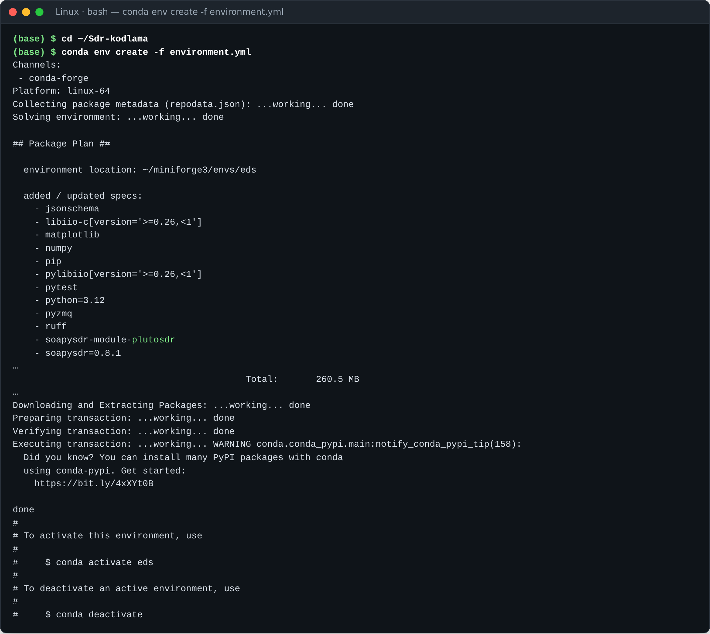

- `environment location: ~/miniforge3/envs/eds` → ortamın kurulacağı yer.
- `added / updated specs` → `environment.yml`'deki 12 satır.
- `Total: 260.5 MB` → indirilecek toplam boyut (hızlı bağlantıda 25 saniye sürdü; ev
  internetinde birkaç dakika sürebilir).
- Son satırlarda **`$ conda activate eds`** önerisi → ortam hazır.
- Arada görünen `WARNING ... notify_conda_pypi_tip ... Did you know?` satırı **zararsız bir
  ipucudur**, hata değildir.

🛠️ **Olmazsa**

- **`EnvironmentFileNotFound: '~/environment.yml' file not found`** (gerçek çıktı) → Depo
  klasöründe değilsiniz. `cd ~/Sdr-kodlama` yapıp tekrar deneyin.
- **`CondaValueError: prefix already exists: ~/miniforge3/envs/eds`** (gerçek çıktı) → Ortam
  zaten var. Silip yeniden kurmak yerine güncelleyin:
  `conda env update -f environment.yml --prune` ([Bölüm 10.1](#101-güncelleme)).
- **`Solving environment: failed` / çakışma (conflict) hatası** → `environment.yml`
  değiştirilmiş olabilir (ör. SoapySDR 0.9 / libiio 1.0 istenmiş). `git diff environment.yml`
  ile bakın, `git checkout environment.yml` ile depodaki hâline döndürün.
- **`CondaHTTPError: HTTP 000 CONNECTION FAILED`** → İnternet kesildi ya da kurum ağı engelliyor.
  Tekrar çalıştırın; conda zaten inmiş paketleri yeniden indirmez.

### 3.6 Ortamı etkinleştir ve EDS'yi kur

🎯 **Ne yapıyoruz ve neden?** Önce `eds` ortamını **etkinleştiriyoruz** ki `pip` doğru ortama
kursun. Sonra EDS paketinin kendisini `pip install -e` ile **düzenlenebilir** (*editable*)
kuruyoruz: pip, `src/eds` klasörünü kopyalamaz, ortama sadece "kod şurada" diye bir bağlantı
koyar. Bu yüzden `src/eds/` altında bir dosyayı değiştirdiğinizde (ya da `git pull` ile yeni
kod geldiğinde) değişiklik **hemen** geçerli olur. `[dev]` eki geliştirme araçlarını da
(pytest, ruff, jsonschema, matplotlib) ister, ama bunlar conda ile zaten kurulduğu için pip
yalnızca eksikleri tamamlar.

⌨️ **Komut**

```bash
conda activate eds                      # ⚠️ her yeni terminalde gerekli
pip install -e ".[dev]"                 # tırnaklar gerekli: köşeli parantezi kabuk yorumlamasın
```

✅ **Beklenen sonuç** (gerçek çıktı; "Requirement already satisfied" satırları kısaltıldı):

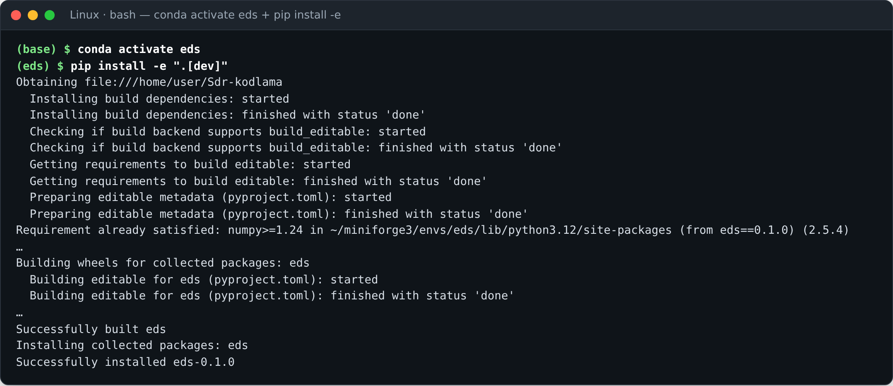

- İstem `(base)` iken **`(eds)`** oldu → ortam etkin.
- `Requirement already satisfied: ... ~/miniforge3/envs/eds/...` → pip doğru ortamı kullanıyor.
- Son satır **`Successfully installed eds-0.1.0`** (sürüm numarası farklı olabilir). İlk
  kurulumda satırda `ruff-0.x` de görünebilir: pip, conda'nın kurduğu ruff'ı tanımadığı için
  kendi kopyasını indirir. Zararsızdır.

🛠️ **Olmazsa**

- **`ERROR: file:///home/... does not appear to be a Python project: neither 'setup.py' nor
  'pyproject.toml' found.`** (gerçek çıktı) → Depo klasöründe değilsiniz: `cd ~/Sdr-kodlama`.
- **İstem hâlâ `(base)`** ve pip `~/miniforge3/lib/...` yazıyor → `conda activate eds`
  atlanmış, EDS base ortamına kurulmuş. `conda activate eds` yapıp `pip install -e ".[dev]"`'i
  tekrarlayın (base'deki kopya zarar vermez ama kafa karıştırır: `pip uninstall eds` ile silin).
- **`CondaError: Run 'conda init' before 'conda activate'`** (gerçek çıktı) → Kabuk ayarı
  yapılmamış: [Bölüm 3.2](#32-miniforgeu-kur-bir-kez)'deki `conda init bash` ve terminali
  yeniden açma adımı.

### 3.7 Kurulumu doğrula

🎯 **Ne yapıyoruz ve neden?** Üç şeyi kontrol ediyoruz: (1) `python` ve `eds` komutları **eds
ortamından** mı geliyor, (2) EDS **düzenlenebilir** kuruldu mu, (3) SoapySDR **Pluto modülünü**
buluyor mu. Üçü de doğruysa kurulum tamamdır. Sonraki hatalar artık kurulumdan değil,
kullanımdan ya da donanımdan kaynaklanır.

⌨️ **Komut**

```bash
conda env list                          # ortamlar; * = etkin olan
which python eds                        # ikisi de ~/miniforge3/envs/eds/bin altında olmalı
pip show eds                            # "Editable project location" depoyu göstermeli
eds --version
SoapySDRUtil --info                     # "Available factories... plutosdr" satırını arayın
python -c "import SoapySDR, iio; print(SoapySDR.getLibVersion(), iio.version[2])"
```

✅ **Beklenen sonuç** (gerçek çıktı):

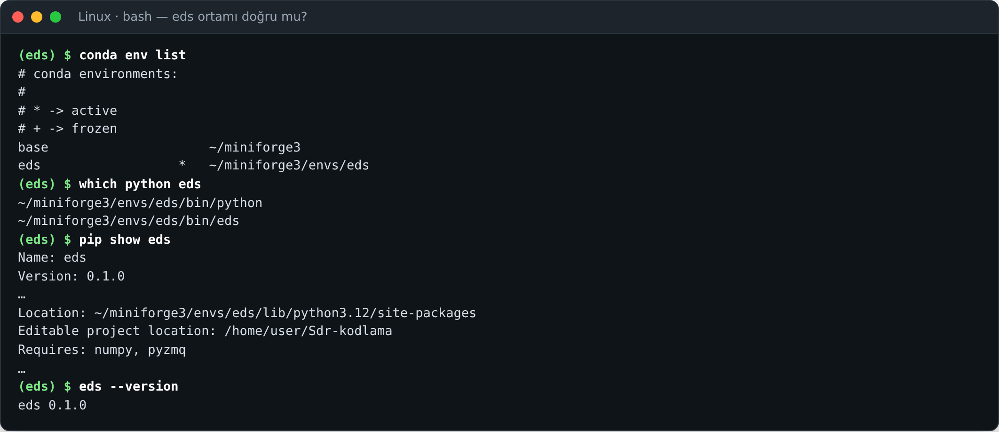

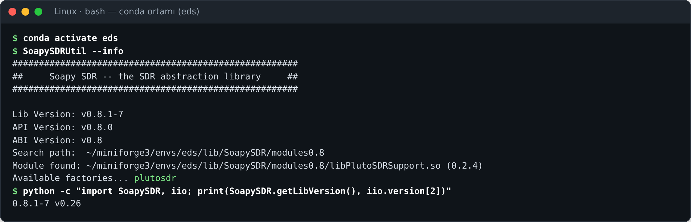

- `eds  *  ~/miniforge3/envs/eds` → `eds` ortamı etkin.
- `Editable project location: /home/user/Sdr-kodlama` → EDS depodan çalışıyor (sizde kendi
  ev klasörünüz görünür).
- `Module found: .../libPlutoSDRSupport.so (0.2.4)` ve **`Available factories... plutosdr`**
  → SDR yığını hazır.
- Son komut `0.8.1-7 v0.26` yazar (SoapySDR ve libiio sürümleri).

Şimdi testleri çalıştırın: [Bölüm 5](#5-doğrulama-her-şey-çalışıyor-mu). Donanımınız varsa
önce 3.8 ve 3.9'u yapın.

🛠️ **Olmazsa**

- **`No modules found!` / `Available factories... No factories found!`** → Ortam etkin değil.
  Gerçek çıktı (programı `~/miniforge3/envs/eds/bin/SoapySDRUtil --info` şeklinde **yoluyla**,
  `conda activate` yapmadan çalıştırınca):

  ```text
  Search path:  /home/conda/feedstock_root/build_artifacts/soapysdr_.../_h_env_placehold_placehold_.../lib/SoapySDR/modules0.8 (missing)
  No modules found!
  Available factories... No factories found!
  ```

  Neden: conda-forge'daki SoapySDR modül klasörünü `CONDA_PREFIX` değişkeninden bulur, bu
  değişkeni de `conda activate` ayarlar. Çözüm: `conda activate eds`.
- **`ModuleNotFoundError: No module named 'SoapySDR'`** (gerçek çıktı, `base` ortamında
  `python -c "import SoapySDR"`) → Yanlış Python. `which python` çıktısı `envs/eds`
  içermiyorsa `conda activate eds`.
- **`which eds` başka bir yer gösteriyor** (ör. `/usr/local/bin/eds`) → Daha önce sistem
  Python'una da kurulmuş. Ortam etkinken conda'nınki önce gelir; karışıklığı önlemek için
  sistemdekini `python3 -m pip uninstall eds` ile kaldırabilirsiniz.

### 3.8 Pluto için USB izni (udev kuralı ve grup) — yalnızca donanım için

🎯 **Ne yapıyoruz ve neden?** Linux USB cihazlarına varsayılan olarak yalnızca root'un
erişmesine izin verir. Depodaki kural Pluto'yu (`0456:b673`, DFU modunda `0456:b674`)
`plugdev` grubuna ve masaüstünde oturum açmış kullanıcıya (`uaccess`) açar. Ayrıca
ModemManager'ın Pluto'yu modem sanıp kurcalamasını engeller: aksi hâlde Pluto'nun açılışı
gecikir ve akış bozulabilir. Grup üyeliği **ancak oturumu kapatıp açınca** geçerli olur.

⌨️ **Komut**

```bash
cd ~/Sdr-kodlama
sudo install -m 0644 scripts/53-adi-plutosdr-usb.rules /etc/udev/rules.d/
sudo udevadm control --reload-rules && sudo udevadm trigger
getent group plugdev || sudo groupadd plugdev    # Fedora/Arch'ta plugdev grubu olmayabilir
sudo usermod -aG plugdev "$USER"
# → şimdi OTURUMU KAPATIP AÇIN (ya da bilgisayarı yeniden başlatın), sonra:
groups
```

✅ **Beklenen sonuç** (beklenen; bu ortamda gerçek kullanıcı oturumu yoktu): `install` ve
`udevadm` sessizce biter (çıktı yazmaz). Oturumu kapatıp açtıktan sonra `groups` çıktısında
**`plugdev`** kelimesi görünür, örneğin:

```text
ayse adm cdrom sudo dip plugdev users
```

🛠️ **Olmazsa**

- **`groups` çıktısında `plugdev` yok** → Oturumu kapatıp açmadınız (yeni terminal açmak
  yetmez). Bilgisayarı yeniden başlatmak en kesin yoldur.
- **`usermod: group 'plugdev' does not exist`** → Önce `sudo groupadd plugdev` (yukarıdaki
  `getent ... || sudo groupadd` satırı bunu yapar).
- **Kural dosyası yanlış yerde** → `ls -l /etc/udev/rules.d/53-adi-plutosdr-usb.rules`
  dosyayı göstermeli. Pluto takılıyken kuralı kurduysanız Pluto'yu çıkarıp yeniden takın.

### 3.9 Pluto'yu tak ve Linux'un gördüğünü doğrula — yalnızca donanım için

🎯 **Ne yapıyoruz ve neden?** EDS'ye geçmeden önce Pluto'nun **USB seviyesinde** görüldüğünü
kontrol ediyoruz. Burada görünmeyen bir Pluto'yu hiçbir yazılım açamaz. Sorun kablo, port ya
da Pluto'nun kendisidir. Pluto takıldıktan sonra açılması ~10-20 saniye sürer (LED yanıp sönmeye
başlar).

⌨️ **Komut**

```bash
lsusb | grep -i 0456                       # lsusb yoksa: sudo apt install -y usbutils
ip -br addr | grep 192.168.2               # Pluto'nun USB-Ethernet arayüzü
SoapySDRUtil --find="driver=plutosdr"      # (eds ortamı etkin olmalı)
```

✅ **Beklenen sonuç** (beklenen; bu ortamda gerçek Pluto yoktu):

```text
Bus 001 Device 007: ID 0456:b673 Analog Devices, Inc. LibIIO based AD9363 Software Defined Radio [ADALM-PLUTO]
enx00e022xxxxxx  UP  192.168.2.10/24 ...
```

`Bus`/`Device` numaraları ve arayüz adı sizde farklı olur. Eski sistemlerde açıklama yalnızca
`Analog Devices, Inc.` olabilir. Önemli olan **`0456:b673`**. Bilgisayar Pluto'dan DHCP ile
`192.168.2.10` adresini alır, Pluto `192.168.2.1`'dedir. Masaüstünde ayrıca **PlutoSDR** adlı bir
USB bellek sürücüsü açılır (içinde `info.html`, `config.txt`). `SoapySDRUtil --find` çıktısında
`driver = plutosdr` ve `uri = usb:...` satırları bulunur. Bu `uri`'yi Bölüm 6.2'de
([ilk donanım oturumu](#6-plutoyu-bağlamak-ve-ilk-donanım-testi)) kullanacağız.

Pluto takılı **değilken** son komutun gerçek çıktısı `No devices found! driver=plutosdr`'dir.

🛠️ **Olmazsa**

- **`lsusb`'de `0456` yok** → Kablo yalnızca şarj kablosu olabilir, Pluto'nun **PWR**
  portuna takılmış olabilir ya da port arızalı olabilir. Başka kablo/port deneyin.
  `sudo dmesg | tail -20` takma anında `idVendor=0456, idProduct=b673` satırını göstermeli.
- **`lsusb` görüyor ama `SoapySDRUtil --find` bulamıyor** → İzin sorunu: 3.8'i yaptınız ve
  oturumu kapatıp açtınız mı? Hızlı test: `sudo ~/miniforge3/envs/eds/bin/SoapySDRUtil --find`
  bulursa kesinlikle izin sorunudur. `sudo`, `CONDA_PREFIX` değişkenini aktarmadığı için
  komutu şöyle yazın:
  `sudo env CONDA_PREFIX=$CONDA_PREFIX $CONDA_PREFIX/bin/SoapySDRUtil --find="driver=plutosdr"`.
  Bu yalnızca teşhis içindir, EDS'yi **sudo ile çalıştırmayın**.
- **`192.168.2.10` adresi yok** → Ağ yöneticisi arayüzü "bağlanmadı" durumunda tutuyor olabilir.
  USB akışı (`usb:` uri) yine çalışır. Ağ yolu yalnızca ince libiio katmanı (`control_uri`)
  için gerekir: `ping -c 2 192.168.2.1` ile deneyin, ayrıntı `docs/HARDWARE_PLUTO.md`.

### 3.10 Günlük rutin

🎯 **Ne yapıyoruz ve neden?** Kurulum bir kez yapılır. Bundan sonra her çalışma oturumunda
yalnızca ortamı etkinleştirip depo klasörüne gitmeniz yeterli.

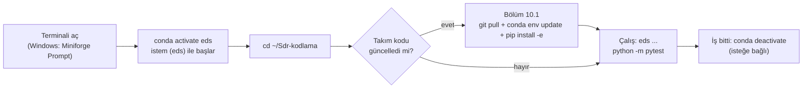

⌨️ **Komut**

```bash
conda activate eds
cd ~/Sdr-kodlama
git pull                                # takım güncellediyse (bkz. Bölüm 10.1)
eds --help                              # ne yapabileceğinize bakın → KULLANIM.md
```

> 💡 **Her terminal `eds` ile açılsın istiyorsanız** (isteğe bağlı): conda'nın yeni
> sürümlerinde `conda config --set default_activation_env eds` yazın. Bu rehberde
> conda 26.9.4 ile denendi: yeni terminalde `$CONDA_DEFAULT_ENV` = `eds` oldu. Eski
> conda'da bu ayar tanınmazsa `echo 'conda activate eds' >> ~/.bashrc` aynı işi görür.
> Geri almak için `conda config --remove-key default_activation_env`.

🛠️ **Olmazsa**: Komut "bulunamadı" ya da `No module named ...` diyorsa %90 ihtimalle
`conda activate eds` unutulmuştur. İstemin başında `(eds)` var mı, bakın.

---

## 4. Windows kurulumu

Windows 10 (21H2+) veya Windows 11, 64-bit. Toplam süre: ~15 dakika.

> ℹ️ Bu bölümdeki **Windows çıktıları "beklenen" çıktılardır**: bu rehber hazırlanırken bir
> Windows bilgisayar yoktu. Ortam win-64 için çözülerek doğrulandı ([Bölüm 9](#9-doğrulanmış-sürümler)).
> Kurulum ekranlarının metinleri sürüme göre biraz farklı olabilir. Bir adım burada
> anlatılandan farklı görünürse ekran görüntüsünü takıma iletin, rehberi güncelleyelim.

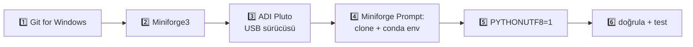

Bölüm numaralarıyla eşleşme: 4.1 sistem kontrolü · 4.2 Git (1️⃣) · 4.3–4.5 Miniforge,
Miniforge Prompt, cmd/PowerShell (2️⃣) · 4.6–4.7 Pluto sürücüsü ve kontrolü (3️⃣) · 4.8 depo +
ortam (4️⃣) · 4.9 UTF-8 (5️⃣) · 4.10 doğrulama (6️⃣) · 4.11–4.12 Windows Terminal ve VS Code.

### 4.1 Sistemi tanı

🎯 **Ne yapıyoruz ve neden?** 64-bit x64 Windows olduğundan ve yeterli disk olduğundan emin
oluyoruz. ARM'lı Windows dizüstüleri (ör. Snapdragon) `ARM64` yazar; bu yol orada doğrulanmadı.

⌨️ **Komut** (Başlat → `cmd` yazın → **Komut İstemi**)

```bat
echo %PROCESSOR_ARCHITECTURE%
ver
```

✅ **Beklenen sonuç** (beklenen): `AMD64` ve `Microsoft Windows [Version 10.0.xxxxx.xxxx]`.
Windows 11 de `10.0.22000` ve üzeri numara yazar. Windows 10 için `10.0.19044` (21H2) veya
üzeri olmalı. Disk: Dosya Gezgini → **Bu Bilgisayar** → `C:` sürücüsünde en az 3 GB boş.

🛠️ **Olmazsa**: `x86` yazıyorsa 32-bit Windows'tur, desteklenmez. Windows 10 sürümü eskiyse
Windows Update ile güncelleyin.

### 4.2 Git for Windows

🎯 **Ne yapıyoruz ve neden?** Depoyu `git clone` ile indirmek ve daha sonra `git pull` ile
güncellemek için. Varsayılan kurulum, `git` komutunu Miniforge Prompt'ta da kullanılabilir yapar.

⌨️ **Komut**: <https://git-scm.com/download/win> adresinden 64-bit kurucuyu indirip
**varsayılan seçeneklerle** kurun (her ekranda *Next*). Ya da PowerShell'de:

```powershell
winget install --id Git.Git -e --source winget
```

✅ **Beklenen sonuç** (beklenen): Yeni açtığınız bir Komut İstemi'nde `git --version` →
`git version 2.xx.x.windows.1`.

🛠️ **Olmazsa**

- **`'git' is not recognized as an internal or external command`** → Kurulumdan önce açık
  olan pencerede `PATH` güncellenmez: pencereyi kapatıp yenisini açın. Hâlâ yoksa kurulumdaki
  "Adjusting your PATH" ekranında *Git from the command line and also from 3rd-party
  software* (varsayılan) seçili olmalıydı. Kurucuyu yeniden çalıştırıp bu seçeneği seçin.
- **Kurulum yönetici şifresi istiyor** ve sizde yok → Kurum bilgisayarında BT birimine
  başvurun ya da kurucunun "yalnızca benim için" seçeneğini kullanın.

### 4.3 Miniforge3 kurulumu — ekran ekran

🎯 **Ne yapıyoruz ve neden?** conda'yı kullanıcı klasörünüze kuruyoruz ("Just Me": yönetici
yetkisi gerekmez, ortamlara yazma izni sorunu çıkmaz). En önemli karar **kurulum yolu**: yol
**boşluk ve Türkçe karakter içermemelidir.** Neden: conda'nın etkinleştirme betikleri (`.bat`)
ve bazı C/C++ kütüphaneleri (SoapySDR'ın modül arama yolu dahil) yolları Windows'un eski
"ANSI" kod sayfasıyla işler. `ş, ğ, ı, İ, ü, ö, ç` gibi harfler ve boşluklar bu araçlarda
"dosya bulunamadı" ya da bozuk karakter hatasına yol açabilir. Linux kurucusu da yardım
metninde "*must not contain spaces*" der.

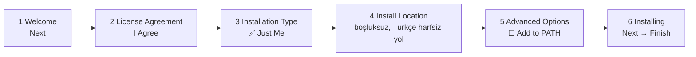

⌨️ **Adımlar**

1. <https://github.com/conda-forge/miniforge/releases/latest> sayfasından
   **`Miniforge3-Windows-x86_64.exe`** dosyasını indirip çift tıklayın. Windows SmartScreen
   "Windows bilgisayarınızı korudu" derse **Ek bilgi → Yine de çalıştır**.
2. **Welcome to Miniforge3 … Setup** → *Next*.
3. **License Agreement** → *I Agree*.
4. **Select Installation Type** → **Just Me (recommended)** seçin → *Next*.
   (*All Users* yönetici ister ve ortamlar `C:\ProgramData` altına gider; pip/conda
   yazarken izin hataları çıkar.)
5. **Choose Install Location** → Önerilen yol `C:\Users\<kullanıcı adınız>\miniforge3`'tür.
   - Kullanıcı adınız **boşluk veya Türkçe karakter içermiyorsa** (ör. `C:\Users\ayse\...`)
     → varsayılanı kabul edin.
   - İçeriyorsa (ör. `C:\Users\Ayşe Yılmaz\...`) → yolu **`C:\miniforge3`** olarak değiştirin.
     Bu rehberin geri kalanında `%USERPROFILE%\miniforge3` gördüğünüz yerde siz `C:\miniforge3`
     kullanın. (Kurucu, yolda boşluk varsa uyarı verebilir. Uyarıyı geçmeyin, yolu değiştirin.)
6. **Advanced Installation Options** (kutucuk metinleri sürüme göre biraz değişebilir):
   - ☑ *Create start menu shortcuts* → **işaretli bırakın** (Miniforge Prompt kısayolu buradan gelir).
   - ☐ *Add Miniforge3 to my PATH environment variable* → **işaretlemeyin.** Neden: conda'nın
     Python'u sistemdeki diğer Python'ların önüne geçer, hangi `python`'un çalıştığı belirsizleşir.
     Biz conda'yı her zaman Miniforge Prompt üzerinden kullanacağız.
   - *Register Miniforge3 as my default Python* ve *Clear the package cache* → varsayılan
     hâliyle bırakın.
   → *Install*.
7. **Installing** ilerleme çubuğu (1-3 dakika) → **Installation Complete** → *Next* →
   **Completing Miniforge3 Setup** → *Finish*.

✅ **Beklenen sonuç** (beklenen): Başlat menüsünde **Miniforge Prompt** (bazı sürümlerde
**Miniforge3 Prompt**) kısayolu belirir. Diskte `C:\Users\<ad>\miniforge3` (veya
`C:\miniforge3`) klasörü oluşur.

🛠️ **Olmazsa**

- **Kurulum "Access is denied" ile duruyor** → *All Users* seçilmiş olabilir ya da yol
  `C:\Program Files` altında. Kaldırıp *Just Me* ve `C:\miniforge3` ile yeniden kurun.
- **Antivirüs kurulumu çok yavaşlatıyor ya da dosya siliyor** → Kurulum süresince
  `miniforge3` klasörünü antivirüs taramasından muaf tutmayı deneyin (kurum bilgisayarında BT'ye sorun).
- **Kurulumu yanlış yola yaptım** → Ayarlar → Uygulamalar → *Miniforge3* → Kaldır, sonra
  doğru yolla yeniden kurun.

### 4.4 Miniforge Prompt'u aç ve Miniforge'u doğrula

🎯 **Ne yapıyoruz ve neden?** **Miniforge Prompt**, `conda`'nın hazır yüklendiği bir Komut
İstemi (cmd) penceresidir. PATH'e eklemediğimiz için normal `cmd`'de `conda` komutu bulunmaz,
bundan sonraki **bütün komutları bu pencerede** çalıştıracaksınız. `conda info` ile doğru
conda'nın çalıştığını kontrol ediyoruz (Linux'taki [Bölüm 3.3](#33-miniforgeu-doğrula-conda-info) ile aynı amaç).

⌨️ **Komut**: Başlat → `miniforge` yazın → **Miniforge Prompt**'u açın, sonra:

```bat
conda --version
conda info
```

✅ **Beklenen sonuç** (beklenen): Pencere `(base) C:\Users\<ad>>` istemiyle açılır.
`conda --version` → `conda 26.x.x` (veya daha yeni). `conda info` çıktısı Linux'takiyle aynı
düzendedir (yukarıdaki [ekran görüntüsü](#33-miniforgeu-doğrula-conda-info)), farklar:

```text
       base environment : C:\Users\<ad>\miniforge3  (writable)
           channel URLs : https://conda.anaconda.org/conda-forge/win-64
                          https://conda.anaconda.org/conda-forge/noarch
               platform : win-64
```

🛠️ **Olmazsa**

- **Başlat menüsünde Miniforge Prompt yok** → 4.3'teki *Create start menu shortcuts*
  işaretsizdi. Komut İstemi'nde şunu yazarak aynı pencereyi elde edersiniz:
  `%USERPROFILE%\miniforge3\Scripts\activate.bat %USERPROFILE%\miniforge3`
- **`base environment` başka bir yol (Anaconda) gösteriyor** → Eski Anaconda PATH'e eklenmiş.
  Ya Anaconda'yı kaldırın ya da her zaman Miniforge Prompt'u kullanın.
- **Normal cmd/PowerShell'de `'conda' is not recognized ...`** → Beklenen davranış: Miniforge
  Prompt'u kullanın ya da PowerShell için 4.5'teki `conda init powershell` adımını yapın.

### 4.5 cmd mi PowerShell mi? (komut farkları)

🎯 **Ne yapıyoruz ve neden?** Miniforge Prompt **cmd** tabanlıdır. Windows Terminal ve VS
Code ise varsayılan olarak **PowerShell** açar. İkisinin sözdizimi farklıdır. İnternetten
kopyaladığınız bir komut "çalışmıyorsa" çoğu zaman yanlış kabuktasınızdır. Bu rehberdeki
` ```bat ` blokları cmd için, ` ```powershell ` blokları PowerShell içindir.

| İş | cmd (Miniforge Prompt) | PowerShell |
|---|---|---|
| Bu pencere için değişken | `set PYTHONUTF8=1` | `$env:PYTHONUTF8 = "1"` |
| Kalıcı değişken (yeni pencerelerde geçerli) | `setx PYTHONUTF8 1` | `setx PYTHONUTF8 1` (aynı program) |
| Değişkeni göster | `echo %CONDA_PREFIX%` | `$env:CONDA_PREFIX` |
| Ev klasörüne git | `cd %USERPROFILE%` | `cd $HOME` |
| Program nerede? | `where python` | `where.exe python` ⚠️ (PowerShell'de `where` başka komuttur) veya `Get-Command python` |
| Komutları art arda | `komut1 && komut2` | `komut1; komut2` |
| Uzun satırı bölmek | satır sonunda `^` | satır sonunda `` ` `` |
| conda kullanımı | hazır | bir kez `conda init powershell` gerekir (aşağıda) |

> ⚠️ **`setx` bulunduğunuz pencereyi değiştirmez**, yalnızca *yeni açılan* pencereleri etkiler.
> `setx`'ten sonra pencereyi kapatıp yeniden açın. **`setx PATH ...` asla kullanmayın**:
> 1024 karakterden uzun PATH'i keser ve PATH'iniz bozulur.

**PowerShell'de conda kullanmak istiyorsanız (isteğe bağlı, bir kez):**

```bat
conda init powershell
```

Bu komutu Miniforge Prompt'ta çalıştırın, sonra PowerShell'i kapatıp açın. PowerShell açılırken
*"... cannot be loaded because running scripts is disabled on this system"* (Türkçe Windows'ta
"bu sistemde komut dosyalarının çalıştırılması devre dışı") hatası çıkarsa PowerShell'de bir kez:

```powershell
Set-ExecutionPolicy -Scope CurrentUser RemoteSigned
```

Kararsızsanız **sadece Miniforge Prompt (cmd) kullanın**: bu rehberdeki bütün Windows
komutları onunla yazıldı.

### 4.6 ADI Pluto USB sürücüsü (yalnızca donanım için)

🎯 **Ne yapıyoruz ve neden?** Linux'taki udev kuralının Windows karşılığı: Windows'un Pluto'nun
USB arayüzlerini tanıması ve libiio'nun (libusb üzerinden) Pluto'ya erişebilmesi için
Analog Devices'ın sürücü paketi gerekir. Bu adım **yönetici yetkisi** ister. Sürücüyü
**Pluto'yu takmadan önce** kurmak en sorunsuz yoldur.

⌨️ **Adımlar**

1. <https://github.com/analogdevicesinc/plutosdr-m2k-drivers-win/releases> sayfasından
   **`PlutoSDR-M2k-USB-Drivers.exe`** dosyasını indirip çalıştırın, varsayılan seçeneklerle
   kurun. "Bu aygıt yazılımını yüklemek istiyor musunuz?" sorularına **Yükle** deyin.
2. Pluto'yu **USB** yazan portundan, veri kablosuyla, doğrudan bilgisayara takın.
   ~20 saniye bekleyin.

✅ **Beklenen sonuç**: Doğru kurulduysa Windows Pluto'yu **üç şekilde** görür:

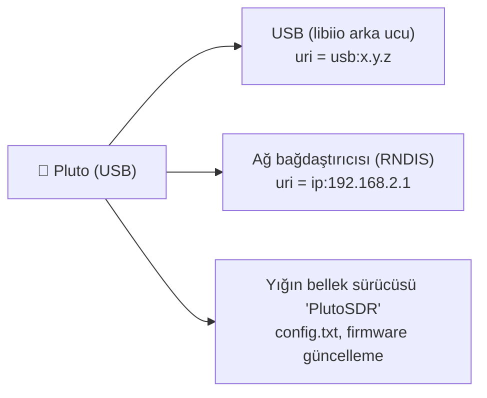

> 💡 EDS akışı için **USB yolunu** (`usb:`) tercih edin, çünkü ağ yolu daha yavaştır. Ağ yolu
> (`ip:192.168.2.1`) ince libiio katmanı (`control_uri`) için kullanılır.

Bu üçünü nasıl kontrol edeceğiniz bir sonraki adımda.

🛠️ **Olmazsa**: Sürücü kurulumu "yönetici olarak çalıştır" ister; çift tıklamak yetmezse sağ
tık → **Yönetici olarak çalıştır**. Pluto sürücüden önce takılıysa çıkarıp yeniden takın.

### 4.7 Pluto'yu Windows'ta doğrula — yalnızca donanım için

🎯 **Ne yapıyoruz ve neden?** Linux'taki `lsusb` kontrolünün Windows karşılığı. Burada
görünmeyen Pluto'yu EDS de göremez. Sorunu yazılıma geçmeden kablo/sürücü seviyesinde yakalarız.

⌨️ **Kontroller** (beklenen sonuçlar; bu ortamda Windows ve Pluto yoktu)

1. **Aygıt Yöneticisi** (`Win + X` → *Aygıt Yöneticisi*): Pluto takılıyken şu türden girdiler
   belirir (adlar sürücü sürümüne göre biraz değişir):
   - *Ağ bağdaştırıcıları* altında bir RNDIS / USB Ethernet bağdaştırıcısı,
   - *Bağlantı noktaları (COM ve LPT)* altında bir USB seri cihaz (Pluto'nun konsolu),
   - *Disk sürücüleri* altında Pluto'nun yığın belleği,
   - *Evrensel Seri Veri Yolu aygıtları* (ya da *libusbK/WinUSB*) altında PlutoSDR benzeri bir girdi.

   **Önemli olan:** sarı ünlemli **"Bilinmeyen aygıt"** ya da **"Diğer aygıtlar"** altında
   Pluto **olmaması**. Varsa sürücü kurulmamıştır (4.6).
2. **Dosya Gezgini**: **PlutoSDR** adlı bir USB sürücü (ör. `E:`) görünür. İçinde `info.html`
   (tarayıcıda açın: firmware sürümü ve seri numarası yazar) ve `config.txt` bulunur.
3. **Ağ** (Miniforge Prompt veya cmd):

   ```bat
   ipconfig
   ping 192.168.2.1
   ```

   `ipconfig` çıktısında yeni bir Ethernet bağdaştırıcısı ve **`IPv4 Address . . . : 192.168.2.10`**
   (Türkçe Windows: `IPv4 Adresi`) görünmeli. `ping` → `Reply from 192.168.2.1: ...`
   (`... yanıt`).
4. **SoapySDR** (Miniforge Prompt, `conda activate eds` yaptıktan sonra, 4.8'den sonra):

   ```bat
   SoapySDRUtil --find="driver=plutosdr"
   ```

   `driver = plutosdr` ve `uri = usb:...` satırları görünmeli.

🛠️ **Olmazsa**

- **Aygıt Yöneticisi'nde hiçbir şey belirmiyor** → Şarj kablosu ya da **PWR** portu. Kabloyu/portu değiştirin.
- **"Bilinmeyen aygıt"** → ADI sürücüsü yok ya da yarım kalmış: 4.6'yı yönetici olarak tekrarlayın,
  Pluto'yu çıkarıp takın.
- **PlutoSDR sürücüsü görünüyor ama `192.168.2.10` yok** → RNDIS sürücüsü kurulmamış. USB akışı
  (`usb:`) yine çalışabilir. Ağ yolunu istiyorsanız 4.6'yı tekrarlayın.

### 4.8 Depo, conda ortamı ve EDS (Miniforge Prompt'ta)

🎯 **Ne yapıyoruz ve neden?** Linux'taki 3.4-3.6 adımlarının aynısı: depoyu indir, `eds`
ortamını **aynı `environment.yml`** ile oluştur, ortamı etkinleştir, EDS'yi düzenlenebilir kur.
Depoyu **OneDrive ile eşitlenen klasörlere** (Masaüstü/Belgeler çoğu zaman öyledir)
koymayın. Eşitleme sırasında dosya kilitleri git/pip işlemlerini bozabilir.

⌨️ **Komut** (Miniforge Prompt)

```bat
cd %USERPROFILE%
git clone https://github.com/Nogeday/Sdr-kodlama.git
cd Sdr-kodlama
conda env create -f environment.yml
conda activate eds
pip install -e ".[dev]"
```

> Kullanıcı adınızda boşluk/Türkçe harf varsa ilk satırı `mkdir C:\eds` ve `cd C:\eds` yapın
> (4.3'teki aynı neden).

✅ **Beklenen sonuç** (beklenen; çıktılar Linux'takilerle aynı düzende, yollar Windows biçiminde):

- `git clone` → [Bölüm 3.4](#34-depoyu-indir)'teki satırlar.
- `conda env create` → [Bölüm 3.5](#35-conda-ortamını-oluştur)'teki gibi, `environment location:
  C:\Users\<ad>\miniforge3\envs\eds`, `Platform: win-64`, sonda `conda activate eds` önerisi.
- `conda activate eds` → istem `(eds) C:\Users\<ad>\Sdr-kodlama>` olur.
- `pip install -e` → son satır `Successfully installed eds-0.1.0`.

🛠️ **Olmazsa**: Linux'taki 3.4-3.6 "Olmazsa" maddeleri aynen geçerlidir
(`EnvironmentFileNotFound` → depo klasöründe değilsiniz, `prefix already exists` → ortam
zaten var, `does not appear to be a Python project` → yanlış klasör). Windows'a özgü:

- **`'conda' is not recognized`** → Normal cmd/PowerShell'desiniz. Miniforge Prompt'u açın.
- **`conda env create` çok uzun sürüyor** → Antivirüs her dosyayı tarıyor olabilir. Sabırla
  bekleyin ya da `miniforge3` klasörünü taramadan muaf tutun.

### 4.9 Türkçe karakterler için UTF-8 modu (önerilir)

🎯 **Ne yapıyoruz ve neden?** İngilizce Windows'ta konsol kodlaması `ş, ğ, İ, ı` harflerini
gösteremeyebilir. EDS bu durumda çökmez (gösterilemeyen harfi `?` ile değiştirir), ama doğru
görmek için Python'u UTF-8 moduna alırız. `PYTHONUTF8=1`, Python'a "dosyalar ve konsol için
her zaman UTF-8 kullan" der.

⌨️ **Komut** (Miniforge Prompt, bir kez)

```bat
setx PYTHONUTF8 1
```

PowerShell'de yalnızca o pencere için: `$env:PYTHONUTF8 = "1"` (kalıcı olması için yine `setx`).

Ardından **Miniforge Prompt'u kapatıp yeniden açın** ve `conda activate eds` yazın.

✅ **Beklenen sonuç** (beklenen): `setx` → `SUCCESS: Specified value was saved.`
(Türkçe Windows: `BAŞARILI: Belirtilen değer kaydedildi.`). Yeni pencerede
`echo %PYTHONUTF8%` → `1`. `eds profiles` çıktısındaki Türkçe harfler düzgün görünür.

🛠️ **Olmazsa**: `echo %PYTHONUTF8%` hâlâ `%PYTHONUTF8%` yazıyorsa pencereyi yeniden
açmadınız. Harfler hâlâ bozuksa **Windows Terminal** kullanın (4.11). Eski `conhost`
penceresinin yazı tipi bazı harfleri çizemez.

### 4.10 Doğrula

🎯 **Ne yapıyoruz ve neden?** Linux'taki [Bölüm 3.7](#37-kurulumu-doğrula) ile aynı: doğru
Python, düzenlenebilir EDS ve Pluto modülü.

⌨️ **Komut** (Miniforge Prompt, `(eds)` istemiyle)

```bat
where python
where eds
pip show eds
eds --version
SoapySDRUtil --info
python -c "import SoapySDR, iio; print(SoapySDR.getLibVersion(), iio.version[2])"
python -m pytest
```

Windows'ta `make` yoktur; `make test` yerine doğrudan `python -m pytest` yazın.

✅ **Beklenen sonuç** (beklenen):

- `where python` → **ilk satır** `C:\Users\<ad>\miniforge3\envs\eds\python.exe`.
- `where eds` → `C:\Users\<ad>\miniforge3\envs\eds\Scripts\eds.exe`.
- `pip show eds` → `Editable project location: C:\Users\<ad>\Sdr-kodlama`.
- `SoapySDRUtil --info` → Linux'taki [ekran görüntüsü](#37-kurulumu-doğrula) ile aynı düzen,
  sonda **`Available factories... plutosdr`**. Fark yalnızca yollarda: modül
  `%CONDA_PREFIX%\Library\lib\SoapySDR\modules0.8\` altındaki `PlutoSDRSupport.dll` dosyasıdır.
- `pytest` → sonda `N passed` ([Bölüm 5.1](#51-test-paketi)).

> ⚠️ **Windows Güvenlik Duvarı:** `eds rx` ilk kez çalıştığında "Python'un ağa erişmesine
> izin verilsin mi?" sorusu gelebilir. ZeroMQ yayını (`tcp://*:5555`) için **Özel ağlar**
> seçeneğini işaretleyin. Yalnızca aynı bilgisayarda kullanacaksanız izin vermeseniz de
> `127.0.0.1` üzerinden çalışır.

🛠️ **Olmazsa**: `No modules found!` → ortam etkin değil (`conda activate eds`).
`where python` ilk satırda `WindowsApps\python.exe` gösteriyorsa Microsoft Store'un Python
kısayolu öne geçmiş demektir: Ayarlar → Uygulamalar → *Gelişmiş uygulama ayarları* →
*Uygulama yürütme diğer adları* → `python.exe` ve `python3.exe`'yi **kapatın**. Ortam etkinken
bu sorun normalde olmaz.

### 4.11 İpucu: Windows Terminal

Windows 11'de hazır gelir (Windows 10'da Microsoft Store'dan *Windows Terminal*). Sekmeler,
düzgün Türkçe karakter ve kopyala-yapıştır (`Ctrl+Shift+C/V`) için eski pencereden daha iyidir.
Miniforge kurulumu, Windows Terminal yüklüyse açılır menüye bir **Miniforge** profili
ekleyebilir. Eklemediyse elle ekleyin:

1. Windows Terminal → başlıktaki **˅** → **Ayarlar** → **Yeni profil ekle** → **Yeni boş profil**.
2. **Ad:** `Miniforge (eds)` · **Başlangıç dizini:** `%USERPROFILE%\Sdr-kodlama`
3. **Komut satırı:**

   ```text
   %WINDIR%\System32\cmd.exe /K %USERPROFILE%\miniforge3\Scripts\activate.bat %USERPROFILE%\miniforge3
   ```

   (Miniforge'u `C:\miniforge3`'e kurduysanız iki `%USERPROFILE%\miniforge3`'ü `C:\miniforge3`
   yapın.) Bu, Miniforge Prompt kısayolunun çalıştırdığı komutun aynısıdır.
4. **Kaydet**. Açılan sekmede `conda activate eds` yazın.

(Bu profil bu rehber hazırlanırken Windows'ta denenmedi. Çalışmazsa Miniforge Prompt
kısayolunun **Özellikler → Hedef** alanındaki komutu kopyalayın.)

### 4.12 VS Code: `eds` yorumlayıcısını seçmek (Linux'ta da aynı)

🎯 **Ne yapıyoruz ve neden?** VS Code kendi başına hangi Python'u kullanacağını bilmez. Yanlış
yorumlayıcı seçilirse editör `import SoapySDR` satırını kırmızıyla işaretler, "Run" ve test
düğmeleri `No module named ...` hatası verir. `eds` ortamını seçince her şey o ortamla çalışır.

⌨️ **Adımlar**

1. VS Code'u ve **Python** eklentisini (yayıncı: Microsoft) kurun.
2. **File → Open Folder** → `Sdr-kodlama` klasörünü açın.
3. `Ctrl+Shift+P` → **Python: Select Interpreter** yazın → listeden **`eds`** ortamını seçin:
   - Windows: `Python 3.12.x ('eds')  ~\miniforge3\envs\eds\python.exe`
   - Linux: `Python 3.12.x ('eds')  ~/miniforge3/envs/eds/bin/python`

   Listede yoksa **Enter interpreter path… → Find…** ile yukarıdaki dosyayı gösterin.
4. Menüden **Terminal → New Terminal** (Türkçe arayüzde **Terminal → Yeni Terminal**) ile
   VS Code içinde yeni bir terminal açın.

✅ **Beklenen sonuç** (beklenen): Sağ alttaki durum çubuğunda `3.12.x ('eds': conda)` yazar.
Yeni terminal `(eds)` istemiyle açılır. Soldaki **Testing** (deney şişesi) panelinde
`tests/` altındaki testler listelenir (pytest ayarı `pyproject.toml`'dan okunur).

🛠️ **Olmazsa**

- **Windows'ta VS Code terminali `(eds)` olmadan açılıyor ya da PowerShell hata veriyor** →
  4.5'teki `conda init powershell` adımını yapın ya da `Ctrl+Shift+P` → **Terminal: Select
  Default Profile** → **Command Prompt** seçin.
- **`eds` listede görünmüyor** → VS Code'u, ortam oluşturulmadan önce açtıysanız
  `Ctrl+Shift+P` → **Developer: Reload Window**.

### 4.13 Windows'ta günlük rutin

Başlat → **Miniforge Prompt** (ya da Windows Terminal'deki Miniforge profili) →

```bat
conda activate eds
cd %USERPROFILE%\Sdr-kodlama
git pull
```

Sonrası Linux ile aynı: [Bölüm 3.10](#310-günlük-rutin) ve [KULLANIM.md](KULLANIM.md).

---

## 5. Doğrulama: her şey çalışıyor mu?

Bu bölüm iki işletim sisteminde de aynıdır (`conda activate eds` yapılmış ve depo klasöründe
olmalısınız).

### 5.1 Test paketi

🎯 **Ne yapıyoruz ve neden?** ~1700 otomatik test, EDS'nin her parçasını (DSP, kalibrasyon,
ölçümler, ZeroMQ mesaj şemaları, Pluto arka ucunun API kullanımı) **simülatörle** sınar.
Hepsi geçiyorsa kurulumunuz takımınkiyle aynı davranıyor demektir. Bir ölçüm sonucunu
tartışmadan önce "testler geçiyor mu?" sorusu ilk sorudur.

⌨️ **Komut**

```bash
make test        # Windows: python -m pytest
```

✅ **Beklenen sonuç** (gerçek çıktı):

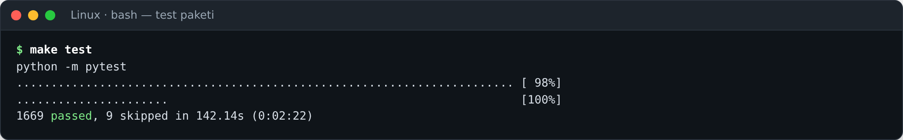

~2-3 dakika sürer. Sonda **`N passed`** görmelisiniz. Test sayısı kod geliştikçe artar:
yukarıdaki ekran görüntüsünde 1669. Bu rehber güncellenirken, [Bölüm 3](#3-linux-kurulumu)'teki
adımlarla sıfırdan kurulan Miniforge ortamında iki ayrı denemede sonuç
`1687 passed, 9 skipped` idi (`python -m pytest` 160.82 s, `make test` 159.57 s). Önemli olan
**`failed` ve `error` olmaması**. `skipped` (atlanan) testler normaldir: gerçek donanım isteyen
testler (`hardware` işaretli) burada atlanır.

> 💡 `make test`, `python3 -m pytest` komutunun kısaltmasıdır (`Makefile`'a bakın). Ubuntu'nun
> bazı kurulumlarında `make` yüklü gelmez: `make: command not found` görürseniz ya
> `sudo apt install -y make` yapın ya da doğrudan `python -m pytest` yazın, sonuç aynıdır.

🛠️ **Olmazsa**

- **`failed` görüyorsanız** → Önce `git status` ile dosyaları değiştirip değiştirmediğinize
  bakın. Değiştirmediyseniz `conda env update -f environment.yml --prune` ve
  `pip install -e ".[dev]"` ([Bölüm 10.1](#101-güncelleme)) yapıp tekrar deneyin.
- **Gerçek zamanlı (zamanlamaya duyarlı) testler** yüklü bir bilgisayarda nadiren takılabilir.
  O zaman `python -m pytest -m "not realtime"` (ya da `make test-fast`) ile tekrar deneyin.
- **`No module named pytest`** → Ortam etkin değil: `conda activate eds`.

### 5.2 Cihaz profilleri

🎯 **Ne yapıyoruz ve neden?** `eds` komutunun çalıştığını ve donanım profillerini okuyabildiğini
görüyoruz. Profiller, her donanımın frekans/bant genişliği sınırlarıdır. EDS her ayarı
donanıma göndermeden önce bunlarla karşılaştırır.

⌨️ **Komut**

```bash
eds profiles
```

✅ **Beklenen sonuç** (gerçek çıktı):

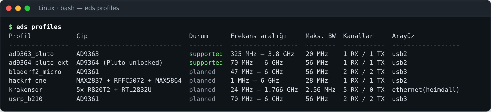

`ad9363_pluto` resmî AD9363 sınırlarıdır (325 MHz – 3.8 GHz, ≤ 20 MHz). Her ayar donanıma
gitmeden önce bu sınırlara göre kontrol edilir. `planned` profiller gelecek donanımlar içindir.

🛠️ **Olmazsa**: `eds: command not found` → `conda activate eds`. Türkçe harfler bozuksa
(Windows) [Bölüm 4.9](#49-türkçe-karakterler-için-utf-8-modu-önerilir).

### 5.3 Simülatörde ilk ölçüm

🎯 **Ne yapıyoruz ve neden?** Uçtan uca zinciri (simüle AD9363 → DSP → ölçüm → rapor)
donanım olmadan çalıştırıyoruz. Rapor klasörü oluşuyorsa matplotlib ve dosya yazma da dahil
her şey yerindedir.

⌨️ **Komut**

```bash
eds -c config/rx_sim.toml measure inst_bw image_rejection --quick
```

✅ **Beklenen sonuç** (gerçek çıktı):

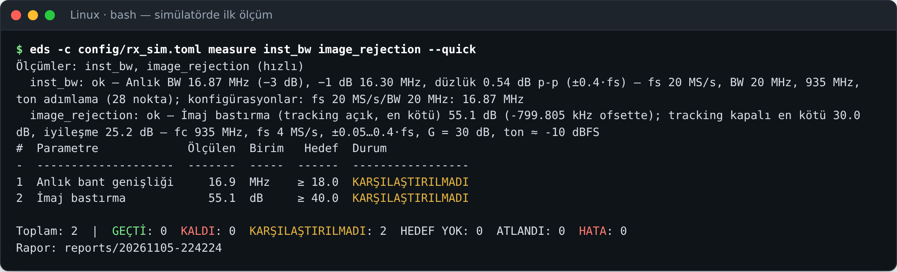

`--quick` (hızlı mod) sonuçları bilerek **KARŞILAŞTIRILMADI** olarak işaretlenir, çünkü
azaltılmış nokta sayısıyla KTR hedefine hüküm verilmez. Tam ölçüm için `--quick`'i kaldırın:

```bash
eds -c config/rx_sim.toml measure all      # ~4–5 dakika, 9 ölçüm
```

Her çalıştırma `reports/<zaman>/` altında bir rapor klasörü oluşturur. `report.html`'i
tarayıcıda açın:

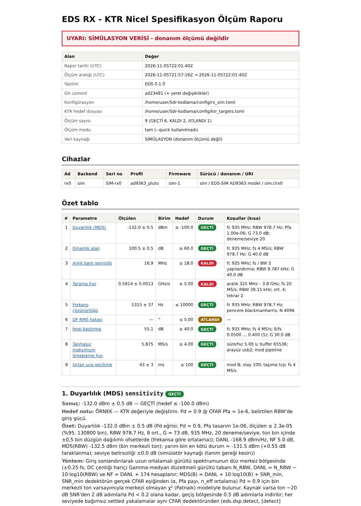

Rapordaki her ölçüm, spektrum analizörü tarzında "ekran görüntüleri" de içerir:

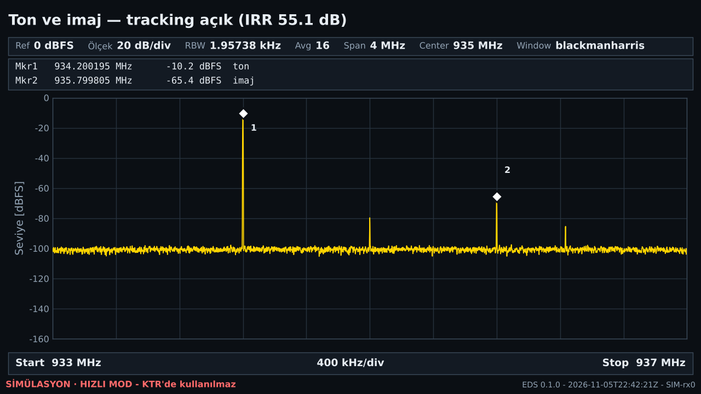

🛠️ **Olmazsa**: `HATA: Konfigürasyon dosyası yok: config/rx_sim.toml` (gerçek çıktı, çıkış
kodu 1) → depo klasöründe değilsiniz (`cd ~/Sdr-kodlama`). `config/...` yolları depo klasörüne
göre yazıldığı için komutlar her zaman depo klasöründen çalıştırılır. Raporu açmak için Linux'ta `xdg-open reports/<zaman>/report.html`,
Windows'ta `start reports\<zaman>\report.html`.

> 📗 **Kurulum ve doğrulama bitti.** Komutların ayrıntılı kullanımı (RX düğümü, tarama,
> ZeroMQ dinleme, ölçüm raporu okuma) → **[Kullanım Rehberi: KULLANIM.md](KULLANIM.md)**.
> Donanımınız varsa önce Bölüm 6'yı yapın.

---

## 6. Pluto'yu bağlamak ve ilk donanım testi

Önce işletim sisteminin Pluto'yu gördüğünden emin olun: Linux [Bölüm 3.8](#38-pluto-için-usb-izni-udev-kuralı-ve-grup--yalnızca-donanım-için)–[3.9](#39-plutoyu-tak-ve-linuxun-gördüğünü-doğrula--yalnızca-donanım-için),
Windows [Bölüm 4.6](#46-adi-pluto-usb-sürücüsü-yalnızca-donanım-için)–[4.7](#47-plutoyu-windowsta-doğrula--yalnızca-donanım-için).

### 6.1 Bağlantı ve güvenlik

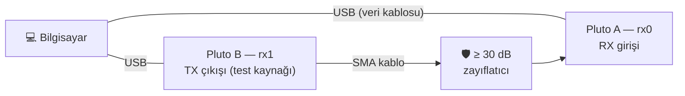

> ⛔ **TX çıkışını asla doğrudan RX girişine bağlamayın.** Arada **en az 30 dB** sabit
> zayıflatıcı olmalı. EDS, ölçümlerde RX girişine verilen seviyeyi yazılımda da
> −5 dBm ile sınırlar (`rx_max_input_dbm`), ama donanımı koruyan zayıflatıcıdır.

> 💡 Bazı USB kabloları yalnızca şarj içindir (veri hattı yoktur). Pluto görünmüyorsa önce
> kabloyu değiştirin.

### 6.2 İlk donanım oturumu — sırayla

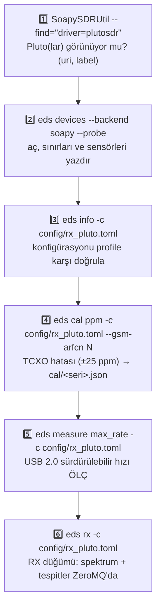

| Adım | Komut | Başarılı olduğunda |
|---|---|---|
| 1 | `SoapySDRUtil --find="driver=plutosdr"` | `driver = plutosdr`, `uri = usb:1.5.5`, `label = PlutoSDR #0 usb:1.5.5`. Seri numarası burada **yazmaz**: aşağıdaki `iio.scan_contexts()` notuna bakın |
| 2 | `eds devices --backend soapy --probe` | Frekans/kazanç sınırları, sıcaklık, `overflow_source = dma_status` |
| 3 | `eds info -c config/rx_pluto.toml` | "hata yok"; varsa uyarılar (ör. USB2 hız uyarısı) |
| 4 | `eds cal ppm ... --gsm-arfcn N` | ppm değeri (ör. `+11.7 ppm`), donanıma `xo_correction` olarak uygulanır |
| 5 | `eds measure max_rate ...` | Taşmasız en yüksek hız (MS/s) — `config/rx_pluto.toml`'daki `sample_rate_hz`'i buna göre seçin |
| 6 | `eds rx ...` ve başka terminalde `eds bus echo rx.detections` | Saniyede birkaç tespit mesajı |

`config/rx_pluto.toml` içindeki `uri` değerini adım 1'de gördüğünüz değerle değiştirin
(ya da `serial = "..."` yazın; EDS seri numarasını uri'ye kendisi çevirir).
GSM900 ARFCN'si için bölgenizde güçlü bir 2G baz istasyonu kanalı seçin. Yoksa GPSDO'ya
kilitli bir sinyal üreteciyle `--ref-hz` kullanın.

> ℹ️ **`iio_info` komutu conda ortamında yoktur** (conda-forge'daki libiio paketi komut satırı
> araçlarını içermez). Hangi `usb:` uri'sinin hangi seri numarasına ait olduğunu görmek için
> eşdeğeri:
>
> ```bash
> python -c "import iio; print(iio.scan_contexts())"
> ```
>
> Pluto takılı değilken gerçek çıktı `{}` (boş sözlük). Takılıyken beklenen çıktı
> `{'usb:1.5.5': '0456:b673 (Analog Devices Inc. PlutoSDR (ADALM-PLUTO)), serial=104473...'}`
> biçimindedir. `HARDWARE_PLUTO.md`'deki `iio_*` komutları için Ubuntu'da
> `sudo apt install libiio-utils` kurun.

### 6.3 Pluto takılı değilken ne görürsünüz?

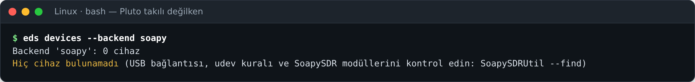

Bu mesaj kurulumun **doğru** olduğunu, ama cihazın görülmediğini söyler. Sırayla şunları
kontrol edin: kablo (veri kablosu mu?), Linux'ta udev kuralı ve `plugdev` grubu (oturumu
kapatıp açtınız mı?), Windows'ta ADI sürücüsü.

### 6.4 İki Pluto

İki Pluto aynı anda kullanılırken (DF için `config/dual_pluto.toml`) dikkat edilecekler:

- **Farklı IP adresleri:** İki Pluto'nun da varsayılan IP'si `192.168.2.1`'dir. Birinin Pluto
  sürücüsündeki `config.txt` dosyasında IP'yi değiştirin (ayrıntı: `docs/HARDWARE_PLUTO.md`).
- **Her Pluto ayrı süreçte çalışır:** SoapyPlutoSDR süreç başına yalnızca bir Pluto
  açabilir. EDS bunu otomatik yönetir (`isolation = "auto"`); sizin bir şey yapmanız gerekmez.
- **Koherens:** DF ölçümünden önce `eds cal coherence -c config/dual_pluto.toml` çalıştırın.
  Çıkış kodu **3** ise kanallar koherent değildir; ortak 40 MHz referans gerekir.
- **USB gücü:** İki Pluto'yu aynı hub'a değil, iki ayrı anakart portuna takın. Pluto'lar
  rastgele kopuyorsa güç yetmiyordur: **PWR** portundan ayrı 5 V adaptörle besleyin.

---

## 7. Alternatif yollar

### 7.1 Ubuntu: sistem paketleriyle kurulum betiği

conda kullanmak istemiyorsanız Ubuntu 22.04/24.04'te betik her şeyi sistem paketleriyle kurar:

```bash
git clone https://github.com/Nogeday/Sdr-kodlama.git && cd Sdr-kodlama
./scripts/install_ubuntu.sh             # --help: seçenekler (--no-build, --no-venv)
source .venv/bin/activate
```

Betiğin yaptıkları (sırayla):

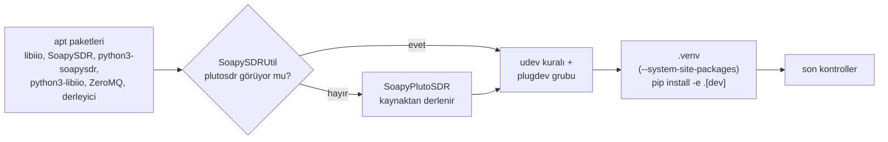

> ℹ️ Bu betik bir test ortamında söz dizimi ve statik kontrollerden geçirildi, ancak bu
> rehber hazırlanırken uçtan uca çalıştırılmadı (Bölüm 3'teki conda yolu ise uçtan uca
> çalıştırıldı). İlk kez kullanacaksanız sonundaki "son kontroller"in hepsinin `[ OK]`
> verdiğine bakın.

Bu yolda günlük rutin `conda activate eds` yerine `source ~/Sdr-kodlama/.venv/bin/activate`'tir.

### 7.2 Windows: WSL2 + usbipd-win (Linux ortamı Windows içinde)

Takımın yarışma makinesi Ubuntu ise, Windows kullanan üyelerin **birebir aynı** ortamda
çalışması için:

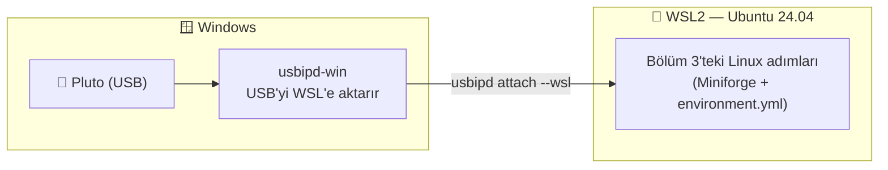

**Yönetici PowerShell'de (bir kez):**

```powershell
wsl --install -d Ubuntu-24.04                  # bilgisayarı yeniden başlatın
winget install --interactive --exact dorssel.usbipd-win
```

**Pluto'yu her taktığınızda (Yönetici PowerShell):**

```powershell
usbipd list                                    # "0456:b673 ... PlutoSDR" satırındaki BUSID'i not edin (ör. 2-3)
usbipd bind --busid 2-3                        # yalnızca ilk seferde
usbipd attach --wsl --busid 2-3
```

Ardından **WSL Ubuntu terminalinde** `lsusb` ile `0456:b673 Analog Devices` satırını görün
ve Bölüm 3'ü uygulayın. udev kurallarının WSL'de çalışması için systemd açık olmalıdır:
`/etc/wsl.conf` dosyasında `[boot]` altında `systemd=true` satırı bulunmalı. Satır yoksa ekleyin
ve PowerShell'de `wsl --shutdown` ile WSL'i yeniden başlatın.

> ⚠️ Firmware güncellemesini WSL üzerinden **yapmayın**. Pluto güncelleme sırasında yeniden
> başlar ve USB aktarımı kopar. Güncellemeyi Windows'ta, Pluto sürücüsüne dosya kopyalayarak yapın.

---

## 8. Sorun giderme

Önce şu üç soruyu sorun. Sorunların çoğu bunlardan birinde çıkar:

1. İstemin başında **`(eds)`** var mı? (Yoksa: `conda activate eds`.)
2. **Depo klasöründe** misiniz? (`pwd` / `cd` → `.../Sdr-kodlama` olmalı.)
3. Donanım sorunuysa: işletim sistemi Pluto'yu **görüyor mu**? (`lsusb` / Aygıt Yöneticisi.)

| Belirti | Olası neden | Çözüm |
|---|---|---|
| `conda: command not found` / `'conda' is not recognized` | Linux: `conda init` yapılmadı ya da terminal yeniden açılmadı · Windows: Miniforge Prompt yerine normal cmd/PowerShell | Linux: `~/miniforge3/bin/conda init bash`, terminali yeniden açın ([3.2](#32-miniforgeu-kur-bir-kez)) · Windows: Miniforge Prompt ([4.4](#44-miniforge-promptu-aç-ve-miniforgeu-doğrula)) |
| `CondaError: Run 'conda init' before 'conda activate'` | Kabuk conda için ayarlanmamış | `conda init bash` (ya da `zsh` / `powershell`), terminali yeniden açın |
| `SoapySDRUtil --info` → **No modules found!** | conda ortamı **etkin değil** (program doğrudan yoldan çağrıldı; `CONDA_PREFIX` yok) | `conda activate eds`, sonra tekrar deneyin ([3.7](#37-kurulumu-doğrula)) |
| `ModuleNotFoundError: No module named 'SoapySDR'` | Yanlış Python (ortam etkin değil ya da `.venv` `--system-site-packages` olmadan kuruldu) | `conda activate eds` · Ubuntu betiği yolunda `source .venv/bin/activate` |
| `EnvironmentFileNotFound: ... environment.yml file not found` | Depo klasöründe değilsiniz | `cd ~/Sdr-kodlama` (Windows: `cd %USERPROFILE%\Sdr-kodlama`) |
| `CondaValueError: prefix already exists` | `eds` ortamı zaten var | `conda env update -f environment.yml --prune` ([10.1](#101-güncelleme)) |
| `conda env create` → çakışma (conflict) hatası | `environment.yml` değiştirilmiş (ör. SoapySDR 0.9 / libiio 1.0 istenmiş) | Dosyayı depodaki hâline döndürün (`git checkout environment.yml`); sürümler bilerek sabittir |
| `... does not appear to be a Python project` (pip) | `pip install -e` depo klasörü dışında çalıştırıldı | `cd ~/Sdr-kodlama`, tekrar `pip install -e ".[dev]"` |
| `Hiç cihaz bulunamadı` | Pluto görünmüyor | Veri kablosu, **USB** portu (PWR değil) · Linux: udev + `plugdev` + oturumu kapat-aç · Windows: ADI sürücüsü · WSL: `usbipd attach` |
| `SoapySDR::Device::make() no match` | `config` içindeki `uri` gerçek cihazla eşleşmiyor | `SoapySDRUtil --find="driver=plutosdr"` çıktısındaki uri'yi yazın ya da `serial = "..."` kullanın |
| Linux: `Permission denied` / `LIBUSB_ERROR_ACCESS` | udev kuralı yok ya da grup üyeliği henüz geçerli değil | Bölüm 3.8, sonra oturumu kapatıp açın |
| `SoapyPlutoSDR süreç başına tek Pluto` hatası | İki Pluto `isolation = "inproc"` ile zorlanmış | `isolation = "auto"` (varsayılan) bırakın |
| Windows: Türkçe harfler `?` görünüyor | Konsol kodlaması UTF-8 değil | `setx PYTHONUTF8 1`, terminali yeniden açın; Windows Terminal kullanın ([4.9](#49-türkçe-karakterler-için-utf-8-modu-önerilir)) |
| Windows: `where python` → `...\WindowsApps\python.exe` | Microsoft Store Python kısayolu öne geçmiş | `conda activate eds`; gerekirse *Uygulama yürütme diğer adları*'nda `python.exe`'yi kapatın ([4.10](#410-doğrula)) |
| VS Code `import SoapySDR`'ı kırmızı işaretliyor | Yanlış yorumlayıcı | **Python: Select Interpreter** → `eds` ([4.12](#412-vs-code-eds-yorumlayıcısını-seçmek-linuxta-da-aynı)) |
| `CondaHTTPError` / `Could not resolve host` | İnternet yok ya da kurum ağı/vekil sunucu engelliyor | Bağlantıyı kontrol edin; okul ağında başka ağ (ör. telefon paylaşımı) deneyin |
| `eds measure max_rate` çok düşük çıkıyor | USB hub, uzun/kalitesiz kablo, USB 1.1 port | Pluto'yu doğrudan anakart USB portuna takın; `buffer_size`'ı büyütün |
| `realtime` işaretli testler ara sıra kalıyor | Yük altındaki bilgisayarda zamanlama | `python -m pytest -m "not realtime"`; ölçümleri boşta bir makinede yapın |
| `eds cal coherence` çıkış kodu 3 | İki Pluto koherent değil | Ortak 40 MHz referans (Rev C/D CLK_IN), `docs/HARDWARE_PLUTO.md` §5 |

Daha ayrıntılı hata çıktısı için her komuta `-v` ekleyin (ör. `eds -v devices --backend soapy`).
Takıma sorarken şu üç çıktıyı da ekleyin: `conda info`, `conda list "^(python|soapysdr|libiio-c|pylibiio)$"`
ve hatanın **tam** metni (ekran görüntüsü yerine kopyalanmış metin daha iyidir).

---

## 9. Doğrulanmış sürümler

| Bileşen | Sürüm |
|---|---|
| Miniforge3 / conda | 26.9.4-2 / 26.9.4 (Linux'ta gerçek kurulum; daha yeni sürümler de çalışmalı) |
| Python | 3.12.16 (conda ortamı), 3.13 (sistem Python, ayrı kurulum) |
| SoapySDR | 0.8.1 (`environment.yml`'de sabit) |
| SoapyPlutoSDR (`soapysdr-module-plutosdr`) | 0.2.4 |
| libiio (`libiio-c`) / pylibiio | 0.26 (`<1` ile sabit) |
| numpy · pyzmq · matplotlib | 2.5.4 · 27.3.0 · 3.11.2 (2026-11-06 kurulumu; bunlar sabit değil, sonraki kurulumlarda daha yeni gelebilir) |

Kendi kurulumunuzda aynı tabloyu görmek için (gerçek çıktı, Linux):

```text
(eds) $ conda list "^(python|soapysdr|soapysdr-module-plutosdr|libiio-c|pylibiio|numpy|pyzmq|matplotlib)$"
# packages in environment at ~/miniforge3/envs/eds:
#
# Name                      Version          Build               Channel
libiio-c                    0.26             h0558edb_3          conda-forge
matplotlib                  3.11.2           py312h6a12a82_1     conda-forge
numpy                       2.5.4            py312he827f4e_0     conda-forge
pylibiio                    0.26             py_3                conda-forge
python                      3.12.16          h5f976f7_0_cpython  conda-forge
pyzmq                       27.3.0           py312h8a5ba0d_0     conda-forge
soapysdr                    0.8.1            py312h93a722d_7     conda-forge
soapysdr-module-plutosdr    0.2.4            h3725345_0          conda-forge
```

Bu rehber hazırlanırken neyin **gerçekten çalıştırıldığı**, neyin yalnızca **kontrol edildiği**:

| Yol | Durum |
|---|---|
| Linux + Miniforge (`environment.yml`) | ✅ Ubuntu 24.04'te **gerçek Miniforge3 26.9.4 kurucusuyla** sıfırdan uçtan uca kuruldu: kurucu → `conda init` → `conda env create` → `pip install -e` → doğrulama → `conda env update --prune` → `conda env remove`. SoapySDR `plutosdr` modülünü buldu. Bu ortamda **1687 test geçti, 9 atlandı** (gerçek SoapySDR/libiio bağlamalarıyla). Bölüm 3, 5 ve 10'daki ekran görüntüleri ve çıktılar bu kurulumdan. Önceki sürümde aynı `environment.yml` ile 1669 test geçmişti (`terminal_testler.png`). |
| Rehberin bağımsız denetimi (Linux) | ✅ Bölüm 3, 5, 6.2–6.3 ve 10'daki Linux komutları, rehberi yazmayan biri tarafından **yazıldığı gibi, sırayla** ve boş bir ev klasöründe yeniden çalıştırıldı (2026-11-06): kurucu, `conda init`, `git clone`, `conda env create` (260.5 MB), `pip install -e`, doğrulama, `make test` (1687 geçti, 9 atlandı), ölçümler, güncelleme, kilit dosyası, kaldırma. Belgelenen çıktılar tuttu; tutmayan iki ifade düzeltildi (5.3'teki hata mesajı ve 6.2'de `SoapySDRUtil --find`'ın seri numarası gösterdiği iddiası). `sudo` ve donanım isteyen adımlar (3.8, 3.9'un bir kısmı, 6.2'nin donanım adımları) yalnızca söz dizimi açısından kontrol edildi. |
| Windows + Miniforge (`environment.yml`) | ✅ Ortam **win-64 için çözüldü** (aynı paket sürümleri mevcut, libiio'nun USB arka ucu `libusb` ile geliyor). ⏳ Bir Windows bilgisayarda uçtan uca **henüz çalıştırılmadı**; Bölüm 4'teki ekran ve çıktı açıklamaları **beklenen** davranıştır. İlk kurulumda sonuçları takıma bildirin. |
| Kodun Windows uyumluluğu | ✅ Unix'e özgü API kullanılmıyor; tüm dosya yazımları UTF-8; Türkçe çıktı cp1252 konsolda çökmez (test edildi). |
| Ubuntu kurulum betiği | ✅ Söz dizimi/statik kontrol. ⏳ Uçtan uca çalıştırılmadı. |
| Gerçek Pluto ile | ⏳ Henüz yok: SoapySDR/libiio kodu gerçek API'lere karşı kontrol edildi; Pluto'ya ait çıktılar (Bölüm 3.9, 4.7, 6) **beklenen** çıktılardır. İlk donanım oturumu için Bölüm 6.2'yi izleyin. |

---

## 10. Güncelleme, kaldırma ve iki bilgisayarı aynı tutmak

### 10.1 Güncelleme

🎯 **Ne yapıyoruz ve neden?** Takım yeni kod gönderdiğinde üç şey değişmiş olabilir: (1) kod
(`src/`), (2) bağımlılık listesi (`environment.yml`), (3) paket tanımı (`pyproject.toml`: yeni
komut, yeni bağımlılık). `git pull` yalnızca (1)'i getirir. Düzenlenebilir kurulum sayesinde kod
hemen geçerli olur, ama (2) ve (3) için ortamı da güncellemek gerekir. Her seferinde üç komutun
hepsini çalıştırmak en güvenlisidir. Değişiklik yoksa birkaç saniyede biterler.

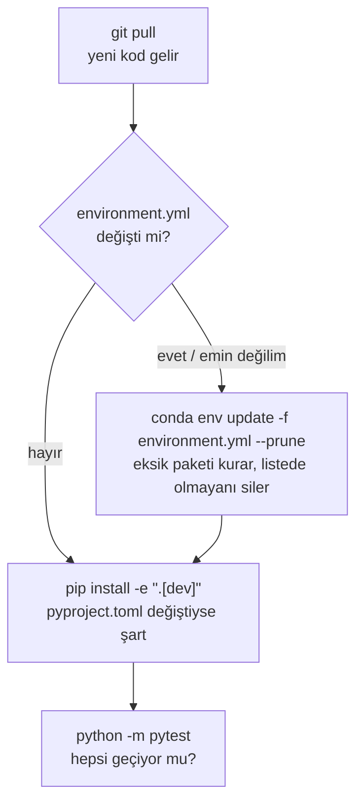

⌨️ **Komut** (ortam etkin, depo klasöründe)

```bash
conda activate eds
cd ~/Sdr-kodlama                        # Windows: cd %USERPROFILE%\Sdr-kodlama
git pull
conda env update -f environment.yml --prune
pip install -e ".[dev]"
python -m pytest
```

`--prune`: `environment.yml`'den çıkarılmış paketleri ortamdan da siler. Böylece ortamınız
dosyadakiyle birebir kalır. (pip ile kurulan `eds` silinmez, bunu doğruladık.)

✅ **Beklenen sonuç** (gerçek çıktı; `git pull` hariç, çünkü bu rehber hazırlanırken çekilecek
yeni kod yoktu):

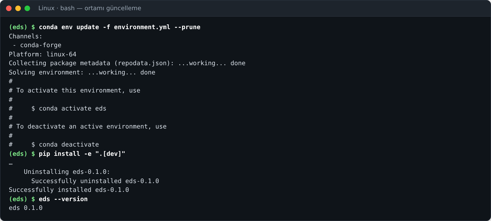

`git pull`'un beklenen çıktısı: yeni kod yoksa `Already up to date.`, varsa `Updating
abc1234..def5678` / `Fast-forward` ve değişen dosyaların listesi.

🛠️ **Olmazsa**

- **`git pull` → `error: Your local changes to the following files would be overwritten by merge`**
  → Bir dosyayı değiştirmişsiniz. Değişikliği saklamak istiyorsanız `git stash`, sonra
  `git pull`, sonra `git stash pop`. İstemiyorsanız `git checkout -- <dosya>`. Ölçüm için
  değiştirdiğiniz konfigürasyonları depo dosyalarında değil, kopyalarında tutun (ör.
  `config/benim_pluto.toml`).
- **`conda env update` çakışma veriyor** → Ortamı sıfırdan kurun: [10.2](#102-kaldırma)'deki
  `conda env remove -n eds -y`, sonra [3.5](#35-conda-ortamını-oluştur)–[3.6](#36-ortamı-etkinleştir-ve-edsyi-kur).
  Ortam bir "çöp kutusu" gibidir, silip yeniden kurmak 1-2 dakika sürer ve hiçbir kodunuzu kaybettirmez.
- **Testler güncellemeden sonra kalıyor** → `pip install -e ".[dev]"` atlanmış olabilir. Hâlâ
  kalıyorsa takıma `git log -1 --oneline` çıktısıyla bildirin.

### 10.2 Kaldırma

🎯 **Ne yapıyoruz ve neden?** Ortam bozulduysa ya da artık gerekmiyorsa. **Ortamı silmek kodu
silmez:** `~/Sdr-kodlama` klasörü ve `reports/` olduğu gibi kalır, yalnızca `~/miniforge3/envs/eds`
silinir.

⌨️ **Komut**

```bash
conda deactivate                        # silinecek ortamın içinde olmayın
conda env remove -n eds -y
conda env list                          # eds artık listede olmamalı
```

✅ **Beklenen sonuç** (gerçek çıktı; 180 satırlık paket listesi kısaltıldı):

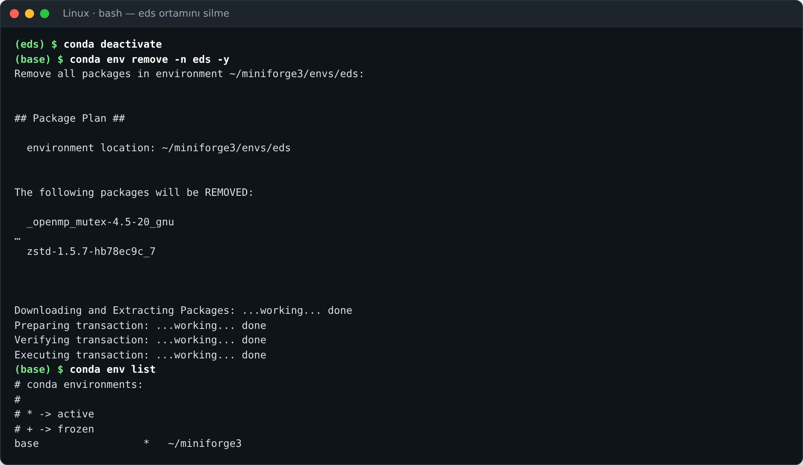

> 💡 `-y` olmadan çalıştırırsanız conda **iki kez** onay ister: önce `Proceed ([y]/n)?`, sonra
> (pip ile kurulmuş `eds` dosyaları ortamda olduğu için) *"Everything found within the
> environment (~/miniforge3/envs/eds), including any conda environment configurations and any
> non-conda files, will be deleted. Do you wish to continue? (y/[n])?"*. İkinci soruda
> varsayılan **hayır**dır. Enter'a basarsanız `CondaSystemExit: Exiting.` der ve klasör yarım
> silinmiş kalır. İkisine de `y` yazın (bu davranış gerçek denemede görüldü).

**Miniforge'u tamamen kaldırmak** (nadiren gerekir):

- **Linux:** önce kabuk ayarını geri alın, sonra klasörü silin:

  ```bash
  ~/miniforge3/bin/conda init --reverse bash      # ~/.bashrc'deki conda bloğunu kaldırır
  rm -rf ~/miniforge3 ~/.conda ~/.condarc
  ```

- **Windows:** Ayarlar → Uygulamalar → **Miniforge3** → Kaldır. ADI sürücüsü ayrı bir
  uygulama olarak listelenir. Pluto'yu kullanmayacaksanız o da oradan kaldırılır.

🛠️ **Olmazsa**: `CondaEnvironmentError: cannot remove current environment` → Önce
`conda deactivate`. Windows'ta "dosya kullanımda" hatası → ortamı kullanan VS Code ve Python
pencerelerini kapatın.

### 10.3 İki bilgisayarı aynı tutmak

🎯 **Ne yapıyoruz ve neden?** Yarışma bilgisayarı ile geliştirme bilgisayarı (ya da iki takım
üyesi) aynı sonucu vermeli. Bir ölçüm iki makinede farklı çıkarsa önce **yazılımın aynı
olduğunu** kanıtlamanız gerekir. Aynılığı üç katman belirler:

| Katman | Aynı olması için | Kontrol komutu |
|---|---|---|
| Kod | Aynı commit | `git rev-parse --short HEAD` ve `git status` ("nothing to commit" olmalı) |
| Ortam | Aynı `environment.yml` + `conda env update --prune` | `conda list "^(python|soapysdr|soapysdr-module-plutosdr|libiio-c|pylibiio|numpy|pyzmq|matplotlib)$"` |
| EDS | `pip install -e ".[dev]"` aynı commit'te | `eds --version` |

⌨️ **Komut** — iki makinede de çalıştırıp çıktıları yan yana koyun:

```bash
git rev-parse --short HEAD
python -c "import sys, numpy, zmq, SoapySDR, iio; print(sys.version.split()[0], numpy.__version__, zmq.__version__, SoapySDR.getLibVersion(), iio.version[2])"
```

✅ **Beklenen sonuç** (gerçek çıktı, bu rehberin hazırlandığı kurulum):

```text
9318a93
3.12.16 2.5.4 27.3.0 0.8.1-7 v0.26
```

İki satır da iki makinede aynıysa yazılım aynıdır. SoapySDR (`0.8.1`), SoapyPlutoSDR ve libiio
(`v0.26`) `environment.yml`'de sabittir. numpy/pyzmq/matplotlib sabit değildir, farklı
günlerde kurulan makinelerde farklı çıkabilir. Bu genellikle sorun değildir. Gerekiyorsa
eskiyi `conda env update --prune` ile güncel hâle getirin.

**Birebir kopya gerekiyorsa** (ör. yarışmadan önce ortamı dondurmak, **yalnızca aynı işletim
sistemi arasında**): Linux'tan alınan liste Windows'ta çalışmaz ve tersi de geçerlidir.

```bash
# Kaynak makinede (eds ortamı etkin):
conda list --explicit > eds-linux-64.lock.txt
# Hedef makinede (aynı commit'te, depo klasöründe):
conda create -n eds --file eds-linux-64.lock.txt -y
conda activate eds
pip install -e ".[dev]"
```

Bu yol bu rehber hazırlanırken Linux'ta denendi: kilit dosyasından oluşturulan ortam aynı
sürüm satırını (`3.12.16 2.5.4 27.3.0 0.8.1-7 v0.26`) verdi. Kilit dosyası paketleri internetten
yine indirir. Tamamen çevrimdışı kurulum gerekiyorsa takımla ayrıca planlayın.

🛠️ **Olmazsa**

- **`git status` "modified" dosyalar gösteriyor** → O makinede depo dosyası değiştirilmiş.
  Ölçüm öncesi ya commit'leyin ya da geri alın. Aksi hâlde "aynı commit" iddiası geçersizdir.
- **`conda env export --from-history`** bu ortamda hata veriyor (gerçek çıktı:
  `CondaValueError: Requested package 'ruff' is not found in 'explicit_packages'.`). Neden:
  `pip install -e ".[dev]"` ruff'ın pip sürümünü de kurar, conda'nın geçmiş kaydı ise conda
  paketini arar. Kilit için yukarıdaki `conda list --explicit` yolunu kullanın.

---

> 📗 **Kurulum bitti → Kullanım Rehberi: [KULLANIM.md](KULLANIM.md)** (RX düğümü, tarama,
> ZeroMQ, kalibrasyon, KTR ölçümleri ve raporları adım adım).
> Donanım ayrıntıları: [HARDWARE_PLUTO.md](HARDWARE_PLUTO.md) · Ölçüm tanımları:
> [MEASUREMENTS.md](MEASUREMENTS.md) · Mimari: [ARCHITECTURE.md](ARCHITECTURE.md).
