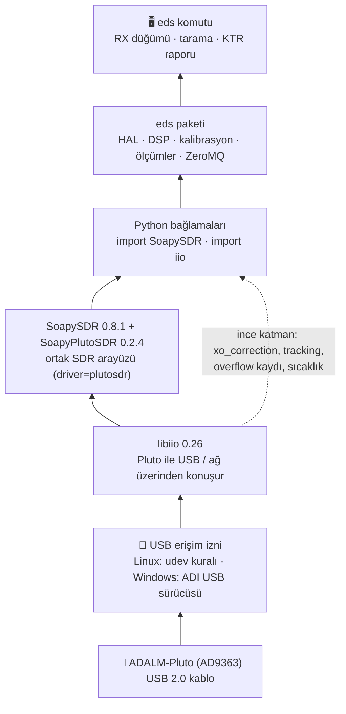
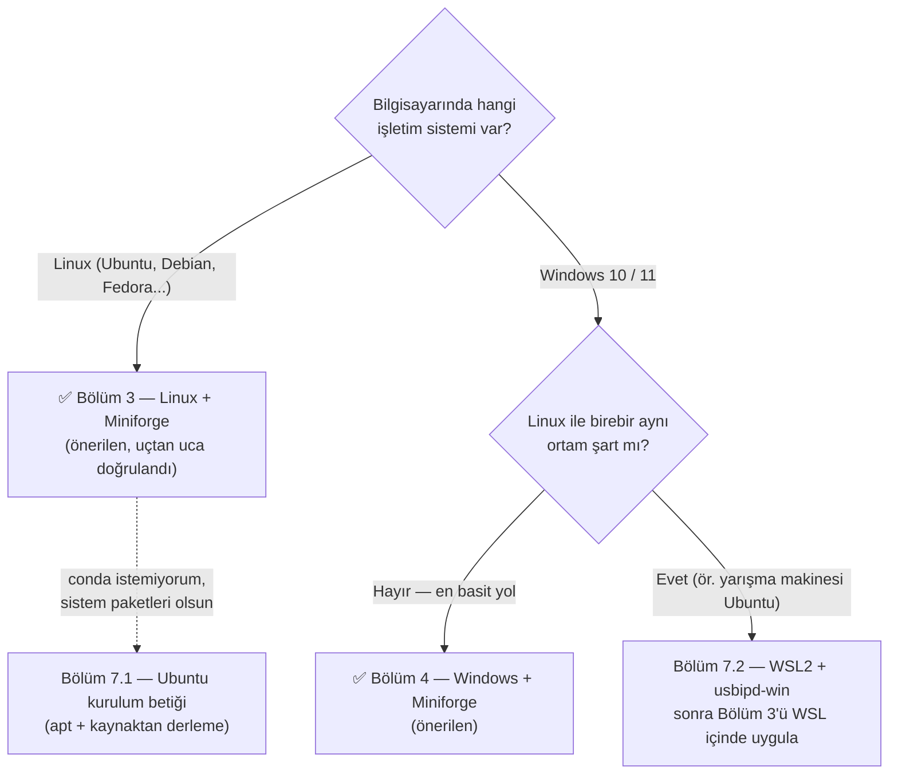
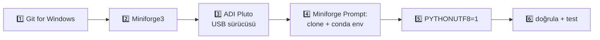
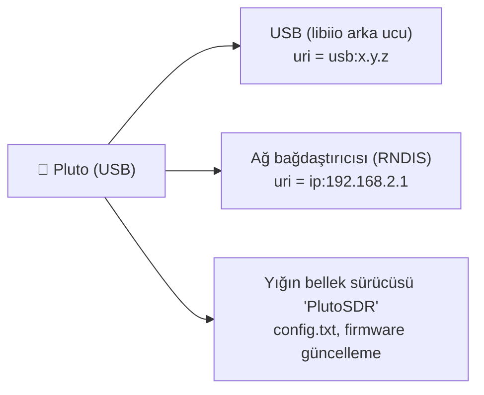
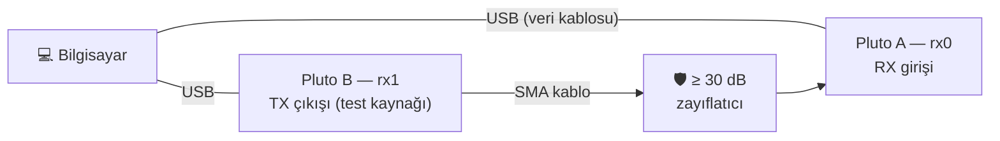
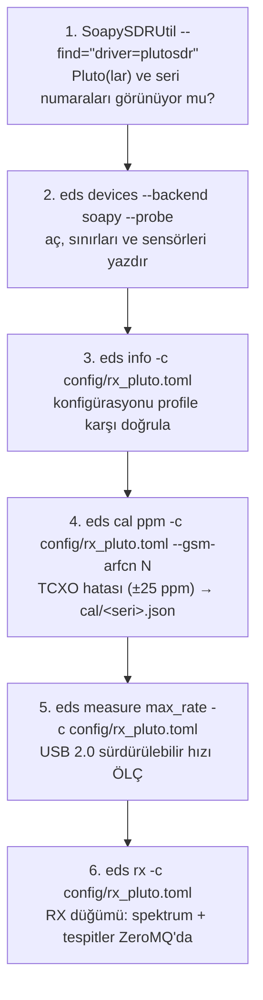
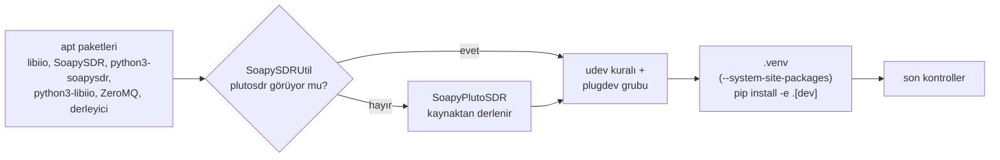
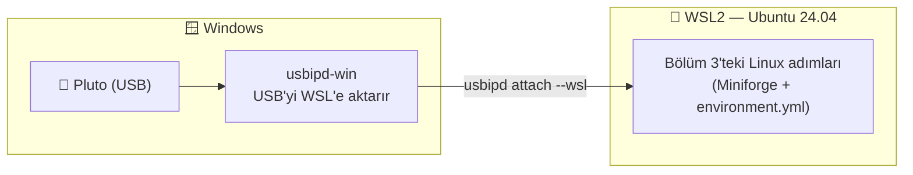

# Kurulum Rehberi — Linux ve Windows

Bu rehber EDS'yi (Elektronik Destek RX omurgası) **sıfırdan çalışır hâle** getirir:
önce donanım olmadan **simülatörde**, sonra **ADALM-Pluto** ile. Her adımda ne yaptığını,
neden yaptığını ve başarılı olduğunda ne göreceğini anlatır.

> **Kısa yol (her iki işletim sistemi):** Miniforge kur → `conda env create -f environment.yml`
> → `conda activate eds` → `pip install -e ".[dev]"` → `eds measure all -c config/rx_sim.toml --quick`.
> Ayrıntılar ve işletim sistemine özgü adımlar aşağıda.

**İçindekiler**

1. [Büyük resim: neyi kuruyoruz?](#1-büyük-resim-neyi-kuruyoruz)
2. [Hangi yolu seçmeliyim?](#2-hangi-yolu-seçmeliyim)
3. [Linux kurulumu (önerilen yol: Miniforge)](#3-linux-kurulumu)
4. [Windows kurulumu (önerilen yol: Miniforge)](#4-windows-kurulumu)
5. [Doğrulama: her şey çalışıyor mu?](#5-doğrulama-her-şey-çalışıyor-mu)
6. [Pluto'yu bağlamak ve ilk donanım testi](#6-plutoyu-bağlamak-ve-ilk-donanım-testi)
7. [Alternatif yollar: Ubuntu betiği, WSL2](#7-alternatif-yollar)
8. [Sorun giderme](#8-sorun-giderme)
9. [Doğrulanmış sürümler ve neyin nerede test edildiği](#9-doğrulanmış-sürümler)

---

## 1. Büyük resim: neyi kuruyoruz?

EDS bir Python paketidir; Pluto'ya ise birkaç katman üzerinden konuşur. Kurulumun tamamı bu
katmanları alttan üste doğru yerleştirmekten ibarettir:



| Katman | Linux'ta nereden gelir | Windows'ta nereden gelir |
|---|---|---|
| USB erişim izni | `scripts/53-adi-plutosdr-usb.rules` (udev) | ADI **PlutoSDR-M2k-USB-Drivers** kurulumu |
| libiio, SoapySDR, SoapyPlutoSDR, Python bağlamaları | `environment.yml` (conda-forge) | `environment.yml` (conda-forge) — **aynı dosya** |
| eds paketi | `pip install -e ".[dev]"` | `pip install -e ".[dev]"` |

> 💡 **Simülatör için donanım gerekmez.** Pluto'nuz yokken de bütün testler ve 9 KTR
> ölçümü fizik tabanlı AD9363 simülatöründe çalışır. Pluto katmanları yalnızca donanım
> takıldığında devreye girer.

---

## 2. Hangi yolu seçmeliyim?



**Neden Miniforge (conda)?** Pluto için gereken dört parça (libiio, SoapySDR, SoapyPlutoSDR
sürücüsü, Python bağlamaları) **Linux'ta da Windows'ta da aynı sürümlerle**, derleme
gerektirmeden gelir. Takımdaki herkesin aynı ortamda çalışması "bende çalışıyordu" sorununu
ortadan kaldırır.

> ⚠️ **Sürümler bilerek sabitlendi.** conda-forge'daki `soapysdr-module-plutosdr 0.2.4`
> paketi SoapySDR **0.9** ve libiio **1.0** ile kurulamıyor; `environment.yml` bu yüzden
> SoapySDR 0.8.1 ve libiio 0.26 seçer. Ortamı "güncellemek" için sürümleri elle değiştirmeyin.

---

## 3. Linux kurulumu

Aşağıdaki adımlar herhangi bir 64-bit Linux'ta (Ubuntu 22.04/24.04 dahil) çalışır.
Toplam süre: ~10 dakika (çoğu indirme).


### 3.1 Miniforge'u kur (bir kez)

Miniforge, yalnızca **conda-forge** kanalını kullanan küçük bir conda dağıtımıdır.

```bash
curl -L -O "https://github.com/conda-forge/miniforge/releases/latest/download/Miniforge3-$(uname)-$(uname -m).sh"
bash Miniforge3-$(uname)-$(uname -m).sh -b -p ~/miniforge3
~/miniforge3/bin/conda init bash        # zsh kullanıyorsanız: conda init zsh
exec $SHELL                             # terminali yeniden başlat
conda --version                         # "conda 24.x" ya da daha yenisi görünmeli
```

### 3.2 Depoyu indir

```bash
sudo apt install -y git                 # (Ubuntu/Debian) git yoksa
git clone https://github.com/Nogeday/Sdr-kodlama.git
cd Sdr-kodlama
```

### 3.3 conda ortamını oluştur ve EDS'yi kur

```bash
conda env create -f environment.yml     # libiio, SoapySDR, SoapyPlutoSDR, numpy, pyzmq, ...
conda activate eds                      # ⚠️ her yeni terminalde gerekli
pip install -e ".[dev]"                 # eds paketi (düzenlenebilir: kod değişince yeniden kurmak gerekmez)
```

> 💡 `pip install -e` **düzenlenebilir** kurulumdur: `src/eds/` altındaki bir dosyayı
> değiştirdiğinizde değişiklik hemen geçerli olur, yeniden kurmanız gerekmez.

### 3.4 Pluto için USB izni (udev kuralı) — yalnızca donanım için

Linux, USB cihazlarına varsayılan olarak yalnızca root'un erişmesine izin verir. Depodaki
kural Pluto'yu (`0456:b673`, DFU modunda `0456:b674`) `plugdev` grubuna açar ve
ModemManager'ın Pluto'yu kurcalamasını engeller:

```bash
sudo install -m 0644 scripts/53-adi-plutosdr-usb.rules /etc/udev/rules.d/
sudo udevadm control --reload-rules && sudo udevadm trigger
sudo usermod -aG plugdev "$USER"        # sonra OTURUMU KAPATIP AÇIN (grup üyeliği ancak böyle geçerli olur)
```

### 3.5 Doğrula

```bash
SoapySDRUtil --info                     # "Available factories... plutosdr" satırını arayın
python -c "import SoapySDR, iio; print(SoapySDR.getLibVersion(), iio.version[2])"
make test                               # ya da: python -m pytest
```

Beklenen çıktı (bu ortamda gerçekten çalıştırıldı):


`plutosdr` satırını görüyorsanız SDR yığını hazırdır. Şimdi [Bölüm 5](#5-doğrulama-her-şey-çalışıyor-mu)'e geçin.

---

## 4. Windows kurulumu

Windows 10 (21H2+) veya Windows 11, 64-bit. Toplam süre: ~15 dakika.



### 4.1 Git for Windows

<https://git-scm.com/download/win> adresinden indirip varsayılan seçeneklerle kurun
(veya PowerShell'de: `winget install --id Git.Git -e`).

### 4.2 Miniforge3

1. <https://github.com/conda-forge/miniforge/releases/latest> sayfasından
   **`Miniforge3-Windows-x86_64.exe`** dosyasını indirin.
2. Kurulumda **"Just Me"** seçin, varsayılan klasörü (`%USERPROFILE%\miniforge3`) kabul edin.
3. Başlat menüsünde **"Miniforge Prompt"** belirir — bundan sonraki bütün komutları
   **bu pencerede** çalıştıracaksınız (normal `cmd`'de `conda` komutu bulunmaz).

### 4.3 ADI Pluto USB sürücüsü (yalnızca donanım için)

Windows'un Pluto ile USB üzerinden konuşabilmesi için Analog Devices'ın sürücüsü gerekir:

1. <https://github.com/analogdevicesinc/plutosdr-m2k-drivers-win/releases> sayfasından
   **`PlutoSDR-M2k-USB-Drivers.exe`** dosyasını indirip kurun.
2. Pluto'yu takın. Doğru kurulduysa Windows Pluto'yu **üç şekilde** görür:



> 💡 EDS akışı için **USB yolunu** (`usb:`) tercih edin, çünkü ağ yolu daha yavaştır. Ağ yolu
> (`ip:192.168.2.1`) ince libiio katmanı (`control_uri`) için kullanılır.

### 4.4 Depo, conda ortamı ve EDS (Miniforge Prompt'ta)

```bat
cd %USERPROFILE%
git clone https://github.com/Nogeday/Sdr-kodlama.git
cd Sdr-kodlama
conda env create -f environment.yml
conda activate eds
pip install -e ".[dev]"
```

### 4.5 Türkçe karakterler için UTF-8 modu (önerilir)

İngilizce Windows'ta konsol kodlaması `ş, ğ, İ, ı` harflerini gösteremeyebilir. EDS
bu durumda çökmez (gösterilemeyen harfi `?` ile değiştirir), ama doğru görmek için Python'u
UTF-8 moduna alın:

```bat
setx PYTHONUTF8 1
```

Ardından **Miniforge Prompt'u kapatıp yeniden açın** ve `conda activate eds` yazın.
Windows Terminal kullanmak da Türkçe karakter görüntüsünü iyileştirir.

### 4.6 Doğrula

```bat
SoapySDRUtil --info
python -c "import SoapySDR, iio; print(SoapySDR.getLibVersion(), iio.version[2])"
python -m pytest
```

Windows'ta `make` yoktur; `make test` yerine doğrudan `python -m pytest` yazın. Beklenen
görünüm Linux ile aynıdır (yukarıdaki ekran görüntüsü). Fark yalnızca yollarda olur: modül
`%CONDA_PREFIX%\Library\lib\SoapySDR\modules0.8\` altındaki `PlutoSDRSupport.dll` dosyasıdır.

> ⚠️ **Windows Güvenlik Duvarı:** `eds rx` ilk kez çalıştığında "Python'un ağa erişmesine
> izin verilsin mi?" sorusu gelebilir. ZeroMQ yayını (`tcp://*:5555`) için **Özel ağlar**
> seçeneğini işaretleyin. Yalnızca aynı bilgisayarda kullanacaksanız izin vermeseniz de
> `127.0.0.1` üzerinden çalışır.

---

## 5. Doğrulama: her şey çalışıyor mu?

Bu bölüm iki işletim sisteminde de aynıdır (`conda activate eds` yapılmış olmalı).

### 5.1 Test paketi

```bash
make test        # Windows: python -m pytest
```


~2–3 dakika sürer. Sonda **`N passed`** görmelisiniz; `failed` görürseniz [Sorun giderme](#8-sorun-giderme)'ye bakın.
Gerçek zamanlı (zamanlamaya duyarlı) testler yüklü bir bilgisayarda nadiren takılabilir;
o zaman `python -m pytest -m "not realtime"` ile tekrar deneyin.

### 5.2 Cihaz profilleri

```bash
eds profiles
```


`ad9363_pluto` resmî AD9363 sınırlarıdır (325 MHz – 3.8 GHz, ≤ 20 MHz). Her ayar donanıma
gitmeden önce bu sınırlara göre kontrol edilir. `planned` profiller gelecek donanımlar içindir.

### 5.3 Simülatörde ilk ölçüm

```bash
eds -c config/rx_sim.toml measure inst_bw image_rejection --quick
```


`--quick` (hızlı mod) sonuçları bilerek **KARŞILAŞTIRILMADI** olarak işaretlenir, çünkü
azaltılmış nokta sayısıyla KTR hedefine hüküm verilmez. Tam ölçüm için `--quick`'i kaldırın:

```bash
eds -c config/rx_sim.toml measure all      # ~4–5 dakika, 9 ölçüm
```

Her çalıştırma `reports/<zaman>/` altında bir rapor klasörü oluşturur. `report.html`'i
tarayıcıda açın:


Rapordaki her ölçüm, spektrum analizörü tarzında "ekran görüntüleri" de içerir:


---

## 6. Pluto'yu bağlamak ve ilk donanım testi

### 6.1 Bağlantı ve güvenlik



> ⛔ **TX çıkışını asla doğrudan RX girişine bağlamayın.** Arada **en az 30 dB** sabit
> zayıflatıcı olmalı. EDS, ölçümlerde RX girişine verilen seviyeyi yazılımda da
> −5 dBm ile sınırlar (`rx_max_input_dbm`), ama donanımı koruyan zayıflatıcıdır.

> 💡 Bazı USB kabloları yalnızca şarj içindir (veri hattı yoktur). Pluto görünmüyorsa önce
> kabloyu değiştirin.

### 6.2 İlk donanım oturumu — sırayla



| Adım | Komut | Başarılı olduğunda |
|---|---|---|
| 1 | `SoapySDRUtil --find="driver=plutosdr"` | `driver=plutosdr`, `uri=usb:1.5.5`, seri numarası |
| 2 | `eds devices --backend soapy --probe` | Frekans/kazanç sınırları, sıcaklık, `overflow_source = dma_status` |
| 3 | `eds info -c config/rx_pluto.toml` | "hata yok"; varsa uyarılar (ör. USB2 hız uyarısı) |
| 4 | `eds cal ppm ... --gsm-arfcn N` | ppm değeri (ör. `+11.7 ppm`), donanıma `xo_correction` olarak uygulanır |
| 5 | `eds measure max_rate ...` | Taşmasız en yüksek hız (MS/s) — `config/rx_pluto.toml`'daki `sample_rate_hz`'i buna göre seçin |
| 6 | `eds rx ...` ve başka terminalde `eds bus echo rx.detections` | Saniyede birkaç tespit mesajı |

`config/rx_pluto.toml` içindeki `uri` değerini adım 1'de gördüğünüz değerle değiştirin
(ya da `serial = "..."` yazın; EDS seri numarasını uri'ye kendisi çevirir).
GSM900 ARFCN'si için bölgenizde güçlü bir 2G baz istasyonu kanalı seçin. Yoksa GPSDO'ya
kilitli bir sinyal üreteciyle `--ref-hz` kullanın.

### 6.3 Pluto takılı değilken ne görürsünüz?


Bu mesaj kurulumun **doğru** olduğunu, ama cihazın görülmediğini söyler. Sırayla şunları
kontrol edin: kablo (veri kablosu mu?), Linux'ta udev kuralı ve `plugdev` grubu (oturumu
kapatıp açtınız mı?), Windows'ta ADI sürücüsü.

### 6.4 İki Pluto

İki Pluto aynı anda kullanılırken (DF için `config/dual_pluto.toml`) dikkat edilecekler:

- **Farklı IP adresleri:** İki Pluto'nun da varsayılan IP'si `192.168.2.1`'dir. Birinin Pluto
  sürücüsündeki `config.txt` dosyasında IP'yi değiştirin (ayrıntı: `docs/HARDWARE_PLUTO.md`).
- **Her Pluto ayrı süreçte çalışır:** SoapyPlutoSDR süreç başına yalnızca bir Pluto
  açabilir. EDS bunu otomatik yönetir (`isolation = "auto"`); sizin bir şey yapmanız gerekmez.
- **Koherens:** DF ölçümünden önce `eds cal coherence -c config/dual_pluto.toml` çalıştırın.
  Çıkış kodu **3** ise kanallar koherent değildir; ortak 40 MHz referans gerekir.

---

## 7. Alternatif yollar

### 7.1 Ubuntu: sistem paketleriyle kurulum betiği

conda kullanmak istemiyorsanız Ubuntu 22.04/24.04'te betik her şeyi sistem paketleriyle kurar:

```bash
git clone https://github.com/Nogeday/Sdr-kodlama.git && cd Sdr-kodlama
./scripts/install_ubuntu.sh             # --help: seçenekler (--no-build, --no-venv)
source .venv/bin/activate
```

Betiğin yaptıkları (sırayla):



> ℹ️ Bu betik bir test ortamında söz dizimi ve statik kontrollerden geçirildi, ancak bu
> rehber hazırlanırken uçtan uca çalıştırılmadı (Bölüm 3'teki conda yolu ise uçtan uca
> çalıştırıldı). İlk kez kullanacaksanız sonundaki "son kontroller"in hepsinin `[ OK]`
> verdiğine bakın.

### 7.2 Windows: WSL2 + usbipd-win (Linux ortamı Windows içinde)

Takımın yarışma makinesi Ubuntu ise, Windows kullanan üyelerin **birebir aynı** ortamda
çalışması için:



**Yönetici PowerShell'de (bir kez):**

```powershell
wsl --install -d Ubuntu-24.04                  # bilgisayarı yeniden başlatın
winget install --interactive --exact dorssel.usbipd-win
```

**Pluto'yu her taktığınızda (Yönetici PowerShell):**

```powershell
usbipd list                                    # "0456:b673 ... PlutoSDR" satırındaki BUSID'i not edin (ör. 2-3)
usbipd bind --busid 2-3                        # yalnızca ilk seferde
usbipd attach --wsl --busid 2-3
```

Ardından **WSL Ubuntu terminalinde** `lsusb` ile `0456:b673 Analog Devices` satırını görün
ve Bölüm 3'ü uygulayın. udev kurallarının WSL'de çalışması için systemd açık olmalıdır:
`/etc/wsl.conf` dosyasında `[boot]` altında `systemd=true` satırı bulunmalı. Satır yoksa ekleyin
ve PowerShell'de `wsl --shutdown` ile WSL'i yeniden başlatın.

> ⚠️ Firmware güncellemesini WSL üzerinden **yapmayın**. Pluto güncelleme sırasında yeniden
> başlar ve USB aktarımı kopar. Güncellemeyi Windows'ta, Pluto sürücüsüne dosya kopyalayarak yapın.

---

## 8. Sorun giderme

| Belirti | Olası neden | Çözüm |
|---|---|---|
| `SoapySDRUtil --info` → **No modules found!** | conda ortamı **etkin değil** (program doğrudan yoldan çağrıldı) | `conda activate eds`, sonra tekrar deneyin |
| `ModuleNotFoundError: No module named 'SoapySDR'` | Yanlış Python (ortam etkin değil ya da `.venv` `--system-site-packages` olmadan kuruldu) | `conda activate eds` · Ubuntu betiği yolunda `source .venv/bin/activate` |
| `conda env create` → çakışma (conflict) hatası | `environment.yml` değiştirilmiş (ör. SoapySDR 0.9 / libiio 1.0 istenmiş) | Dosyayı depodaki hâline döndürün; sürümler bilerek sabittir |
| `Hiç cihaz bulunamadı` | Pluto görünmüyor | Veri kablosu · Linux: udev + `plugdev` + oturumu kapat-aç · Windows: ADI sürücüsü · WSL: `usbipd attach` |
| `SoapySDR::Device::make() no match` | `config` içindeki `uri` gerçek cihazla eşleşmiyor | `SoapySDRUtil --find="driver=plutosdr"` çıktısındaki uri'yi yazın ya da `serial = "..."` kullanın |
| Linux: `Permission denied` / `LIBUSB_ERROR_ACCESS` | udev kuralı yok ya da grup üyeliği henüz geçerli değil | Bölüm 3.4, sonra oturumu kapatıp açın |
| `SoapyPlutoSDR süreç başına tek Pluto` hatası | İki Pluto `isolation = "inproc"` ile zorlanmış | `isolation = "auto"` (varsayılan) bırakın |
| Windows: Türkçe harfler `?` görünüyor | Konsol kodlaması UTF-8 değil | `setx PYTHONUTF8 1`, terminali yeniden açın; Windows Terminal kullanın |
| `eds measure max_rate` çok düşük çıkıyor | USB hub, uzun/kalitesiz kablo, USB 1.1 port | Pluto'yu doğrudan anakart USB portuna takın; `buffer_size`'ı büyütün |
| `realtime` işaretli testler ara sıra kalıyor | Yük altındaki bilgisayarda zamanlama | `python -m pytest -m "not realtime"`; ölçümleri boşta bir makinede yapın |
| `eds cal coherence` çıkış kodu 3 | İki Pluto koherent değil | Ortak 40 MHz referans (Rev C/D CLK_IN), `docs/HARDWARE_PLUTO.md` §5 |

Daha ayrıntılı hata çıktısı için her komuta `-v` ekleyin (ör. `eds -v devices --backend soapy`).

---

## 9. Doğrulanmış sürümler

| Bileşen | Sürüm |
|---|---|
| Python | 3.12 (conda ortamı), 3.13 (sistem Python) |
| SoapySDR | 0.8.1 |
| SoapyPlutoSDR (`soapysdr-module-plutosdr`) | 0.2.4 |
| libiio / pylibiio | 0.26 |
| numpy · pyzmq · matplotlib | 2.x · 27.x · 3.9+ |

Bu rehber hazırlanırken neyin **gerçekten çalıştırıldığı**, neyin yalnızca **kontrol edildiği**:

| Yol | Durum |
|---|---|
| Linux + Miniforge (`environment.yml`) | ✅ Ubuntu 24.04'te uçtan uca kuruldu; SoapySDR `plutosdr` modülünü buldu; **1669 test gerçek SoapySDR/libiio bağlamalarıyla geçti**. Ekran görüntüleri bu kurulumdan. |
| Windows + Miniforge (`environment.yml`) | ✅ Ortam **win-64 için çözüldü** (aynı paket sürümleri mevcut, libiio'nun USB arka ucu `libusb` ile geliyor). ⏳ Bir Windows bilgisayarda uçtan uca **henüz çalıştırılmadı**; ilk kurulumda sonuçları takıma bildirin. |
| Kodun Windows uyumluluğu | ✅ Unix'e özgü API kullanılmıyor; tüm dosya yazımları UTF-8; Türkçe çıktı cp1252 konsolda çökmez (test edildi). |
| Ubuntu kurulum betiği | ✅ Söz dizimi/statik kontrol. ⏳ Uçtan uca çalıştırılmadı. |
| Gerçek Pluto ile | ⏳ Henüz yok: SoapySDR/libiio kodu gerçek API'lere karşı kontrol edildi; ilk donanım oturumu için Bölüm 6.2'yi izleyin. |
